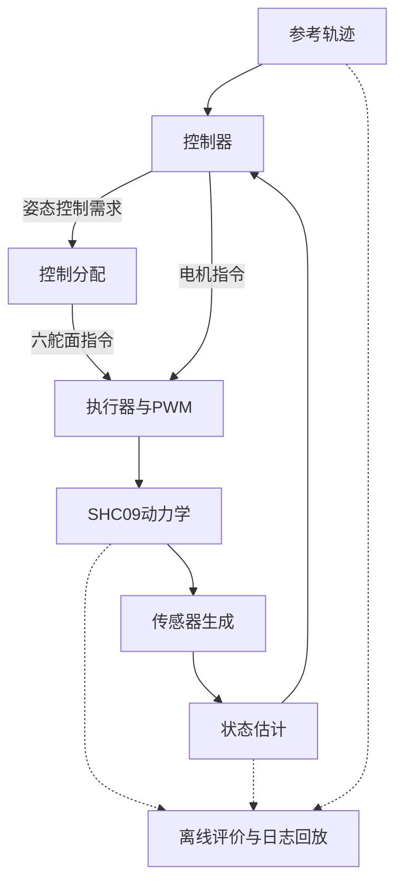

# SHC09 MATLAB 仿真与控制分配研究平台

这是一个面向**六舵面涵道式无人机SHC09**的MATLAB仿真平台，用于研究飞行控制、控制分配、执行器动态，以及状态估计误差对闭环性能的影响。

项目在同一研究协议下替换分配器，比较跟踪误差、约束处理和舵面活动量。当前以SHC09为对象；未来计划演进为 **AeroGNC-Sim** 多机型框架，通用化和仓库更名尚未实施。本项目不是PX4 SITL，也没有完成实机标定或实飞性能验证。

## 为什么需要控制分配

SHC09用六个舵面产生三轴控制力矩，属于过驱动系统：同一个控制需求可能对应多组舵角。实际舵机还有幅值、速率、响应时间和PWM更新限制，因此“算出需要多少力矩”之后，还要决定“六个舵面分别如何动作”。

控制器根据参考和反馈计算需求；分配器把需求转换为舵面指令；执行器模型描述指令如何变成实际舵角；飞行器动力学计算运动；传感器与估计器提供控制反馈。这些模块各自有边界，分配方法更复杂并不自动意味着闭环跟踪更好。

| 分配器 | 本项目中的主要处理方式 |
|---|---|
| `DA_NS` | 直接分配与零空间修正，在舵角界内实现可行需求 |
| `WLS` | 加权最小二乘，在多轴误差与输入代价之间作取舍 |
| `DCA` | 使用名义执行器动态，优化一个预测终点的力矩误差 |
| `PCA_STATIC` | 按优先级处理静态需求，优先满足高优先级项，并记录不可达回退 |
| `PCA_PREDICTIVE` | 在名义执行器及PWM预测时序下进行优先级分配 |

五种方法的约束处理和目标不同，研究比较的是具体工况下的权衡，不宣称某一种在所有场景最优。实现依据与适配边界见[方法说明](docs/reference/method_adaptations.md)。`EXAMPLE_PINV`是额外的插件/开发示例，不属于正式五方法。

## 系统如何运行



图中的反馈对应估计模式。真实状态用于物理推进、传感器生成和离线评价，不直接提供给估计反馈控制器或分配器。`ideal`是显式允许的理想参考模式，不能用它代表真实导航能力。

当前有两条运行路径：

| 路径 | 入口与职责 |
|---|---|
| 平台比较路径 | `main` / `shc09_run`进入总线、调度和模块化控制链；支持姿态任务及位置保持等配置 |
| PPID-PINDI研究路径 | `run_ppid_pindi`等研究入口使用位置P、速度PID、姿态P、角速度P＋INDI四环实现，有独立协议、频率与来源锁 |

两条路径复用部分飞行器、执行器、估计和分配实现，**不是同一套控制器的两个名称**。频率、坐标和信息隔离详见[架构指南](docs/guides/architecture.md)。

## 已实现的功能

- 五方法分配接口、执行器响应与限幅/限速模型、控制计算和PWM下发时序。
- 显式选择`ideal`、`lite`或`px4_ecl`状态反馈；`lite`为简化估计器，`px4_ecl`使用归档PX4 ECL桥接，两者都不是完整PX4飞控系统。
- 悬停、八字轨迹、扰动与恢复研究，以及相应指标、曲线和来源记录。
- 配套[WindTrace](apps/windtrace/README.md)：只读回放单次飞行`.wtr`，查看真实/估计状态、曲线和参数；仍位于本仓库，尚未拆成独立仓库或Submodule。

## 快速开始

已保存的MATLAB验证环境为 **R2025b + Optimization Toolbox**；其他版本兼容性未全面验证。基础短例不需要启动ECL、安装WindTrace或下载历史原始日志。

首次获取项目：

```bash
git clone https://github.com/tangqingxi/Ducted-Fan-SHC09-matlab.git
```

在MATLAB中将当前目录切换到克隆的仓库根目录，然后执行：

```matlab
ca_setup;
r = hover_app("PCA_PREDICTIVE");
disp(r.metrics);
```

这是**单方法、2秒仿真时长**的悬停示例，默认`ideal`状态反馈，不保存结果或图。2秒指模型时间，不是墙钟耗时。完成后在`r`中查看配置、日志和指标；它不构成正式研究验收。

需要保存结果、查看依赖或选择反馈模式时，按[运行指南](docs/guides/getting_started.md)操作。不要把`main_comparison`、研究入口或测试套件当作同样大小的短例：有些命令会运行多方法、多种子或完整52/55秒任务，见[研究工作流与运行规模](docs/guides/research_workflows.md)。本次文档整改仅静态核对命令，没有重新运行仿真。

## 目录怎么找

```text
platform/       总线、调度、控制/估计模块及仿真推进
models/         SHC09动力学、参数和冻结参考数据
allocators/     显式注册的分配器插件
studies/       四环、hover等研究场景和版本化协议
configs/        公共参数、机型预设及研究配置
studies/legacy_experiments/    平台实验、轨迹和研究入口
analysis/       指标、诊断、作图及离线导出
apps/           平台应用入口和WindTrace配套程序
results/        本机运行结果、原始MAT及生成工件，通常不入Git
logs/ figures/  部分批次的WTR交付索引、审计记录和图表
examples/       可分发的轻量研究证据
docs/ tests/    文档、验证记录与测试/冻结基线
```

实际布局和其他目录见[仓库地图](docs/repository_map.md)。`src/`、`airframes/`、`studies/`及统一`results/<study>/<batch_id>/`属于后续规划，不是当前已经完成的目录重构。

## 研究现状与证据

| 研究方向 | 已有结果及解读边界 |
|---|---|
| 平台悬停比较 | v0.5协议已有多种子比较与可比性门禁；通过门禁不等于方法两两可分或统计显著，见[比较指南](docs/guides/allocation_comparison_guide.md) |
| 八字与四环研究 | 保存了F8协议、开发/确认批和四环五方法结果；各阶段控制器与阈值不同，见[研究路线](docs/guides/research_workflows.md) |
| 55秒起飞/扰动恢复 | 历史两批各15/15运行完成，但真实恢复均0/15通过；估计恢复通过不能替代真实恢复，见[证据阅读指南](docs/guides/results_and_evidence.md) |
| GNSS与ECL | GNSS-GM-v2的1000 s工程模型已并入main，单条55秒数值回归完成，真实恢复仍未通过；[Issue #1](https://github.com/tangqingxi/Ducted-Fan-SHC09-matlab/issues/1)暂缓处理，非当前文档及结构治理阻塞 |

这些结果是工程仿真证据，不代表某台GNSS接收机、整机气动或执行器的精确实机复现，也不提供实飞安全或闭环全局稳定性保证。

## 按你的角色继续阅读

| 读者 | 推荐入口 |
|---|---|
| 首次使用 | [快速运行](docs/guides/getting_started.md) → [架构](docs/guides/architecture.md) |
| 研究人员 | [研究工作流](docs/guides/research_workflows.md) → [结果与证据](docs/guides/results_and_evidence.md) → 对应协议/报告 |
| 贡献者 | [仓库地图](docs/repository_map.md) → [插件指南](docs/guides/platform_plugin_guide.md) → [开发约束](AGENTS.md) |
| Agent | [AGENTS.md](AGENTS.md) → [当前交接](HANDOFF.md) → 本次任务涉及的源码和冻结来源 |

完整入口见[文档导航](docs/README.md)。[独立审计仓库](https://github.com/tangqingxi/AeroGNC-Phase-Audit)已保存Phase1、Git分支收敛和Phase2A设计；Results Governance、多机型架构及WindTrace拆分仍处于后续实施准备。Phase2B 已完成备份、验证、登记与非破坏性试点；Phase3 的 C0–C8 已在 `refactor/phase3-source` 完成；main 保持稳定基线，不提前合并完整 Phase3。参见[映射](docs/refactor/PHASE3_MAPPING.md)。

## 许可证

本项目自有代码及文档采用 [BSD-3-Clause 许可证](LICENSE)。第三方依赖、参考模型和数据的许可边界见[来源与许可说明](THIRD_PARTY_NOTICES.md)。
