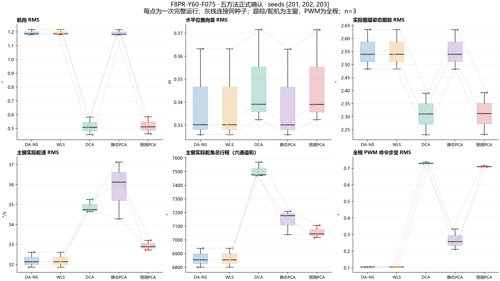
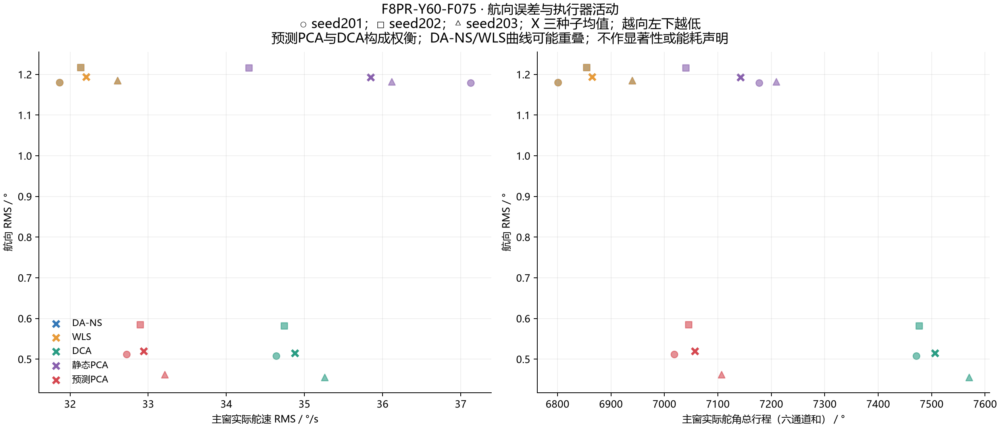

# Codex F8阶段图表、文档纠偏与交付报告

日期：2026-11-01（Asia/Shanghai）

仓库：`E:\Ducted-Fan-SHC09-matlab`

## 1. 交付结论

本阶段已完成用户授权的五项任务：修正交接文档事实错误；使用现有15次确认数据生成正式五方法对比图；完成轻量交付包；检查来源完整性、复现信息与交付质量；整理待提交清单。

正式交付入口：[examples/f8_comparison_20261101/README.md](examples/f8_comparison_20261101/README.md)。

确认场景报告：[F8PR-Y60-F075/report.md](examples/f8_comparison_20261101/F8PR-Y60-F075/report.md)。

本阶段没有运行MATLAB，没有重跑任何仿真，没有修改冻结数值源码或实验数据，没有修改main，没有执行merge、rebase、cherry-pick，没有删除原始数据，也没有暂存、提交、打tag或push。

## 2. 当前Git状态与授权边界

| 项目 | 结果 |
|---|---|
| 工作分支 | `f8-research` |
| HEAD | `7c5c9ab91fdb310c33d5bf08209e0302e540008f`，未改变 |
| main | `9918d9dba180f38a62c36f602e37993b87d0d38d`，未改变 |
| 分支关系 | main是f8-research祖先，差异0/2；无真正分支分叉 |
| 暂存区 | 未执行暂存 |
| 提交与远端 | 未提交、未push、未fetch |
| 合并决策 | 按用户决定暂不合并；验收后是否快进合并另行批准 |

接手时已经存在AGENTS.md与HANDOFF.md的未提交修改，以及上一轮新增但未提交的codex-repo-1.md。本阶段在这些现有文件上继续修订，没有把已有工作清理或覆盖回HEAD版本。Git差异中HANDOFF.md的大幅增加包含上一位Agent尚未提交的最终交接内容，不能全部归为本阶段新写。

## 3. 文档纠偏内容

已修改AGENTS.md、HANDOFF.md，并同步修正README.md中会误导F8读者的协议适用范围。

| 原问题 | 本阶段处理 |
|---|---|
| DA_NS与WLS“逐位相同” | 改为数值极接近、存在浮点差异；明确显示精度相同不等于原值相等 |
| 对DCA的“真实Pareto优势” | 改为航向跟踪与实际执行器活动的权衡，不宣称Pareto支配 |
| 将航向收益直接归因于多个预测子机制 | 明确未做消融，不能分离终点预测、等待/保持处理和最小变化恢复各自贡献 |
| 偏航参考写作60°sin(0.75φ) | 若φ是位置相位，正确为60°sin(15φ)；等价于60°sin(2π×0.75×平滑运动时钟) |
| task_metrics.csv为39列 | 修正为40列 |
| 工作区“交接后干净” | 改为存在未提交修改与新增交付文件 |
| 已提交分支差异统计不准确 | 更正为相对main共166文件：157新增、9修改，+18172/−10行；与本阶段未提交变更分开 |
| 位置控制源码索引错误 | 更正为platform/modules/position_control/ca_f8_position_control.m |
| 用旧悬停“跟踪差异被淹没”概括F8 | 明确限定v0.5悬停条件；F8结果单独解释 |
| README的tau/rate matched限制覆盖所有实验 | 限定原v0.5悬停；F8为真实24–40ms、名义30ms的未实测失配假设 |
| DA_NS/201的确定性检查外推全平台 | 限定为已核验配置，保留证据，不宣称覆盖全部方法和配置 |
| 历史打包脚本仍作为下一步入口 | 更新为受Git管理的新入口tools/package_f8_results.py；原脚本保留历史 |
| 出图和打包“尚未完成” | 更新为交付完成、等待用户验收和提交批准 |
| “无需重复接手核验” | 改为先做只读核对，不以文档快照替代实际状态 |

另外，HANDOFF中的百分比表明确为“三种子均值之比”。逐种子百分比的均值通常略有不同，场景报告和配对CSV单独呈现，避免混用统计口径。

## 4. 重要补充：纠正上一轮对λ的范围判断

绘图时逐窗核对priority_activation.csv和priority_events.csv，发现此前“本次全程λ恒为1”的表述不准确。

真实记录如下：

- 任务主窗[6,50]秒：两种PCA、全部三个种子均无缩放，λ_min=1、主窗回退计数为0。
- 全程：PCA_PREDICTIVE的seed202在`t=0`有1个控制采样点和1个PWM事件缩放，λ=`0.966394388996382`。
- 该控制采样点按800Hz计数为`0.00125s`，位于启动窗，不在任务主窗。
- 未达到协议要求的累计0.1s、连续0.02s和至少两个种子条件，更没有因此满足任务主窗的几何激励证据要求。

AGENTS、HANDOFF、交付README和确认场景报告均已作相应更正。原始CSV未改动。codex-repo-1.md作为上一轮历史报告保留，其“全程未缩放”以及过强的收益排除性归因以本节更正为准。

结论仍然是：不能宣称本次验证了受限优先级保护。也不能在没有消融的情况下完全分离启动、预测、恢复等机制的闭环贡献。

原始证据已收录：

- [逐窗激励计数](examples/f8_comparison_20261101/F8PR-Y60-F075/priority_activation.csv)
- [精确事件](examples/f8_comparison_20261101/F8PR-Y60-F075/priority_events.csv)

## 5. 正式对比图与统计口径

确认场景为F8PR-Y60-F075，使用现有五方法×独立确认种子201、202、203，共15条完整运行。示例时序种子201来自原协议的预定example_seed，没有按结果重新选择。

确认批新生成13组PNG/PDF：

| 图组 | 文件名或范围 | 用途 |
|---|---|---|
| 五方法各自十二状态 | `DA_NS/WLS/DCA/PCA_STATIC/PCA_PREDICTIVE_12states_seed201`，5组 | 共同目标、对象真值、估计反馈及反馈修正指令分别显示 |
| 十二状态误差箱线图 | `boxplot_12states_rmse` | 三种子逐次指标，保留种子配对关系 |
| 跟踪与代价 | `boxplot_tracking_costs` | 任务门槛、跟踪、估计和PWM活动 |
| 五方法轨迹 | `figure8_five_methods_seed201` | 八字几何跟踪及位置误差 |
| 跟踪误差时序 | `tracking_errors_seed201` | 航向、水平位置与机体r相对共同参考误差 |
| 优先级缩放 | `priority_lambda` | 全程与任务主窗分开，保留启动事件 |
| 真实分配及舵机活动 | `boxplot_actual_allocation_and_actuation` | 实际舵速、行程、PWM预测及名义/真实残差区分 |
| 关键指标配对 | `key_metrics_paired` | 航向、水平位置、内环姿态、实际舵速、行程与PWM步变 |
| 航向与执行器权衡 | `yaw_actuation_tradeoff` | 显示三个种子和均值，避免将运动量收益写成全面优越 |

主要图：





主窗为[6,50]秒，巡航窗[10,46]秒，全程52秒。评分不做相位对齐。图中时序使用既有100Hz导出；统计指标沿用完整800Hz日志核验后的指标。实际舵速和六通道总行程为主窗量，PWM步变RMS为全程量，不能当成能耗或机械磨损。

每个方法只有3个独立种子点。箱线图叠加实际数据点和同种子连线，不宣称显著性、不合成总分。曲线或散点重叠时，图注说明可能遮盖，尤其DA_NS与WLS。

## 6. 主要数值结论

| 方法 | 航向RMS ° | 水平位置RMS m | 主窗舵速RMS °/s | 主窗总行程 ° | 全程PWM步变RMS ° |
|---|---:|---:|---:|---:|---:|
| DA_NS | 1.194296 | 0.339752 | 32.203152 | 6864.809681 | 0.104508 |
| WLS | 1.194296 | 0.339752 | 32.203152 | 6864.809674 | 0.104508 |
| DCA | 0.515009 | 0.347702 | 34.879401 | 7505.920940 | 0.731486 |
| PCA_STATIC | 1.192514 | 0.339697 | 35.844912 | 7142.309376 | 0.267222 |
| PCA_PREDICTIVE | 0.519578 | 0.347640 | 32.943959 | 7056.690908 | 0.710812 |

按三种子均值之比，预测PCA相对DCA的航向RMS高约0.89%、实际舵速低约5.55%、行程低约5.99%，构成权衡。相对WLS的航向RMS低约56.50%，实际舵速高约2.30%、行程高约2.80%、水平位置RMS高约2.32%，PWM步变约为6.80倍。

配对CSV和确认场景报告按每个种子先算百分比再取均值，例如预测PCA相对DCA的航向配对均值约+0.9273%，相对WLS约−56.54%；这与均值之比并不矛盾。

所有结果只适用于本场景、三个确认种子和既定未实测动态假设，不外推实机优势、全局最优或普遍方法排名。

## 7. 交付包内容与体积

交付包共172个文件，30,154,354字节，约28.76MiB。包含30组PNG/PDF：确认批13组新图、基础F8-R/F8-D各8组原有图、开发筛选1组原有图。

```text
examples/f8_comparison_20261101/
  README.md
  artifact_manifest.json
  F8PR-Y60-F075/       确认批新图、报告、指标与核验证据
  F8-R/               基础合格场景历史结果与图表，原样复制
  F8-D/               基础场景历史结果及10条任务超限记录，原样复制
  development_screen/ 开发状态、选择规则、6完成/3失败及3份失败JSON
  partial_batch/      原1/15暂停批的轻量状态与指标，不计入确认统计
  audit/              冻结锁、流水线、管理性例外、原始来源快照与本次检查
  reproducibility/    后处理脚本、依赖版本、数值源码哈希及打包时Git状态
```

没有将原始MAT、完整tracks和完整geometry拷入Git交付目录。它们保留在本地原始results目录，路径和SHA256完整列入来源快照。轻量包支持报告阅读、指标复算与图表审阅；恢复原始轨迹文件后可重新绘制时序图，不能宣称仅靠此轻量包即可重建完整仿真。

历史仿真驱动仅以`.m.txt`存档，不作为当前后处理入口。原results/f8_work_20261101/package_results.py保留不动；当前工具已转入tools并可由Git管理。

## 8. 完整性与质量验收

| 验收项 | 结果与范围 |
|---|---|
| 冻结文件锁 | 20/20匹配；锁及锁内文件均未修改 |
| 既有日志哈希 | 51份匹配：45份基础/确认正式日志、6份开发完成日志 |
| 原始批次文件 | 280个文件在构建前后逐文件SHA256相同；包括基础、开发、确认、暂停批及work证据目录 |
| 数值源码快照 | 207个源码/协议/气动表哈希留存并复核匹配 |
| 确认批完整性 | 五方法×201–203，无重复或缺失；15/15 completed；720行状态指标 |
| 轨迹与几何行数 | 15份tracks各5201数据行；6份geometry各35201数据行 |
| 跨方法共同输入 | 同种子的input_signature一致；真值隔离及非smoke标记检查通过 |
| 交付文件清单 | 171个产物SHA256全部匹配；另有manifest自身，共172文件；无清单外文件 |
| 原样复制关系 | 100份显式复制文件与各自来源SHA256一致；图表另由产物清单覆盖 |
| 数值汇总 | 独立复算70行确认汇总的均值、样本标准差、最小和最大值 |
| 配对差值 | 独立复算294行候选减基线、百分比变化 |
| 图像检查 | 30个PNG可解码，尺寸符合检查条件；对应PDF均存在且PDF头有效 |
| 视觉审查 | 查看全部13组确认PNG的总览，并检查关键指标图与权衡图原尺寸；标签、图例和中文显示正常 |
| 文档链接 | 64份Markdown、443个本地链接，0断链 |
| 覆盖保护 | 对现存交付目录再次调用打包入口被拒绝，manifest保持不变 |
| Python语法 | 三个后处理/打包/验收脚本编译检查通过 |
| Git差异 | git diff --check通过；仅有现存换行规范化提示 |
| main与仿真 | main不变；本阶段仿真次数0 |

这里的图像检查不冒充独立PDF渲染验收；PDF与PNG由同一Matplotlib图对象导出，视觉检查针对PNG。

MATLAB完整日志重算和LP抽查沿用上一阶段既有记录，其原始MAT哈希已重新匹配。本阶段未调用MATLAB独立核验器，未重新计算完整800Hz状态指标，也未新执行LP抽查。交付包明确区分“既有MATLAB检查”与“本次Python哈希和汇总复核”。

冻结锁自身SHA256仍为：

```text
4f6c4e6e1ae179f4f9485332642c84adfbc0b30eb0b33de463316dde0d49395b
```

交付manifest的SHA256为：

```text
a9a6120e7d050c3635e05b103113972e5c8a4dca6482ce78ced87d735b3b1fde
```

验收证据：[audit/delivery_checks.json](examples/f8_comparison_20261101/audit/delivery_checks.json)、[来源快照](examples/f8_comparison_20261101/audit/source_files_before.json)、[产物清单](examples/f8_comparison_20261101/artifact_manifest.json)。

## 9. 后处理代码变化与复现

### tools/plot_f8_comparison.py

- 从协议读取三个确认种子及预定示例种子。
- 新增必填`--output-dir`，要求新目录且与来源分离；不再往原始实验目录写图或报告。
- 五方法均生成十二状态图；新增关键指标配对图和航向/执行器权衡图。
- 汇总与配对表纳入实际舵速和总行程；报告增加与DCA的配对比较。
- 从既有逐窗计数动态显示启动缩放，主窗与全程分开。

### tools/package_f8_results.py

- 新的受Git管理的打包入口；未修改历史results打包脚本。
- 写入前核对冻结锁、共同输入和原始日志哈希，确认目标不存在。
- 在新的results临时目录构建，通过检查后才将新交付包移入examples。
- 原始批次前后做全文件哈希对照；基础、开发、确认和暂停证据分开。
- 随包保存后处理源码、依赖、数值源码哈希、打包时Git状态及绘图差异。
- source_uncommitted取实际Git状态，避免硬编码。

### tools/f8_delivery_audit.py

- 支持只读来源核对、交付文件清单与SHA验证、图像配对检查，以及汇总/配对指标独立复算。
- 不调用MATLAB或任何仿真入口。

### tools/requirements-f8-delivery.txt

记录本机实际后处理版本：Matplotlib 3.11.1、NumPy 2.5.1、Pillow 12.3.0。没有为本任务安装新依赖。

只读验收命令：

```powershell
python tools/f8_delivery_audit.py examples/f8_comparison_20261101
python tools/check_docs_links.py
git diff --check
```

只对现有确认数据重新绘图时，使用新的派生目录：

```powershell
python tools/plot_f8_comparison.py results/f8_pressure_confirm_20261101_Rbase_v2_holdout_3seeds_rerun1/F8PR-Y60-F075 --output-dir results/f8_delivery_replot_NEW
```

该命令不运行仿真。完整打包入口在最终目录已存在时会拒绝覆盖，不应通过删除结果目录来绕过。

PNG/PDF字节可能随字体、平台或库版本变化；不承诺跨环境图片逐字节相同。数值汇总、配对关系和原始来源哈希可独立复核。source_head与未提交源码副本结合使用，不能仅凭HEAD定位本次新增后处理实现。

## 10. 建议提交清单与分组

以下仅整理建议，没有执行git add或git commit。

| 建议分组 | 文件 | 内容 |
|---|---|---|
| 文档纠偏 | AGENTS.md、HANDOFF.md、README.md | 事实更正、结论边界、交付状态和入口 |
| 后处理工具 | tools/plot_f8_comparison.py | 只读来源、13组正式图、汇总和报告 |
| 打包与验收 | tools/package_f8_results.py、tools/f8_delivery_audit.py、tools/requirements-f8-delivery.txt | 新打包流程、哈希审计、依赖信息 |
| 轻量研究交付 | examples/f8_comparison_20261101/全部172文件 | 图表、指标、失败证据、协议与复现资料 |
| 接手与本阶段报告 | codex-repo-1.md、codex-repo-2.md | 保留审查历史；上一轮λ表述由本报告明确更正 |

不建议纳入提交：原始MAT、完整tracks/geometry、results中的构建目录、首次交付草稿、视觉审查总览、Python缓存。它们位于既有忽略范围；本阶段没有更改.gitignore，也没有删除这些文件。

首次构建的派生交付草稿因补充λ启动事件说明而保留到`results/f8_delivery_review_first_draft/`，最终包重新构建并验收。这是已有CSV上的后处理修订，不是仿真重跑，也没有移动任何原始批次。

## 11. 当前停止点与下一步批准事项

本阶段成果已完成，等待用户验收。建议先审阅确认场景报告、两张主要图和本报告中的λ范围更正，再决定是否批准上述文件提交。

仍不执行main整合；只有F8阶段验收完成且用户另行批准后，才考虑将f8-research快进合并到main。优先级保护专项、F8-D控制器改进或新增仿真均不属于本轮完成范围。
