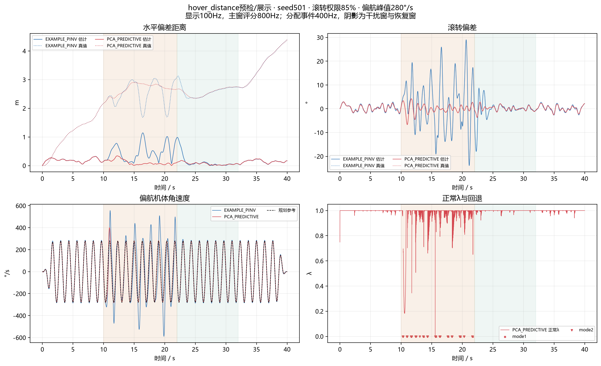

# hover_distance实现、预检与正式批停点报告

日期：2026-11-02，Asia/Shanghai。

**结论：已新建hover_distance分支、实现独立场景，并完成两条种子501的40秒预检；正式15条未启动，验收尚未完成。** 两条数据均完整有效、无气动越界，但预测PCA的λ_min=0.00823089没有达到用户要求的0.3–0.6。遵照“若预检未达到λ目标，先报告再决定，不要硬跑正式批”，本轮停止，不调门槛、不扩跑正式种子。

## 1. 分支与保护范围

已在指定工作区执行`git switch -c hover_distance`：

`C:\Users\32450\.codex\worktrees\controller-ppid-p-indi\Ducted-Fan-SHC09-matlab`

原有未提交改动全部随分支保留，包括上一轮旧平台速率环的两行修改；没有回滚、清理、合并、暂存、提交、打tag或push。HEAD仍为`7c5c9ab91fdb310c33d5bf08209e0302e540008f`；main仍为`9918d9dba180f38a62c36f602e37993b87d0d38d`。

本轮只新增入口、场景、检查/绘图/打包工具、报告与轻量证据。与开始前快照比较，既有工作区1019个文件内容全部不变。原F8确认批及PPID正式批两套15条目录共133个文件，SHA、字节数及文件集合全部不变。父研究的protocol.json、formal_lock.json、正式驱动及控制源码均未改。

## 2. 实现与实际工况

入口为`run_hover_distance.m`，场景位于`research/hover_distance/`。直接调用父研究的`ppid_config`、`ppid_control_step`、`ppid_noise`、`ppid_simulate`与传感器/ECL，不复制或重整控制律，不修改任何分配器。

| 项目 | 实际设置 |
|---|---|
| 规划位置 | NED [0,0,−10] m，定点悬停 |
| 规划姿态 | 滚转/俯仰为0；内部期望姿态仍由原位置/速度环做纠偏 |
| 偏航速率 | 280°/s正弦，0.75 Hz，0–2 s平滑起振、38–40 s收振 |
| 偏航角/角加速度 | 对平滑速率解析积分/求导，初末角度均回到0；不读未来测量或真值 |
| 滚转力矩 | 0.5 Hz正弦，10 s加载，22 s开始卸载，0.5 s五次平滑过渡 |
| 全时长 | 40 s，另有与父研究一致的30 s传感器静置对准 |
| 主评价窗 | [10,22)s，右端不重复计时 |
| 恢复窗 | [22,32)s，卸载的0.5 s过渡位于恢复窗内 |
| 父外扰 | 原F8的偏航外扰已移除，没有附加随机力矩或风 |
| 原物理/执行器 | M2b线性舵效[1.2,1,0.8,1,1.2,1]、真实τ=[24,27,30,33,36,40] ms、名义30 ms、±40°、600°/s，均保留 |

### 2.1 权限实读，不采用约1.7 N·m的初估

按现有`ca_priority_direction_protocol`返回的`axis_capacity_nm`读取，当前名义悬停模型为：

| 轴 | 权限 N·m |
|---|---:|
| 滚转 | 1.213133995 |
| 俯仰 | 1.400806477 |
| 偏航 | 0.519400155 |

所以本轮滚转正弦幅值是**0.85×1.213133995=1.031163896 N·m**，并非约1.7 N·m。这是模型权限，不是实机标定；未通过手工改力矩把幅值凑到1.7。

为沿用原生外扰插值接口，配置中的`disturbance_type="random"`仅作为序列传输标识：随机力矩幅值为0，配置与experiment均提供同一条预先生成的确定性平滑正弦序列。没有偷偷叠加随机力矩。源代码与配置均明确记录此点。

### 2.2 共用控制、传感器与PWM

位置P/速度PID/姿态P/角速度P＋INDI及全部增益不变：位置[1.3,1.3,1]，速度P=[3.2,3.2,2.1]、I=[0.05,0.05,0.08]、D=[0.03,0.03,0.02]，姿态[6,6,6]，速率[12,12,12]。H1/H2均8 Hz。

位置/速度/姿态/速率与分配分别25/50/100/400 Hz；IMU800 Hz，ECL主滤波约100 Hz，PWM333 Hz，GNSS5 Hz、气压/磁计50 Hz。CUAV类别误差、偏置、漂移、延迟和名义舵角估计全部沿用，真值只用于对象、传感器生成和离线评价。

分配器原参数也继承，包括WLS轴权重[1,1,1000]；没有因新滚转扰动而重整权重。未来五方法比较需连同这项背景一起解读，不将不同目标函数的取舍写成无条件优劣。

父仿真器有一处52 s的EKF频率统计分母，本包装层将40 s日志的这个元数据分母修正为40；没有改变任何状态更新或PWM事件。原52 s PWM缓冲预分配只是内存上限，40 s日志按实际13321个事件截断。

所有方法采用同一需求拆分：nu_h只含名义历史舵效减测量角加速度，nu_c含参考角加速度与比例速率反馈。PCA保nu_h缩nu_c，其余取和。名义B、模型τ、时钟/限幅与可用信息规则相同；各闭环的nu、delta_hat与held_command数值会随分配器作用分叉，不能强行共用另一方法的状态。这是闭环分叉，不是参考不一致。

## 3. 预检条件与逐次记录

首次飞行前已写定新场景protocol.json、输入检查和评价定义。开发只使用501，两个预检设置均为85%/280°/s，没有调参。

| 次序 | 方法 | 时长 | 结果 |
|---|---|---:|---|
| 设置检查 | 非飞行 | — | 参考、扰动和随机输入检查；首次检查的向量assert写法报错，改为标量最大残差，无控制/场景数值改动，未启动飞行 |
| a1 | EXAMPLE_PINV，501 | 40 s | 完整、无越界、未发散；干扰窗偏航速率误差较大，预检工程线未过 |
| a1 | PCA_PREDICTIVE，501 | 40 s | 完整、无越界、未发散；λ占空比合格，λ最小值不合格 |

两条运行之前均记录来源快照、实际权限/幅值、参考与随机输入签名。每条结束仍与来源快照一致。没有用502/503筛选或调参。

### 3.1 目标逐项核对

| 项目 | 要求/定义 | PCA_PREDICTIVE实测 | 结论 |
|---|---|---:|---|
| 正常模式λ<1占空比 | 主窗400 Hz，10–30% | **15.0000%** | 达到 |
| 正常模式λ_min | 0.3–0.6 | **0.00823089**，发生于15.57 s | **未达到** |
| mode1占比 | ≤5% | 0.354167% | 未触发降载分支 |
| mode2占比 | 单列，不混为正常λ | 1.854167% | 单列报告 |
| 有限且完成40 s | 必须满足 | 是 | 达到 |
| 气动越界 | 0 | 0 | 达到 |

运行前还将“伪逆偏航跟踪正常”量化为主窗RMS≤70°/s，这是工程检查线，不是用户明确给出的论文阈值。伪逆无扰段4–10 s为4.0902°/s，恢复后24–32 s为4.0811°/s，说明正常段可跟踪；干扰主窗149.5653°/s未过该工程线。即使不采用这一额外工程线，预测PCA仍独立未满足用户明确要求的λ_min，因此正式停点不依赖70°/s这项判断。

没有触发“λ全程1”，所以没有提高到90%或300°/s；没有mode1>5%或发散，所以没有自行降到80%/75%。没有为凑目标而改控制增益、噪声、阈值或最小值定义。

预检在首次运行前已明确按10–22 s主窗解释占空比目标。作为补充，预测版全程400 Hz控制样本的缩放占比为5.7809%；若用户本意是按全程要求10–30%，这一项也不满足。无论采用哪个窗口解释，本轮都不应启动正式批。

## 4. 两条预检主表：仅501，不是五方法正式结论

主表沿用用户此前选择的估计反馈域口径；评分800 Hz，主窗[10,22)s。以下没有三种子均值或波动，因为502/503未运行。

| 指标 | EXAMPLE_PINV | PCA_PREDICTIVE |
|---|---:|---:|
| 估计水平距离RMS m | 0.544526 | 0.140534 |
| 估计水平距离峰值 m | 1.143913 | 0.340081 |
| 估计滚转RMS ° | 10.836827 | 1.843137 |
| 估计滚转峰值 ° | 29.022492 | 6.692454 |
| **偏航机体角速度RMS代价 °/s** | **149.565270** | **24.893179** |
| 真实水平距离RMS m | 2.537 | 2.679 |
| 真实滚转RMS ° | 10.847 | 1.837 |
| 真实偏航机体角速度RMS °/s | 146.44 | 23.82 |
| 实际舵速RMS °/s | 171.3923 | 211.4929 |
| 实际六通道总行程 ° | 7685.3582 | 11125.2110 |
| PWM步变RMS ° | 0.979371 | 9.156728 |
| 正常缩放累计 s | 不适用 | 1.8000 |
| 正常缩放最长episode s | 不适用 | 0.4850 |
| 正常λ_min | 不适用 | 0.00823089 |
| PWM正常λ缩放下发事件数 | 不适用 | 616 |
| 高优先级缩放回退mode1时长 s | 0 | 0.0425 |
| 工程兜底mode2时长 s | 0 | 0.2225 |
| 全程最大真实倾角 ° | 34.006 | 7.068 |
| 气动越界/发散 | 0/无 | 0/无 |

PWM步变为主窗实际333 Hz下发事件的相邻步变，不是能耗。舵速/行程由800 Hz实际舵面运动计算。偏航代价同时给出规划机体r参考与测量/真实r之差；不是欧拉角导数，也不是速率内环指令误差的替代名。

本例伪逆主窗75.1875%的400 Hz样本发生原始B+解越界并逐元素限幅。因此它不能作为“可行域内等同B+”条件下DA_NS的替身。DA_NS有零空间修正，WLS/DCA的目标与约束也不同；不能由这两条预检推断预测PCA优于其余四种。

预测版相对伪逆在估计位置、滚转和偏航上均改善，但舵速、行程和PWM活动增加；真实水平偏差没有改善。所有这些取舍都保留，不将某个有利指标单独当作全面优势。

### 4.1 恢复窗结果

恢复定义：22 s后首次连续0.5 s满足估计水平距离≤0.2 m、水平速度≤0.2 m/s、滚转绝对值≤2°；报告进入时间及确认时间，不作轨迹平移。

| 指标 | EXAMPLE_PINV | PCA_PREDICTIVE |
|---|---:|---:|
| 恢复进入时间，距22 s，s | 2.28375 | 1.01875 |
| 连续保持确认时间，距22 s，s | 2.78375 | 1.51875 |
| 恢复窗估计距离峰值 m | 0.98532 | 0.18033 |
| 恢复窗估计滚转峰值 ° | 17.969 | 3.699 |
| 相对22 s偏差方向的反向位置超调 m | 0.018733 | 0.076417 |
| 反向滚转超调 ° | 8.585975 | 2.799497 |

位置超调按22 s偏差方向投影后跨过目标的反向峰值定义；另列恢复窗绝对峰值，避免把距离非负量称为百分比超调。

## 5. λ与高优先级解释

对主窗4800个控制判定时刻做支撑面几何检查，正常模式4694个样本的最优λ与日志一致。λ几何最大误差6.3283e−15，正常分配等式最大误差2.8422e−14 rad/s²；本次极小λ不是LP残差造成的假激励。

进一步诊断：正常模式λ<0.3累计0.2225 s，λ<0.6累计0.4300 s；正常模式λ的1%分位约0.20685。仅作诊断，没有将这些统计量替换用户要求的最小值门槛。

独立几何还显示：nu_h单独在名义短时预测集合外累计11.865 s。**mode1不是nu_h单独不可达性的等价指标**：正常射线仍可能在正λ处与动态集合相交；mode1表示正常射线无解后高项缩放射线有解，mode2表示进一步兜底。因此不能用mode1<5%声称高优先级目标始终单独可达。报告保留这个差异，不把它隐去或自动改作降载触发条件。

本轮几何审计核对正常模式最优λ和等式；回退模式记录次数/时长，没有另做全量独立LP最优性复核。不能把这些结果扩展为实际对象优先级保护、稳定性或鲁棒性证明。

## 6. 正式批与消融状态

| 方法 | 501正式 | 502正式 | 503正式 |
|---|---|---|---|
| DA_NS | 未启动 | 未启动 | 未启动 |
| WLS | 未启动 | 未启动 | 未启动 |
| DCA | 未启动 | 未启动 | 未启动 |
| PCA_STATIC | 未启动 | 未启动 | 未启动 |
| PCA_PREDICTIVE | 未启动；已有独立预检 | 未启动 | 未启动 |

因此下列验收项仍待完成：15/15数据有效；预测版与DA_NS/WLS/DCA主指标及偏航代价成对比较；三种子逐条/均值及种子波动；预测版与静态版、静态版与DA_NS/WLS的消融。DCA排序未预设，不能拿旧八字结果或本次伪逆结果填入。

正式入口和新锁逻辑已实现：同设置501伪逆与预测版预检均通过，且来源与输入签名一致，才允许`hd_freeze`创建新锁；正式驱动才会运行五方法×501/502/503。本轮审计实际调用冻结入口并确认它拒绝不合格预检，`research/hover_distance/formal_lock.json`不存在。

如果以后正式批启动，501是已用于开发的种子，会明确披露，不作为独立保留验证种子。不得依据502/503表现继续整定后再追认本批。

## 7. 来源、SHA与验证

两条运行的输入签名完全相同：

`a5bde05815ca5c826cbb516153aead5ac4a5b8751a2bacfb7a76014b09c5cd6d`

该签名覆盖cfg、名义model、ref和预生成experiment；共用控制器和场景配置另由来源清单锁定。五方法将共用同一控制器、参考、初态和随机误差过程，实际测量及nu会随分配器闭环作用不同。这一点不属于参考不一致。

| 项目 | SHA256/指纹 |
|---|---|
| 当前公共引擎，本轮未变 | `86a39d2241d3d7b6c5d6814b7149e1ceb1f812aab530889f73efd09336ba8ec9` |
| 两次来源快照sources.json | `ca031b4a768a135d833ce41cb121d9c1d385ebcbe70e1a4866e096ddd5591389` |
| 新入口run_hover_distance.m | `1f309abcb25c1c077635982ecc02ea09a92cd79aca160dc8834f8ccb97af6aeb` |
| 新场景protocol.json | `59f6d21cafd0db65170e02c2cb254ca0d2aa49bab8d6a84df1c03f5bb89307ac` |
| hd_config.m | `d785f022c3b353338297a76dbabbf517f3deb0a31128d4cc3b31386251d82b42` |
| hd_reference.m | `c483d409a04aefb7a0bc165503f1bc0392ac06b3a9657fb4007cb2633714cb01` |
| 沿用的ppid_control_step.m，未改 | `e325ad479a37653e9493cca11735e3bfb06986559a516125efb1dac2206d014d` |
| 父protocol.json，未改 | `bfcae37cd21d0c68828d0667a341445341f3473d57566d2beabe74577cd1374d` |
| 父formal_lock.json，未改 | `049213840ffe173dddcaffee4414998cba4444b86cac5791a2836ee265599538` |

完整数值来源清单包括父研究49个显式文件、新场景/入口/父锁11个文件、公共引擎和ECL二进制SHA。后处理源码SHA单独保存，未把未提交代码假称为已提交版本。

新协议独立检查通过：参考速率差分误差2.7688e−10 rad/s，参考角加速度差分误差3.6465e−8 rad/s²；父控制/传感器参数相同；外扰范围/插值正确；同种子随机输入逐位一致。

两条完整日志独立审计通过：每条32001个800 Hz状态样本、16001次速率更新、1001/2001/4001次位置/速度/姿态更新、4001次ECL主更新、200次GNSS观测、13321个精确333 Hz PWM事件。nu_h滤波历史重建误差0，主指标复算最大差2.8422e−14，所有PWM下发对应最新候选指令，真值隔离接口与坐标恒等式检查通过。

这些是新场景协议/数据检查。前轮旧实现兼容测试与逐位基线的失败状态没有被本轮“修复”或改称通过；没有运行旧正式批或修改旧基线。

## 8. 新目录与轻量交付

完整预检日志：

- `results/hover_distance_precheck_20261102_a1_L085_Y280_pinv/`
- `results/hover_distance_precheck_20261102_a1_L085_Y280_pred/`

独立审计：`results/hover_distance_audit_20261102_r2/`。初版审计r1也保留；r2补强通用审计的静态PCA分支与空样本处理，没有重飞。

图表：`results/hover_distance_review_20261102_r1/`。工作保护/设置记录：`results/hover_distance_work_20261102/`。

轻量交付：[examples/hover_distance_precheck_20261102/README.md](examples/hover_distance_precheck_20261102/README.md)，31文件、612740字节。包含两条预检逐行指标、来源/协议、实际设置、独立检查、λ诊断及PNG/PDF；不含原始MAT、完整tracks/geometry、build或缓存。manifest覆盖除自身外全部文件，已独立核验，文本统一LF。

## 9. 下一步建议与停止位置

**当前不启动15条，也不声称五方法验收完成。** 本次λ占空比已达到目标，最小值却过低，且独立几何证实是真实约束激励；单种子预检不足以替代正式比较。

建议用户决定是否增加新的开发规则：“λ_min<0.3时，也允许降低滚转干扰幅值”。若批准，下一步仅用501、保持280°/s和所有控制/估计参数不变，先试80%（约0.970507 N·m），必要时75%（约0.909850 N·m），每组重新跑伪逆与预测版并保留全部记录，不保证这些设置一定满足目标。未批准前不运行。

伪逆主窗70°/s工程线是否符合“受扰时允许偏航牺牲”的实验意图，也可由用户决定；如需改为无扰段正常性检查，应另立开发协议版本并重新预检，不能把本次数据事后判为通过。λ最小值的用户硬条件目前保持原样。

所有更改留在hover_distance工作区，等待决定；不提交、不打tag、不push。

## 10. 最终交付检查

本轮新增47个拟纳入Git的源码、文档及轻量文件；既有文件内容改变0个。47个新增文件逐一比较Git原字节与clean过滤后的摘要，变化0；新增文本尾部空白错误0。`git diff --check`通过；文档检查63份、413个本地链接、断链0；轻量包31文件的manifest复核通过。原始MAT、完整tracks/geometry、results/build和Python缓存没有出现在新Git文件清单中。

当前索引为空，正式输出目录和新正式锁均不存在。完整文件清单与检查记录见`results/hover_distance_work_20261102/delivery_quality.json`，旧文件保护结果见同目录`protection_summary.json`。
