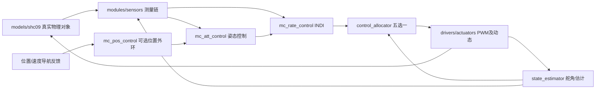
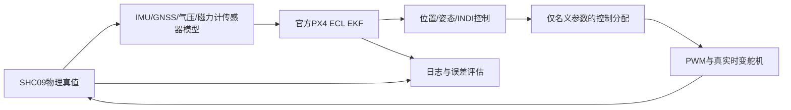

# 架构与数据流

对象侧结构失配字段`vane_*`仅由配置校验、物理对象和实验记录读取，不进入分配器配置或模型。真实舵效非线性在原舵角限幅后施加；名义矩阵不变。严格门禁阶梯入口及日志定义见[vane_mismatch_phase1.md](vane_mismatch_phase1.md)。

第二轮新增`aero_low_speed_*`同样只在对象侧读取；默认legacy，实验hold_90在低速取90°并于过渡区混合力。原始迎角在阈值外仍受严格气动表门禁，分配器白名单不变。新协议及失败继续策略见[vane_mismatch_round2.md](vane_mismatch_round2.md)。

本项目按 PX4 飞行栈的职责拆分：位置控制 → 姿态控制 → 角速度控制 → 控制分配 → 执行器。参考 [PX4 Controller Diagrams](https://docs.px4.io/main/en/flight_stack/controller_diagrams) 和 [Control Allocation](https://docs.px4.io/main/en/concept/control_allocation)。这是职责映射，控制律仍是本项目的几何姿态控制和 INDI，并非 PX4 控制器实现。

`simulation/ca_simulate.m` 只管理时钟、模块连接和日志。800Hz 控制刷新候选命令，333Hz PWM 事件锁存命令；物理对象和估计器按事件划分的同一时间段推进。电机命令为控制周期保持，经一阶响应进入物理对象，不参加六舵面分配。

| 模块 | 输入 | 输出/职责 |
|---|---|---|
| models/shc09 | 保持舵命令、电机命令、风/外力/外力矩 | 真实位置、速度、姿态、角速度、舵角、电机与气动输出 |
| sensors | 真实角速度对应传感信号、模型舵角、公共噪声 | 含噪角速度与差分滤波角加速度、历史滤波舵角 |
| state_estimator | 已下发保持命令、上一估计舵角、名义动态 | 当前模型舵角 |
| mc_pos_control | 位置/速度反馈、目标位置/偏航角 | 公共期望姿态和电机转速命令 |
| mc_att_control | 测量姿态/角速度、期望姿态及前馈 | 角速度与角加速度参考 |
| mc_rate_control | 测量角速度/角加速度、历史滤波舵角、参考 | 补偿需求 v_h 与跟踪需求 v_c |
| control_allocator | v_h、v_c、模型舵角、名义效能、公共限幅和 PWM 时序 | 六舵面候选命令及求解诊断 |
| drivers/actuators | 保持命令、物理/名义时间常数 | PWM 锁存、真实舵机/电机及模型舵机响应 |
| analysis | 日志与参考 | 统一真实状态指标、物理适用范围指标及图 |

分配器选择只有 `main(allocator_flag, overrides)` 的 `allocator_flag`，编号 1～5，或同名字符串。`ca_allocator_name` 负责映射，`ca_allocate` 负责分派。五个实现位于 `modules/control_allocator/` 各自子目录，不复制五套完整飞行闭环。

物理模型保留参考工程的“前向 y、轴向 z、侧向 x”定义。目录命名借鉴 PX4，不代表机体轴已转换为 PX4 FRD。将来接入固件或实机时必须单独完成坐标转换。

真实气流/舵效矩阵只写入物理日志；控制器与分配器使用同一个悬停名义矩阵。含噪模式不把真实角加速度或已知外扰反馈给控制器。初始配平舵角同时用于物理初态与估计初态，是公共的初始化假设。位置保持的导航反馈暂为理想值，尚未引入位置/速度估计器。

参考原件和气动表在 `models/shc09/reference/`，原始 SHA256 在 `docs/physical_reference.json`；这些文件不自动加入运行路径。测试临时加入参考函数后通过清理对象移除。完整重构前源码在 `archive/source_before_layout_20261030.zip`；文件迁移映射在 `docs/layout_migration.json`。旧数据留在 results，各个来源仓库均未移动。
# 非理想导航和真实参数隔离补充（2026-10-30）

新增`main_realistic/main_realistic_comparison`保持五分配器标志与公共物理对象，切入官方ECL导航反馈。历史默认入口仍保留理想导航语义。

`ca_navigation_step`仅在生成原始传感器时读取真值。官方独立进程不接收真值姿态、真实tau或控制目标；估计未有效则终止。`ca_allocator_config`白名单显式排除真实参数、传感器偏置和扰动，仅传名义tau等必要设置；舵角估计也使用该名义配置。

真实时间常数由`drivers/actuators/ca_true_actuator_tau`供物理积分器调用，缓变时按子步中点冻结。完整来源、传感器假设、对准过程、非理想反馈测试和模型适用域限制见`results/realistic_px4_ecl_20261030/report.md`。

