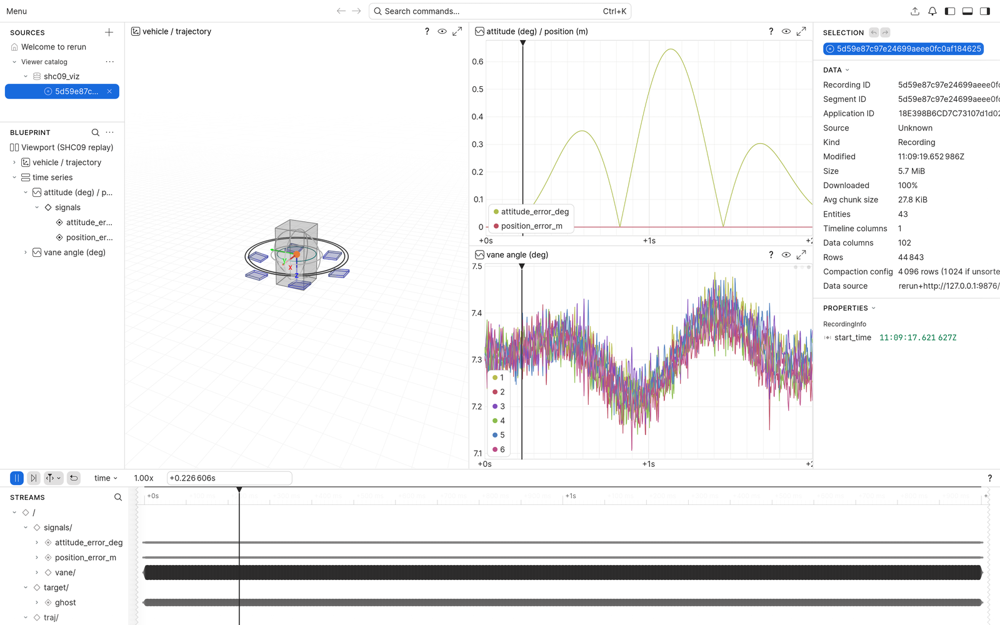
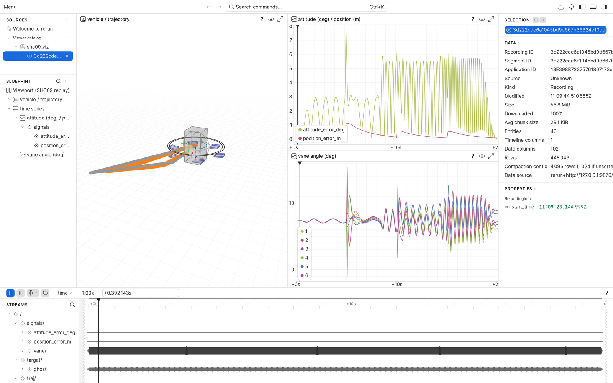

# SHC09 飞行日志回放（VIZ v0.1）

> **当前状态 · 2026-10-31**
> - 分支 `viz-replay`（基线 `main@e662e7d`，计划 `docs/viz_replay_plan_v0.1.md`）
> - 进度：**M0 ✅ · M1 ✅ · M2 ✅ · M3 ✅ · M4 进行中**（文档/示例/tag）
> - 已产出：`viz/shc09_viz/`、`viz/geometry/shc09_geometry.json`、2 s/20 s 两份真实日志的
>   `replay.rrd` + `manifest.json`、`viz/examples/flight_replay/` 两张截图
> - 下一命令：`.\\.venv-viz\\Scripts\\python.exe viz\\replay.py --log results\\viz_20s_ideal_DCA\\DCA\\log.mat --out results\\viz\\viz_20s_ideal_DCA --rate 800`
> - 已知问题：见 §9（都不阻塞验收）

---

## 1. 这是什么

把 MATLAB 已经保存的 `.mat` 飞行日志转成 **Rerun `.rrd` 3D 回放 + 3 条曲线**。
纯后处理：不嵌入 `ca_simulate`、不改变任何数值结果或随机序列、不做实时。

**不是**数字孪生、不是实机一致的证据、不是方法排名工具。回放只证明"日志长这样"。

## 2. 快速开始

```powershell
cd E:\Ducted-Fan-SHC09-viz

# 1) 环境（一次性；只在 worktree 内）
D:\app\python_manager\3.13.0\python.exe -m venv .venv-viz
.\.venv-viz\Scripts\python.exe -m pip install -r viz\requirements.txt

# 2) 生成真实日志（唯一需要 MATLAB 的动作）
#    2 s 悬停：
matlab -batch "cd('E:\Ducted-Fan-SHC09-viz'); addpath('viz/tools'); make_fixture('viz_fixture_2s_DCA', 2, 'ideal');"
#    20 s 带参考机动（否则悬停误差只有 8e-5 m，看不出轨迹偏差）：
matlab -batch "cd('E:\Ducted-Fan-SHC09-viz'); addpath('viz/tools'); make_fixture('viz_20s_ideal_DCA', 20, 'ideal', [0 0 0 -10; 5 1 0.5 -10; 10 0.5 0 -10; 15 0 0 -10]);"

# 3) 一条命令出回放（headless，不需要 viewer）
.\.venv-viz\Scripts\python.exe viz\replay.py --log results\viz_20s_ideal_DCA\DCA\log.mat `
  --out results\viz\viz_20s_ideal_DCA --rate 800

# 4) 看回放（可选）
.\.venv-viz\Scripts\python.exe viz\replay.py --log ... --out ... --viewer
#    或直接：.\.venv-viz\Scripts\rerun.exe results\viz\viz_20s_ideal_DCA\replay.rrd
#    截图：.\.venv-viz\Scripts\python.exe viz\tools\screenshot.py --rrd ... --out shot.png
```

产物是 `<out>\replay.rrd` + `<out>\manifest.json`。`--rate` 只对没有时间向量的
平台日志（`results/<tag>/<METHOD>/log.mat`）生效，默认 800 Hz；`assumed_rate`
会在 stderr 打警告并写进 manifest。

## 3. 场景里有什么

| 元素 | Rerun entity | 表达 |
|---|---|---|
| 地面网格 / 原点 | `/world/grid`、`/world/axes` | 1 m 网格 10×10 m（z=0），N/E 箭头（ENU） |
| 参考轨迹 | `/traj/reference` | 灰色折线 |
| 实际轨迹 | `/traj/actual` | 方法色折线（DA_NS 蓝、WLS 绿、DCA 橙、PCA_STATIC 紫、PCA_PREDICTIVE 红、EXAMPLE_PINV 棕） |
| 估计轨迹（lite） | `/traj/estimated` | 青色谱线，仅当日志里有 `estimated_position_ned_m` |
| 目标 ghost | `/target/ghost` | 半径 0.15 m 的三圈线框球（0.41 的点球不透明，见 §9） |
| 机体 | `/vehicle`（Transform）+ `/vehicle/body` | 0.18×0.18×0.35 m 盒子 + x/y/z 短轴（示意） |
| 涵道环 / 桨盘 | `/vehicle/duct`、`/vehicle/fan` | 0.30/0.28 m 双环；0.114 m 面积等效圆 |
| 六舵实际 | `/vehicle/vane/{1..6}` + `/panel` | 绕切向轴转 `actual_delta_rad`，按 `|δ|/cm` 蓝→红，饱和纯红 |
| 六舵命令 | `/vehicle/vane_cmd/{1..6}` | 半透明浅色叠加（固定色，避免与真实舵偏混淆） |
| 姿态误差 | `/signals/attitude_error_deg` | `rotation_error_rad` → 度 |
| 位置误差 | `/signals/position_error_m` | `‖p − p_ref‖`（NED，m） |
| 六舵角 | `/signals/vane/{1..6}` | `actual_delta_rad` → 度 |
| 饱和 / 气动越界 | `/events/saturation`、`/events/aero_extrapolation` | 发生时刻的标量标记（`|command| ≥ cm−1e-6`；`table_extrapolated`） |

时间轴只有一条：`time`（秒，duration）。`log_time` 已显式关闭，viewer 打开就是仿真时间。

## 4. 坐标约定（写死，有单测）

| 事实 | 值 |
|---|---|
| 导航系 | NED：x 北、y 东、z **下**；重力 +z；推力沿机体 −z |
| 机体系 | x **左**、y **前**、z 下 |
| 欧拉角 | `[roll pitch yaw]`，ZYX，与 `lib/math/ca_euler_rotation.m` 逐项一致 |
| ψ=0 前向 | 机体 y → NED **+y = 东**（不是北） |
| 显示系 | **ENU**：x 东、y 北、z 上；`p_enu=[E,N,−D]`，`A=[[0,1,0],[1,0,0],[0,0,−1]]`，det(A)=+1 |
| 姿态 | `R_enu_body = A @ R_ned_body`，`Rotation.from_matrix(...).as_quat()`（xyzw），相邻帧符号连续化 |
| 校验 | `assert_proper_rotation` 要求 `|RᵀR−I|<1e-9` 且 `|det−1|<1e-9`，失败抛出而不是静默修复 |

MATLAB 数值裁决（`viz/tools/check_frames.m`，与 `test_frames.py` 冻结值一致）：

```text
R(0,0,0)  * [0;1;0]  = [0 1 0]            % 前向 = 东
R(0,0,90) * [0;1;0]  = [-1 6.1e-17 0]
R(90,0,0) * [0;0;-1] = [0 1 -6.1e-17]     % 对应 R_enu_body @ [0,0,-1] = [0,0,1]
det(R) = 1.000000000000000
```

**与旧 HANDOFF §10 的差异**：旧文档写 `[north, east, up]`，那是 NEU，相对 NED 是镜像
（det=−1），四元数无法用相似变换表示，会出现左右翻转/转向反号。本实现用 ENU，是对
HANDOFF §10 的更正。

## 5. 时间基准（绝不静默插值）

1. `L.time_for_metrics` 存在 → 直接用（比较日志走这条）；
2. 否则 `r.time_s` 存在 → 用；
3. 否则 `(0:n−1)/rate`，`rate` 默认 800、可由 `--rate` 覆盖；manifest 记
   `time_base="assumed_rate"`，stderr 警告一次。

校验：`n≥2`、时间严格递增、`t[0]≈0`、`dt` 与 `rate` 相对误差 ≤1%。两条曲线采样率不同
时各用各的时间戳，不做重采样。

## 6. 字段来源

| 场景 | `.mat` 字段 |
|---|---|
| 实际/参考/估计轨迹 | `L.position_ned_m`、`L.position_reference_ned_m`、`L.estimated_position_ned_m` |
| 机体姿态 | `L.euler_rad`（ZYX） |
| 位置误差 | `‖L.position_ned_m − L.position_reference_ned_m‖` |
| 姿态误差 | `L.rotation_error_rad`（MATLAB 用 `acos((trace(R_trueᵀR_des)−1)/2)`） |
| 六舵实际/命令 | `L.actual_delta_rad`、`L.command_rad` |
| 饱和 | `|L.command_rad| ≥ cm−1e-6`，`cm=deg2rad(40)` 来自几何 JSON |
| 气动越界 | `L.table_extrapolated` |
| 方法/时长 | `L.name`、`c.sample_hz`、`c.duration_s` |

PWM（`pwm_command_rad`/`pwm_update_time_s`）与 `solver_exitflag` 在 v0.1 **不进 .rrd**，
见 §8。

## 7. 几何来源与"示意"声明

`viz/geometry/export_geometry.m` 从 `ca_shc09_parameters` 导出
`viz/geometry/shc09_geometry.json`（l1/l2/P_cs/cm、质量/惯量、面积等效半径），带
`source="ca_shc09_parameters"`、`assumed=[...]` 和 SHA-256（`f94dc2cb…79a8a2`）。
Python 不复制常数；改了参数没重导出，`load_geometry` 会因哈希不符直接报错。

涵道 0.30/0.28 m、机体盒 0.18×0.18×0.35 m 是**视觉选择**；0.114 m 是桨盘**面积等效**
半径，不是涵道半径。三者都不是实机外形，截图与文档均按此标注。

## 8. 曲线兜底：PWM / 求解健康看 CSV

v0.1 只画 3 组曲线。PWM、`solver_exitflag`、residual 等全量曲线用日志同目录的
`control.csv` / `pwm.csv`（角度单位是**度**）。零代码方案（3 行）：

```powershell
# 装一次 PlotJuggler（或用任一带 CSV 的曲线工具）
.\.venv-viz\Scripts\python.exe viz\replay.py --log results\viz_20s_ideal_DCA\DCA\log.mat --out results\viz\viz_20s_ideal_DCA --rate 800
# 把 results\viz_20s_ideal_DCA\DCA\control.csv 与 pwm.csv 直接拖进 PlotJuggler，按 time_s / pwm_time_s 对齐
```

## 9. 验证证据（2026-10-31 实测）

```text
$ .\.venv-viz\Scripts\python.exe -m pytest viz\tests -q
32 passed in 6.58s

$ .\.venv-viz\Scripts\python.exe viz\replay.py --log results\viz_fixture_2s_DCA\DCA\log.mat --out results\viz\viz_fixture_2s_DCA --rate 800
replay: platform log, method=DCA, n=1601, t=[0, 2.000]s, time_base=assumed_rate
replay: wrote results\viz\viz_fixture_2s_DCA\replay.rrd (1.73 MB) and manifest.json in 3.1s

$ .\.venv-viz\Scripts\python.exe viz\replay.py --log results\viz_20s_ideal_DCA\DCA\log.mat --out results\viz\viz_20s_ideal_DCA --rate 800
replay: platform log, method=DCA, n=16001, t=[0, 20.000]s, time_base=assumed_rate
replay: wrote results\viz\viz_20s_ideal_DCA\replay.rrd (17.55 MB) and manifest.json in 30.6s

$ .\.venv-viz\Scripts\python.exe viz\tools\check_curves_csv.py --log results\viz_20s_ideal_DCA\DCA\log.mat --control results\viz_20s_ideal_DCA\DCA\control.csv
 index      t_s   vane_deg  pos_err_m  att_geo_deg csv_euler_note
     0    0.000   4.44e-15   0.00e+00     0.00e+00       0.00e+00
  8000   10.000   4.44e-15   2.78e-17     6.62e-12       1.16e-06
 16000   20.000   3.55e-15   5.55e-16     9.33e-09       3.64e-07
gate tolerance=1e-06: PASS
```

- 2 s 日志同样 PASS（vane 3.6e-15 deg、位置 1.1e-15 m、姿态 4.4e-11 deg）。
- `csv_euler_note` 是 CSV 的**欧拉差**与回放曲线**测地旋转角**的定义差（二阶小量），不是门禁项；
  姿态曲线本身用 MAT 的 `euler_rad/desired_euler_rad` 重算测地角验证。
- manifest 稳定性：`test_manifest_is_stable_except_created_at` 跑两次，除 `created_at` 外逐字段相等。
- `.rrd` 每次生成字节数会因 Rerun 内部 ID/分块略变，manifest 不记录 rrd 字节数，只记文件名。
- MATLAB 回归（viz worktree）：14/14 项目测试、6/6 平台测试、冻结基线 20 例全过；日志在
  `results/validation/m*_gate_matlab.log`。
- 截图：`viz/examples/flight_replay/2s_hover.png`、`20s_reference_tracking.png`。





## 10. 已知限制与问题

- **不是实机/数字孪生**：几何示意；回放不参与任何数值结论。
- **lite 是 stress 演示**：估计轨迹层会画，但不能当真实数据或方法排名。
- Rerun 0.41 的 `Points3D` 球体不透明，"半透明小球"退化为半径 0.15 m 的线框球。
- MATLAB `string` 对象在 `-v7` 里是 MCOS opaque，`estimator_mode`/`plant_model` 在 manifest 里为
  `null`；`L.name`（char）仍可用于方法校验。
- Rerun viewer 需要可写 TEMP；本沙箱系统 TEMP 不可写，`tools/screenshot.py` 把它指到
  `.\\.tmp\\`（已在 `.gitignore`）。
- 20 s 日志在 t=10 s 处 CSV 欧拉差与测地角相差 1.16e-6 deg（定义差，见 §9）。
- 一次只回放一条日志；多方法叠加、PWM 曲线、视频、真实外形是 v0.2。

## 11. 与 HANDOFF §10 的差异

| 条目 | HANDOFF §10 | 本实现 | 原因 |
|---|---|---|---|
| 显示坐标 | `[north, east, up]` | **ENU** `[E,N,U]` | NEU 是镜像，四元数无法表示 |
| 几何来源 | 代码内复用 | MATLAB 导出 JSON + SHA-256 | 避免 Python 复制常数、漂移无人发现 |
| 时间基准 | 未提 | 三分支 + `--rate` | 平台日志没有时间向量 |
| 备选方案 | `flight_view_app` | 不提供 | 仓库里没有该文件 |
| 产物 | 只有 `.rrd` | `.rrd` + `manifest.json` | 与仓库证据/溯源风格一致 |
| 曲线范围 | 含 PWM/residual | 3 组 + 2 类事件 | v0.1 时间盒；全量曲线走 CSV |
