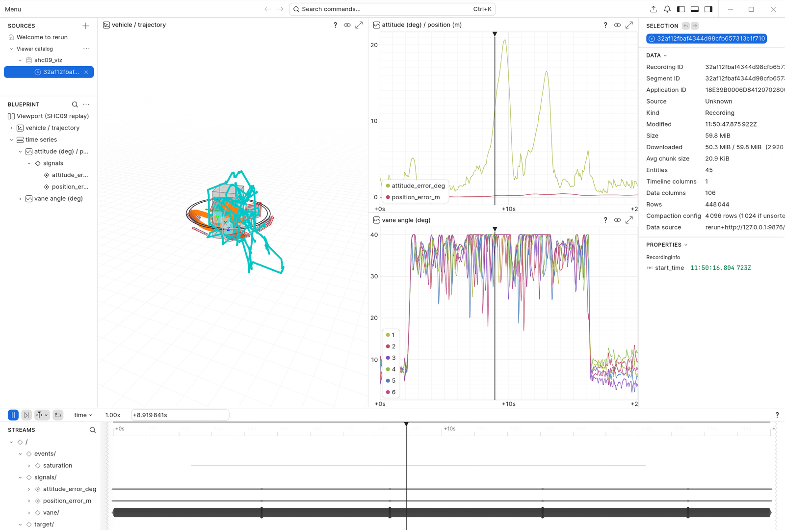

# SHC09 飞行日志回放（VIZ）

> **当前状态 · 2026-10-31**
> - 分支 `viz-replay`（基线 `main@e662e7d`；计划 `docs/viz_replay_plan_v0.1.md` 与
>   `docs/viz_replay_plan_v0.2.md`）
> - 进度：v0.1 M0–M4 ✅（tag `viz-preview`）· v0.1.1 ✅（tag `viz-v0.1.1`）·
>   v0.2 多方法并排 / 汇总指标 / 数字追溯 ✅（tag `viz-v0.2.0`，未 push）
> - 已产出：`viz/shc09_viz/`、几何 JSON、2 s/20 s 单日志回放、5 方法并排回放、
>   `docs/evidence/viz_numbers.md`（生成物）、示例截图
> - 下一命令：`.\\.venv-viz\\Scripts\\python.exe viz\\replay.py --study <study> --case M0 --mode lite --seed 1 --out results\\viz\\study_M0_lite_s1 --active DCA`
> - 已知问题：见 §10（都不阻塞验收）；push 前需人工确认（计划 §14）

---

## 1. 这是什么

把 MATLAB 已经保存的 `.mat` 飞行日志转成 **Rerun `.rrd` 3D 回放**。
单日志：3 条信号曲线（姿态误差、位置误差、六舵角）+ 3 个窗口汇总值；
多方法：每方法 2 条信号曲线（姿态/位置误差）+ 汇总表，六舵角只画 active 方法。
纯后处理：不嵌入 `ca_simulate`、不改变任何数值结果或随机序列、不做实时。

**不是**数字孪生、不是实机一致的证据、不是方法排名工具。回放只证明"日志长这样"。

## 2. 快速开始

```powershell
cd E:\Ducted-Fan-SHC09-viz

# 1) 环境（一次性；只在 worktree 内）
D:\app\python_manager\3.13.0\python.exe -m venv .venv-viz
.\.venv-viz\Scripts\python.exe -m pip install -r viz\requirements.txt

# 2) 生成真实日志（唯一需要 MATLAB 的动作）
#    2 s 悬停：
matlab -batch "cd('E:\Ducted-Fan-SHC09-viz'); addpath('viz/tools'); make_fixture('viz_fixture_2s_DCA', 2, 'ideal');"
#    20 s 带参考机动（否则悬停误差只有 8e-5 m，看不出轨迹偏差）：
matlab -batch "cd('E:\Ducted-Fan-SHC09-viz'); addpath('viz/tools'); make_fixture('viz_20s_ideal_DCA', 20, 'ideal', [0 0 0 -10; 5 1 0.5 -10; 10 0.5 0 -10; 15 0 0 -10]);"

# 3) 一条命令出回放（headless，不需要 viewer）
.\.venv-viz\Scripts\python.exe viz\replay.py --log results\viz_20s_ideal_DCA\DCA\log.mat `
  --out results\viz\viz_20s_ideal_DCA --rate 800

# 4) 看回放（可选）
.\.venv-viz\Scripts\python.exe viz\replay.py --log ... --out ... --viewer
#    或直接：.\.venv-viz\Scripts\rerun.exe results\viz\viz_20s_ideal_DCA\replay.rrd
#    截图：.\.venv-viz\Scripts\python.exe viz\tools\screenshot.py --rrd ... --out shot.png
```

产物是 `<out>\replay.rrd` + `<out>\manifest.json`。`--rate` 只对没有时间向量的
平台日志（`results/<tag>/<METHOD>/log.mat`）生效，默认 800 Hz；`assumed_rate`
会在 stderr 打警告并写进 manifest。

### 类型 A（正式比较日志）

正式证据用比较日志（`results/<tag>/logs/<case>_<mode>_s<seed>_<METHOD>_<hash>.mat`）：
时间向量来自 `L.time_for_metrics`，**不要加 `--rate`**。`lite` 日志带
`estimated_position_ned_m`，回放里对应青色 `/traj/estimated`；`ideal` 没有这个实体
（不是画空实体，而是根本不创建）。

```powershell
.\.venv-viz\Scripts\python.exe viz\replay.py `
  --log "E:\Ducted-Fan-SHC09-matlab\results\allocation_comparison_cache\M0_lite_s1_DCA_<hash>.mat" `
  --out results\viz\typeA_M0_lite_DCA

# 期望：comparison log, n=16001, t=[0, 20.000]s, time_base=time_for_metrics
# manifest: estimator_mode=lite / source=filename（真日志的 MATLAB string 是 opaque）
#           plant_model=shc09_6dof / source=output_tag
```

## 3. 场景里有什么

| 元素 | Rerun entity | 表达 |
|---|---|---|
| 地面网格 / 原点 | `/world/grid`、`/world/axes` | 1 m 网格 10×10 m（z=0），N/E 箭头（ENU） |
| 参考轨迹 | `/traj/reference` | 灰色折线 |
| 实际轨迹 | `/traj/actual` | 方法色折线（DA_NS 蓝、WLS 绿、DCA 橙、PCA_STATIC 紫、PCA_PREDICTIVE 红、EXAMPLE_PINV 棕） |
| 估计轨迹（lite） | `/traj/estimated` | 青色谱线，仅当日志里有 `estimated_position_ned_m` |
| 目标 ghost | `/target/ghost` | 半径 0.15 m 的三圈线框球（0.41 的点球不透明，见 §9） |
| 机体 | `/vehicle`（Transform）+ `/vehicle/body` | 0.18×0.18×0.35 m 盒子 + x/y/z 短轴（示意） |
| 涵道环 / 桨盘 | `/vehicle/duct`、`/vehicle/fan` | 0.30/0.28 m 双环；0.114 m 面积等效圆 |
| 六舵实际 | `/vehicle/vane/{1..6}` + `/panel` | 绕切向轴转 `actual_delta_rad`，按 `|δ|/cm` 蓝→红；命令饱和（`|command| ≥ cm−1e-6`）时强制纯红并把板加粗 1.4× |
| 六舵命令 | `/vehicle/vane_cmd/{1..6}` | 半透明浅色叠加（固定色，避免与真实舵偏混淆） |
| 姿态误差 | `/signals/attitude_error_deg` | `rotation_error_rad` → 度 |
| 位置误差 | `/signals/position_error_m` | `‖p − p_ref‖`（NED，m） |
| 六舵角 | `/signals/vane/{1..6}` | `actual_delta_rad` → 度 |
| 饱和度 / 气动越界 | `/events/saturation`、`/events/aero_extrapolation` | 发生时刻的标量标记（`|command| ≥ cm−1e-6`；`table_extrapolated`） |
| 多方法轨迹 / 机体 | `/traj/actual/<METHOD>`、`/vehicles/<METHOD>` | 每方法一条方法色轨迹；机体/六舵默认只显示 `--active`，其余可手动打开 |
| 多方法信号 | `/signals/<METHOD>/attitude_error_deg`、`/position_error_m`（5 方法）；`/signals/<ACTIVE>/vane/{1..6}`（仅 active） | `rr.SeriesLines` 静态设置方法色；颜色只表示身份 |
| 多方法事件 | `/events/<METHOD>/saturation`、`/events/<METHOD>/aero_extrapolation` | 该方法的逐帧饱和舵数 / 越界标记，直接看“谁在何时饱和” |
| 汇总表 | `/summary`（`TextDocument` + `TextDocumentView`） | 窗口三指标 Markdown 表；`status` 原样引用 comparability.csv |

时间轴只有一条：`time`（秒，duration）。`log_time` 已显式关闭，viewer 打开就是仿真时间。

## 4. 坐标约定（写死，有单测）

| 事实 | 值 |
|---|---|
| 导航系 | NED：x 北、y 东、z **下**；重力 +z；推力沿机体 −z |
| 机体系 | x **左**、y **前**、z 下 |
| 欧拉角 | `[roll pitch yaw]`，ZYX，与 `lib/math/ca_euler_rotation.m` 逐项一致 |
| ψ=0 前向 | 机体 y → NED **+y = 东**（不是北） |
| 显示系 | **ENU**：x 东、y 北、z 上；`p_enu=[E,N,−D]`，`A=[[0,1,0],[1,0,0],[0,0,−1]]`，det(A)=+1 |
| 姿态 | `R_enu_body = A @ R_ned_body`，`Rotation.from_matrix(...).as_quat()`（xyzw），相邻帧符号连续化 |
| 校验 | `assert_proper_rotation` 要求 `|RᵀR−I|<1e-9` 且 `|det−1|<1e-9`，失败抛出而不是静默修复 |

MATLAB 数值裁决（`viz/tools/check_frames.m`，与 `test_frames.py` 冻结值一致）：

```text
R(0,0,0)  * [0;1;0]  = [0 1 0]            % 前向 = 东
R(0,0,90) * [0;1;0]  = [-1 6.1e-17 0]
R(90,0,0) * [0;0;-1] = [0 1 -6.1e-17]     % 对应 R_enu_body @ [0,0,-1] = [0,0,1]
det(R) = 1.000000000000000
```

**与旧 HANDOFF §10 的差异**：旧文档写 `[north, east, up]`，那是 NEU，相对 NED 是镜像
（det=−1），四元数无法用相似变换表示，会出现左右翻转/转向反号。本实现用 ENU，是对
HANDOFF §10 的更正。

## 5. 时间基准（绝不静默插值）

1. `L.time_for_metrics` 存在 → 直接用（比较日志走这条）；
2. 否则 `r.time_s` 存在 → 用；
3. 否则 `(0:n−1)/rate`，`rate` 默认 800、可由 `--rate` 覆盖；manifest 记
   `time_base="assumed_rate"`，stderr 警告一次。

校验：`n≥2`、时间严格递增、`t[0]≈0`、`dt` 与 `rate` 的相对误差 ≤1e-2。两条曲线采样率不同
时各用各的时间戳，不做重采样。

## 6. 字段来源

| 场景 | `.mat` 字段 |
|---|---|
| 实际/参考/估计轨迹 | `L.position_ned_m`、`L.position_reference_ned_m`、`L.estimated_position_ned_m` |
| 机体姿态 | `L.euler_rad`（ZYX） |
| 位置误差 | `‖L.position_ned_m − L.position_reference_ned_m‖` |
| 姿态误差 | `L.rotation_error_rad`（MATLAB 用 `acos((trace(R_trueᵀR_des)−1)/2)`） |
| 六舵实际/命令 | `L.actual_delta_rad`、`L.command_rad` |
| 饱和 | `|L.command_rad| ≥ cm−1e-6`，`cm=deg2rad(40)` 来自几何 JSON |
| 气动越界 | `L.table_extrapolated` |
| 方法/时长 | `L.name`、`c.sample_hz`、`c.duration_s` |

PWM（`pwm_command_rad`/`pwm_update_time_s`）与 `solver_exitflag` 在 v0.1 **不进 .rrd**，
见 §8。

## 7. 几何来源与"示意"声明

`viz/geometry/export_geometry.m` 从 `ca_shc09_parameters` 导出
`viz/geometry/shc09_geometry.json`（l1/l2/P_cs/cm、质量/惯量、面积等效半径），带
`source="ca_shc09_parameters"`、`assumed=[...]` 和 SHA-256（`f94dc2cb…79a8a2`）。
Python 不复制常数；改了参数没重导出，`load_geometry` 会因哈希不符直接报错。

涵道 0.30/0.28 m、机体盒 0.18×0.18×0.35 m 是**视觉选择**；0.114 m 是桨盘**面积等效**
半径，不是涵道半径。三者都不是实机外形，截图与文档均按此标注。

## 8. 逐帧 PWM 曲线仍走 CSV

v0.2/v0.2.1 只给**窗口汇总**（饱和率、PWM 总变差、solve P95），不是 PWM 时间曲线；
`pwm_command_rad` 的逐帧走向、`solver_exitflag`、residual 等仍用日志同目录的
`control.csv` / `pwm.csv`（角度单位是**度**）。零代码方案（3 行）：

```powershell
# 装一次 PlotJuggler（或用任一带 CSV 的曲线工具）
.\.venv-viz\Scripts\python.exe viz\replay.py --log results\viz_20s_ideal_DCA\DCA\log.mat --out results\viz\viz_20s_ideal_DCA --rate 800
# 把 results\viz_20s_ideal_DCA\DCA\control.csv 与 pwm.csv 直接拖进 PlotJuggler，按 time_s / pwm_time_s 对齐
```

## 9. 验证证据（2026-10-31 实测）

```text
$ .\.venv-viz\Scripts\python.exe -m pytest viz\tests -q
60 passed in 17.45s

$ .\.venv-viz\Scripts\python.exe viz\replay.py --log results\viz_fixture_2s_DCA\DCA\log.mat --out results\viz\viz_fixture_2s_DCA --rate 800
replay: platform log, method=DCA, n=1601, t=[0, 2.000]s, time_base=assumed_rate
replay: wrote results\viz\viz_fixture_2s_DCA\replay.rrd (1.74 MB) and manifest.json in 3.4s

$ .\.venv-viz\Scripts\python.exe viz\replay.py --log results\viz_20s_ideal_DCA\DCA\log.mat --out results\viz\viz_20s_ideal_DCA --rate 800
replay: platform log, method=DCA, n=16001, t=[0, 20.000]s, time_base=assumed_rate
replay: wrote results\viz\viz_20s_ideal_DCA\replay.rrd (18.25 MB) and manifest.json in 36.1s

$ .\.venv-viz\Scripts\python.exe viz\replay.py --log ...\M0_lite_s1_DCA_bcca….mat --out results\viz\typeA_M0_lite_DCA
replay: comparison log, method=DCA, n=16001, t=[0, 20.000]s, time_base=time_for_metrics
replay: wrote results\viz\typeA_M0_lite_DCA\replay.rrd (18.20 MB) and manifest.json in 33.9s

$ .\.venv-viz\Scripts\python.exe viz\replay.py --log ...\M0_ideal_s1_DCA_5a5f….mat --out results\viz\typeA_M0_ideal_DCA
replay: comparison log, method=DCA, n=16001, t=[0, 20.000]s, time_base=time_for_metrics
replay: wrote results\viz\typeA_M0_ideal_DCA\replay.rrd (17.51 MB) and manifest.json in 31.7s

$ .\.venv-viz\Scripts\python.exe viz\tools\check_curves_csv.py --log results\viz_20s_ideal_DCA\DCA\log.mat --control results\viz_20s_ideal_DCA\DCA\control.csv
 index      t_s   vane_deg  pos_err_m  att_geo_deg csv_euler_note
     0    0.000   4.44e-15   0.00e+00     0.00e+00       0.00e+00
  8000   10.000   4.44e-15   2.78e-17     6.62e-12       1.16e-06
 16000   20.000   3.55e-15   5.55e-16     9.33e-09       3.64e-07
gate tolerance=1e-06: PASS
```

- 2 s 日志同样 PASS（vane 3.6e-15 deg、位置 1.1e-15 m、姿态 4.4e-11 deg）。
- 类型 A（lite）：`time_base=time_for_metrics`、`n=16001`、无 `--rate` 警告；
  `.rrd` 里能查到 `/traj/estimated` 实体（`rerun rrd print -v`）。
- 类型 A（ideal）：同一路径、同样 16001 点，`.rrd` 里**没有** `/traj/estimated`
  （不是空实体，见 `test_type_a_estimated_layer`）。
- manifest 来源：`M0_lite_s1_DCA_….mat` → `estimator_mode=lite, source=filename`；
  `plant_model=shc09_6dof, source=output_tag`（MATLAB `string` 在 `-v7` 里是 opaque，
  `c` 的 char 兜底取不到时按文件名/输出标签解析；合成夹具走 `source=c`）。
- `csv_euler_note` 是 CSV 的**欧拉差**与回放曲线**测地旋转角**的定义差（二阶小量），不是门禁项；
  姿态曲线本身用 MAT 的 `euler_rad/desired_euler_rad` 重算测地角验证。
- manifest 稳定性：`test_manifest_is_stable_except_created_at` 跑两次，除 `created_at` 外逐字段相等。
- `.rrd` 每次生成字节数会因 Rerun 内部 ID/分块略变，manifest 不记录 rrd 字节数，只记文件名。
- 干净树复跑（`git archive HEAD` → `.tmp/clean`，不依赖 MATLAB）：`pytest viz/tests -q` → **60 passed**；
  同一命令生成 `replay.rrd`（1.7 MB）+ `manifest.json`。
- MATLAB 回归（viz worktree）：14/14 项目测试、6/6 平台测试、冻结基线 20 例全过（exit 0）；
  日志在 `results/validation/m1_gate_matlab.log`、`m2_gate_matlab.log`。
- `--viewer`：`REPLAY_EXIT=0`，Rerun 主窗口标题 `Rerun`；TEMP/TMP 由 `temp_env()` 处理
  （系统 TEMP 不可写时回退 `<repo>/.tmp`，`test_temp_env_fallback` 覆盖）。
- 截图：`viz/examples/flight_replay/` 下 `2s_hover.png`、`20s_reference_tracking.png`、
  `m4_lite_stress.png`。




上图为 `M4_lite_s1_DCA_7dd8….mat` 在 t≈8.9 s 的回放（viewer 暂停后截屏）：六舵命令顶到
40° 限幅，3D 里对应舵面为纯红并加粗 1.4×。各方法在 M4/lite 各 load 下的饱和率与姿态峰值
以生成表 [`viz_numbers.md`](evidence/viz_numbers.md) 为准，本节不手写百分比。该日志**不是**
失稳结论或方法排名——lite 是 stress 演示，且单个 DCA 变体不能代表方法整体。

## 10. 已知限制与问题

- **不是实机/数字孪生**：几何示意；回放不参与任何数值结论。
- **lite 是 stress 演示**：估计轨迹层会画，但不能当真实数据或方法排名。
- Rerun 0.41 的 `Points3D` 球体不透明，"半透明小球"退化为半径 0.15 m 的线框球。
- MATLAB `string` 对象在 `-v7` 里是 MCOS opaque，Python 读不到原文：`estimator_mode` 依次从
  `c.estimator_mode`（char 兜底）、文件名解析，`plant_model` 从 `c.plant_model`、`output_tag`
  解析；manifest 用 `estimator_mode_source` / `plant_model_source` 如实记录来源
  （`c` / `filename` / `output_tag` / `unknown`）。没有 `c` 的平台日志才会是 `unknown`。
- Rerun viewer 需要可写 TEMP；本沙箱系统 TEMP 不可写，`shc09_viz.temp_env.temp_env()` 探测失败时
  回退 `<repo>/.tmp`（已忽略）。`cli.py --viewer` 与 `tools/screenshot.py` 共用该函数。
- 20 s 日志在 t=10 s 处 CSV 欧拉差与测地角相差 1.16e-6 deg（定义差，见 §9）。
- 一次只回放一组条件；**逐帧 PWM 曲线未做**（只有窗口汇总，逐帧走向看 `pwm.csv`）；
  跨种子叠加、视频、真实外形仍是后续版本。多方法并排见 §12。

## 11. 与 HANDOFF §10 的差异

| 条目 | HANDOFF §10 | 本实现 | 原因 |
|---|---|---|---|
| 显示坐标 | `[north, east, up]` | **ENU** `[E,N,U]` | NEU 是镜像，四元数无法表示 |
| 几何来源 | 代码内复用 | MATLAB 导出 JSON + SHA-256 | 避免 Python 复制常数、漂移无人发现 |
| 时间基准 | 未提 | 三分支 + `--rate` | 平台日志没有时间向量 |
| 备选方案 | `flight_view_app` | 不提供 | 仓库里没有该文件 |
| 产物 | 只有 `.rrd` | `.rrd` + `manifest.json` | 与仓库证据/溯源风格一致 |
| 曲线范围 | 含 PWM/residual | 3 组 + 2 类事件 | v0.1 时间盒；全量曲线走 CSV |

## 12. v0.2 多方法并排与汇总指标

### 12.1 一条命令

```powershell
.\.venv-viz\Scripts\python.exe viz\replay.py `
  --study E:\Ducted-Fan-SHC09-matlab\results\allocation_comparison_research_3seeds `
  --case M0 --mode lite --seed 1 `
  --out results\viz\study_M0_lite_s1 --active DCA
```

- 从 `<study>\logs\` 精确匹配 `<case>_<mode>_s<seed>_<METHOD>_<hash>.mat`，5 个方法中至少 2 个；
- 同方法多 hash、混 case/mode/seed 一律非零退出（不猜、不平均）；
- `--active` 指定默认显示的机体（默认 DCA）；其余方法机体已记录但蓝图默认隐藏，可在 viewer 手动打开；
- 非当前方法的机体按每 8 个采样（100 Hz）记录、当前方法全速率；信号层按预算估算，
  非 active 方法 stride=2、active 全速率，逐实体 stride 写进 manifest；
- 实测（含信号层与汇总表）约 **27–28 MB / 45–50 s**（单次记录值随 Rerun 分块略变；
  v0.2.0 无信号时为 19.86 MB / 30.4 s），低于 200 MB / 5 min。

### 12.2 视图

- 单 `time` 时间轴；五条轨迹同时显示，颜色只表示身份（方法色，不按好坏着色）；
- 默认只显示 `--active` 的机体与六舵；其余机体在 `/vehicles/<METHOD>` 下可手动打开；
- 信号：每方法 `attitude_error_deg` + `position_error_m` 五色曲线；六舵角只画 active 的 6 条；
- 事件：`/events/<METHOD>/saturation`（该帧饱和舵数）与 `aero_extrapolation` 按方法分开；
- **汇总值用 Markdown 表**（`/summary` + `TextDocumentView`），不用折线；`/metrics/...` 标量仍
  保留供机器读取，但不进蓝图；时间轴范围由窗口 `[start, end]` 决定；
- 可选 `--metric-lines` 会把窗口值在起止各记一次，形成常量参考线（不是时间信号）。

### 12.3 三条汇总指标（冻结定义）

| 指标 | 定义 | 来源 |
|---|---|---|
| `saturation_percent` | 窗口内 PWM 事件中任一舵角 ≥ cm−1e-5 的比例（100×） | `analysis/ca_metrics.m` |
| `pwm_total_variation_deg` | 窗口内相邻 PWM 事件六通道 \|Δdeg\| 之和 | `analysis/estimator_feedback_metrics_row.m:17` |
| `solve_time_p95_ms` | 窗口内 `solve_time_s` 的 95 分位（线性）×1000 | 本计划 v0.2 §3 |

窗口默认 `task`（`summary.csv` 的 [6,16] s），`--window whole` 取 [0,T]；末端超长会截断并记入
manifest。manifest 的 `metrics.definitions`、`metrics.window`、`logs[].sha256` 给出定义、窗口与
每个日志的来源。

### 12.4 数字只从生成物引用

各方法的饱和率、姿态峰值、位置峰值、估计 RMS 与状态见
[`docs/evidence/viz_numbers.md`](evidence/viz_numbers.md)（由 `viz/tools/summarize_study.py`
从 `summary.csv`/`comparability.csv`/`status.csv` 生成，含文件 SHA256 与 git SHA）。
本文不手写这些数值；需要更新时重跑生成器。
