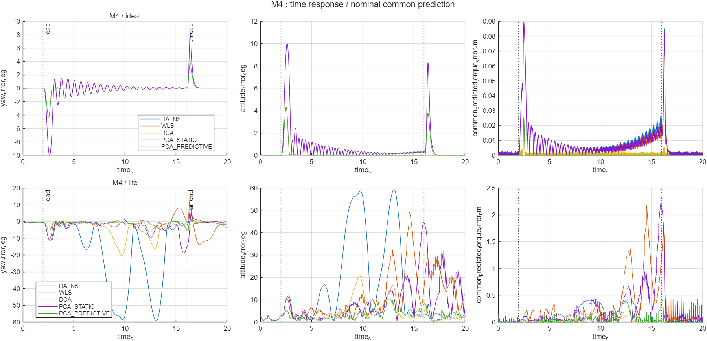
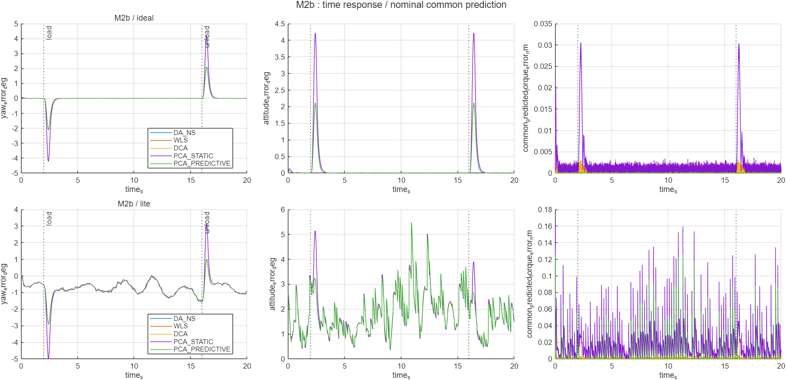
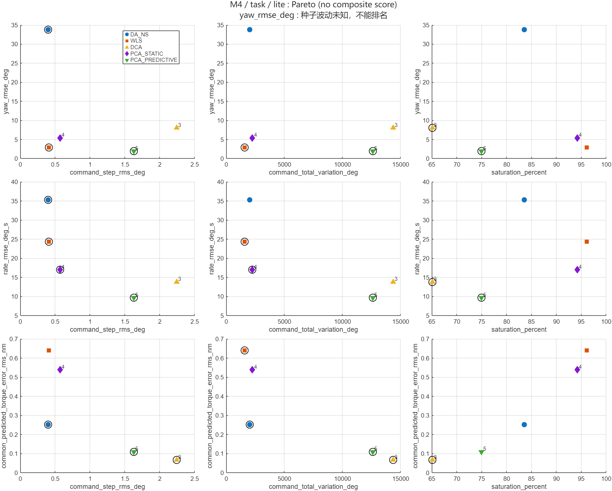
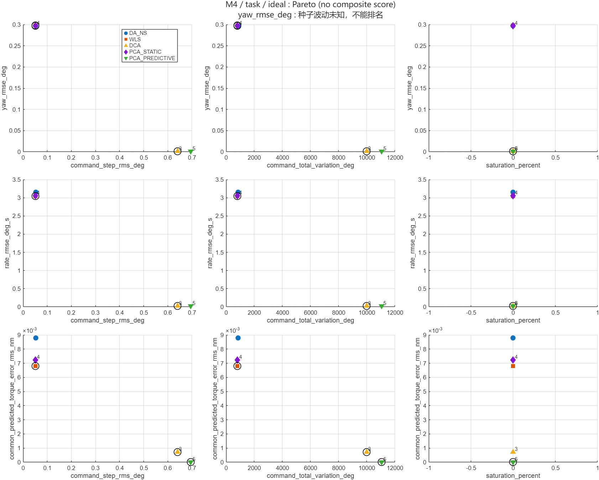

# E3：估计反馈下的结构失配

> 文档类型：历史。

状态：正式30/30完成；lite仍experimental，默认ideal。方法之间存在分配/代价及M4大幅轨迹差异，不能作单一姿态排名。

## 设计与复现

```matlab
ca_setup;
s = e3_estimated_mismatch_app;
```

固定使用 ca_mismatch_protocol(20,0.6,"load_hold")：M0/M2b/M4，ideal/lite，五方法，共三十次。2 s 加载、16 s 卸载、0.5 s 过渡；whole=[0,20]、task=[6,16]、transient=[0,6]。固定 seed=1、lite_seed=72001，各方法共享同一参考、初态、噪声过程，传感器读数随物理轨迹变化。M2b 的 [1.2,1,.8,1,1.2,1] 列增益及 M4 的 tanh/28° 原样取自旧协议；没有新增或搜索参数。

入口不改变默认：ideal 是 oracle，lite 仍 experimental，ECL 本轮不跑（Stage6A 已显示明显墙钟开销，且本轮不是发布门槛）。偏置门禁 .05°/s、kp/ki 与位置时间常数保持不变。case 改动必须对 ca_allocator_config/ca_model 不可见，运行中 assert 验证。aero_extrapolation_policy 始终 error；任何运行异常记 failure.json、failure.mat、完整计划状态并停止，不把 M4 改成 record，也不回退真值。

结果目录 results/e3_estimated_mismatch_<tag> 含 summary.csv、pareto.csv、metric_effects.csv、status.csv、cases.csv、provenance.csv、report.md、figures 和每个组合的数值日志。默认全新运行，禁止覆盖已有输出；显式 reuse_from 仅重放本仓库某个已完成输出的 logs，并逐项校对配置/参考。每个新鲜 lite 运行检查 plant_truth/sensor_attitude/sensor_local_position 不存在；真值仅测量生成与离线评价。日志剥离 topic 前保存核验标记，不伪称旧数值缓存包含完整 topic。

## 指标与解释

直接复用 estimator_feedback_metrics_row 与 MVP 的 Pareto 产品。summary 区分 case_id、estimator_mode、method、window、experiment_id=E3，保留跟踪、分配、代价和估计全部字段。共同预测力矩误差是名义 J 换算后的 Nm；common_residual/allocation demand error 为 rad/s²；native residual 保留原生目标语义，不跨不同动态目标排名。moment_model_error_rms_nm 另衡量实际模型与名义力矩差异，不能与共同预测目标残差混为一谈。

每 case/mode 的九个二维 Pareto 指标对沿用 MVP 容差和最小化方向，不计算综合得分。跟踪主轴统一偏航，另保留角速度和共同预测力矩；横轴分别 PWM 步变、总变差和饱和。whole/早期窗观察启动与卸载收益，task 不代表全动态鲁棒性。

单种子未知种子波动时，沿用 MVP “种子波动未知，不能排名”；没有用姿态估计 RMS 充当种子标准差，也不新造统计分辨阈值。对“当前约一度误差下主窗不可分辨”的判断只作为本次配对轨迹的保守量级解释，需同时呈现误差跨度和分配/代价证据，不能升级为任意噪声下的定理。

## 正式结果与问题回答

正式输出为本地 `results/e3_estimated_mismatch_research_seed1`：30/30 全新完成，90 行 summary、810 行 Pareto、306 行效应量；30 行来源均 loaded=false，15 次 lite topic 隔离均通过。气动域 error 保持原样，控制采样越界比例全部为零，未触发运行中健康/气动域停止条件。ideal 的三个工况与旧示例相同 whole/task 窗口的 450 个公共数值字段差为零。未运行完整六工况阶梯，也未复用旧研究数值缓存。

轻量证据见 [示例](../../examples/e3_estimated_mismatch/README.md)、[汇总](../../examples/e3_estimated_mismatch/summary.csv)、[Pareto](../../examples/e3_estimated_mismatch/pareto.csv)、[效应量](../../examples/e3_estimated_mismatch/metric_effects.csv)、[状态](../../examples/e3_estimated_mismatch/status.csv)。原始数值日志、共同输入和完整生成 report.md 仍保留在本地输出。

### 1. M4 的两组收敛结论没有完整保留

ideal 重现旧结果：主窗 DA_NS/WLS/静态约 0.297°，DCA/预测约 0.001135°，静态/DCA=261.707，静态/预测=261.614。lite 下静态/DCA=0.673369，静态/预测=2.77109，不能继续概括为“DCA/预测收敛快，其余都慢”。

|模式|方法|whole 偏航°|瞬态偏航°|主窗偏航°|主窗姿态°|主窗姿态估计误差°|
|---|---|---:|---:|---:|---:|---:|
|ideal|DA_NS|1.73296|2.71695|0.297105|0.333571|0|
|ideal|WLS|1.72951|2.7118|0.297705|0.319338|0|
|ideal|DCA|0.664996|0.926277|0.00113469|0.00269384|0|
|ideal|PCA_STATIC|1.73113|2.71516|0.296956|0.321026|0|
|ideal|PCA_PREDICTIVE|0.683734|0.958746|0.00113509|0.00270356|0|
|lite|DA_NS|24.0943|5.18841|33.8175|33.9403|1.71975|
|lite|WLS|4.64813|2.85406|2.8835|16.7604|6.66541|
|lite|DCA|5.78424|1.59534|8.0288|8.3599|1.44446|
|lite|PCA_STATIC|4.591|3.50159|5.40634|12.635|3.73255|
|lite|PCA_PREDICTIVE|1.73807|1.50503|1.95098|4.35481|1.93803|

lite 早期窗仍可观察到 DCA/预测的较低偏航误差（1.595/1.505°，静态3.502°、DA_NS5.188°），但主窗 DCA 达8.029°，不能称其已快速收敛到原来的微小稳态误差。预测主窗1.951°也远高于其ideal值。WLS主窗偏航2.883°而总姿态16.760°，只看偏航会漏掉其他轴退化。

这不是全部主窗差异被约1°噪声淹没：M4/lite 的偏航方法跨度31.8665°，姿态估计误差也随轨迹变成1.444～6.665°，DA_NS姿态主窗33.940°、静态12.635°。时域显示较大摆动和持续饱和，已偏离原小角轨迹。运行门禁通过不等于控制质量合格；这里只描述这一次配对闭环，不能把退化全部归因于估计噪声，也不据此宣布统计排名或稳定性。



### 2. M2b 的实际行空间失配仍可测，姿态差别很小

M2b 行空间算子范数0.293334、零空间0.0868843；M4的0.836101仅为名义24°负载点的局部雅可比，均见 cases.csv，不能把后者当全局线性效能。M2b/ideal 主窗偏航0.000991～0.001124°，相对M0只变化0.0000136～0.000149°。lite 的配对变化如下。

|方法|M2b 主窗偏航°|相对M0变化°|实际力矩模型误差增量Nm|名义共同预测力矩误差增量Nm|
|---|---:|---:|---:|---:|
|DA_NS|0.843319|0.00268328|0.0813218|-6.71133e-06|
|WLS|0.843319|0.00268328|0.0813218|-6.71132e-06|
|DCA|0.841836|-0.000875825|0.0816661|4.36258e-06|
|PCA_STATIC|0.843319|0.00268328|0.0813218|-6.71133e-06|
|PCA_PREDICTIVE|0.840424|-0.000322925|0.078619|-6.55848e-05|

实际模型误差增加约0.0786～0.0817Nm，比千分之几度的跟踪变化更清楚地显示失配仍存在；但名义共同残差的配对变化仅约10⁻⁶～10⁻⁵Nm，不能笼统宣称所有分配残差都对实际失配更敏感。它衡量名义目标可达性，不直接知道实际舵效。

M2b/lite 主窗五方法偏航跨度仅0.0028953°，姿态估计RMS1.401～1.407°。作为单轨迹量级描述，当前 ~1° 估计误差下，M0/M2b 的主窗姿态细微差别不可分辨；种子波动未知，不能据此作统计排名。与此同时，M2b静态/DA/WLS共同预测力矩约0.0270Nm，DCA/预测约0.00676/0.00636Nm；相应PWM步变约0.331°与2.637/2.309°，代价和分配指标仍区分方法。



### 3. M4 保留残差与 PWM 权衡，饱和方向需分开看

下表均为主窗。总变差是窗内六舵PWM角命令绝对增量之和，饱和是任一舵触及公共位置限幅的事件比例，不等于mode1/2。PWM角单位沿用MVP，不是脉宽微秒。

|模式|方法|共同预测力矩Nm|步变RMS°|总变差°|饱和%|mode1%|mode2%|
|---|---|---:|---:|---:|---:|---:|---:|
|ideal|DA_NS|0.00877647|0.0530071|840.971|0|—|—|
|ideal|WLS|0.00680036|0.0502275|798.036|0|—|—|
|ideal|DCA|0.000720103|0.639651|9977.01|0|—|—|
|ideal|PCA_STATIC|0.0072391|0.0507209|805.39|0|0|0|
|ideal|PCA_PREDICTIVE|9.73115e-17|0.694982|11055.9|0|0|0|
|lite|DA_NS|0.25244|0.398217|2026.99|83.5785|—|—|
|lite|WLS|0.640798|0.410431|1581.78|96.1273|—|—|
|lite|DCA|0.0670308|2.24179|14347.3|65.0856|—|—|
|lite|PCA_STATIC|0.538488|0.568986|2248.63|94.1759|20.21|0|
|lite|PCA_PREDICTIVE|0.110306|1.6271|12603.8|74.9625|14.8481|0.474941|

lite 的 DCA/预测相对静态保留更低共同预测力矩残差（0.0670/0.1103 对0.5385Nm），同时步变与总变差更高。饱和却更低（65.09/74.96% 对94.18%）；ideal主窗饱和均零，瞬态DCA/预测也低于静态。因此“以更高PWM活动换更低残差”成立，“一定以更高饱和换取”不成立。

Pareto 必须指定两轴：M4/lite主窗“PWM步变—共同力矩残差”数值前沿为DA_NS、DCA、预测；“饱和—共同残差”只有DCA；“饱和—偏航”是DCA与预测。预测比DCA的偏航误差及PWM活动更低，DCA的共同残差及饱和更低，不能选出一个跨所有目标的最优。黑圈只表示本次二维数值非支配，容差沿用MVP，不是显著性标记。





### 4. 基准能区分部分行为，不能给出普适方法排名

M0/M2b在约1.4°估计误差下，不能稳定依靠主窗姿态微小差异区分；分配残差、PWM活动、饱和和离线实际模型误差仍提供不同信息。M4/lite则明显改变轨迹量级，在本组数据中清楚分开了方法行为，但它测到的是结构失配、估计反馈、饱和和物理轨迹的共同闭环响应，不是原ideal收敛优势的直接复刻。单种子没有波动估计，所有E3效应量表的种子标准差/归一化比值保持缺失，不能作统计显著性或实机优势结论。

ECL本轮未运行，没有关于它与lite方向一致的新增主张。后续要验证因果或普适性，需要另开多种子/估计器/执行器研究；本次不继续扩展。

## 测试

`test_e3_estimated_mismatch` 仅运行两秒 M0/M2b、ideal/lite，检查 case/mode/列/窗口、五方法配置/参考/噪声/初态一致、真值 topic 隔离及同种子独立重跑（完整日志沿用冻结基线的 shc09_log_signature 排除墙钟字段，汇总仅扣除 simulation_elapsed_s）；不代替正式三十次。E3阶段旧14/6、冻结逐位基线、MVP、E3独立重复均通过，见 [验证记录](../release_validation/e3/e3_checks.json)；合并main后发布前的14/6、冻结基线、MVP及最终E3独立重复再次全部通过，MATLAB退出码0，见 [v0.3.0发布验证](../release_validation/v0.3.0/release_checks.json)。run_estimator_tests 仍应在 LitePhysicalBias 失败。

## 结论边界

lite 未验收，默认 ideal，ECL 为归档旧版；真实和名义 tau 均30 ms匹配。单组种子只报方向与效应量；模型预测终点残差受到匹配 tau 的有利假设影响。未做执行器二阶/死区/延迟、参数不确定性、实机标定、完整多种子统计或 HIL，旧报告结论保持原样。
