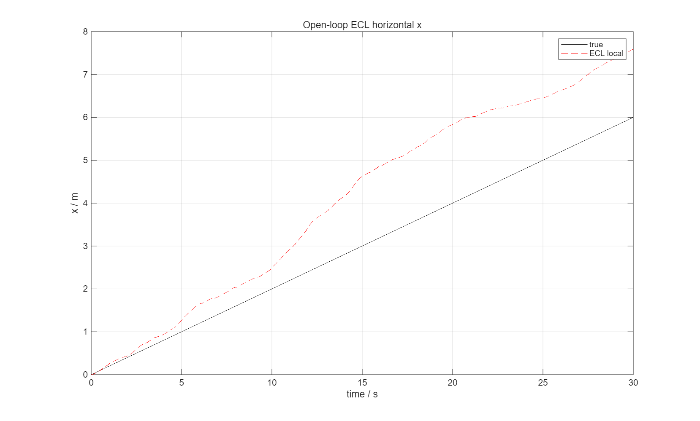
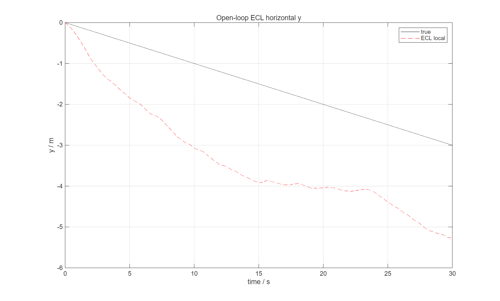

# PX4-ECL 导航位置分离根因诊断

- 分支：`debug-ecl-position`
- 基准：`change-B` `661a128f1bfeaa6484f1dca3f9dbc489bb1195bc`
- 本轮不运行正式 55 秒批次，不修改 B/J、控制器增益、正式日志/锁。
- 诊断源码改动仅增加 stderr/日志字段，不改变 EKF 数值计算和 stdout 协议。

## 1. 结论摘要

现有证据把问题定位到：

> **ECL 的局部水平位置状态没有跟随已被接受的 GNSS 水平观测；桥接器的固定原点投影、传感器生成、控制分配和控制器反馈原点都不是主要根因。**

具体证据：

1. `shc09_navigation_sensors.m` 的 GNSS 位置/速度来自同一时刻的对象 NED 真值，经过固定延迟缓冲；日志中的 GPS 输入与真值+协议噪声一致，没有发现轴置换、符号或单位错误。
2. `px4_ecl_bridge.cpp` 中 `getPosition()` 是 ECL 局部位置，`getEkfGlobalOrigin()` 提供固定原点；桥接器输出的 world NED = 局部位置 + 固定原点投影。
3. 在短时诊断中，GPS 位置 innovation 与 test ratio 均显示 **GPS 位置被接受**（`gpsflag=1`, `hpos_ratio≈0.03`），但 ECL 的局部水平位置仍与 GPS/真值分离。
4. **无控制器、无控制分配器的开环估计器诊断**同样复现水平误差：真实 12 s 位移 `(2.4, -1.2) m`，ECL 局部 `(3.43, -3.48) m`；因此不是控制分配器或控制器造成的。
5. `navigation_origin_offset` 在 t=0 只去掉初始固定偏移；t=0 估计接近参考是定义使然，不能证明后续导航正确。

尚未得到可由源码唯一确定的单行错误；当前有明确证据指向 **ECL 局部位置更新/独立 ECL 接口**，需要下一轮针对 ECL 内部状态或 GPS 时间戳的最小实验。

---

## 2. 现有导航链审查

### 2.1 真实 NED 与 GNSS 生成

`platform/sim/shc09_navigation_sensors.m:9-20`：

```matlab
nav.gps_position_buffer(slot,:)=state.position'+cfg.gnss_position_bias_m(:)'+noise...
nav.gps_velocity_buffer(slot,:)=state.velocity'+noise...
source=k-nav.delay_samples; slots=...
gps_position=nav.gps_position_buffer(slots(1),:);
gps_velocity=nav.gps_velocity_buffer(slots(1),:);
packet=[timestamp,dt,...,gps_position,gps_velocity,...]
```

- 位置来自 `state.position`（NED 真值）；
- 速度来自 `state.velocity`（NED）；
- 读取的是延迟缓冲中的同一时刻；
- 没有机体系旋转（GNSS 是 NED 量）；
- 单位 m、m/s。

### 2.2 送入 ECL 的 GPS

`px4_ecl_bridge.cpp:65-76`：

```cpp
map_projection_reproject(&world, gps_position[0], gps_position[1], &latitude,&longitude);
gps.lat=llround(latitude*1e7); gps.lon=llround(longitude*1e7);
gps.alt=llround((origin_altitude-gps_position[2])*1000.0);
gps.vel_ned(i)=gps_velocity[i]; gps.time_usec=timestamp;
```

- `gps_position` 是 NED；
- `map_projection_reproject` 使用 x=north、y=east，与 NED 一致；
- 高度为 `origin_altitude - z`（z 向下）；
- 没有发现显式轴置换或符号翻转。

### 2.3 ECL 输出

`px4_ecl_bridge.cpp:84-94`：

```cpp
const auto local_position = ekf->getPosition();
auto position = local_position;
...
origin_valid = ekf->getEkfGlobalOrigin(...);
if (origin_valid) {
  map_projection_project(&world, latitude, longitude, &offset_n,&offset_e);
  position(0)+=offset_n; position(1)+=offset_e; position(2)+=origin_altitude-altitude;
}
```

`getPosition()` 是 ECL **局部**位置；`offset_n/e` 是 ECL 全局原点相对任务 `world` 原点的固定投影；输出是 world NED。

### 2.4 MATLAB 原点与控制器

`research/ppid_pindi/ppid_simulate.m:7`：

```matlab
navigation_origin_offset=nav.estimate.position-ref.position_ned_m(1,:)';
```

`:36` 控制器反馈：

```matlab
fb.position = estimate.position - navigation_origin_offset
```

`:49` 日志：

```matlab
L.estimated_position = estimate.position - navigation_origin_offset
```

`hdtf_metrics.m:69-85` 用同一判据分别评价 `L.position` 和 `L.estimated_position` 对 `ref.position_ned_m` 的误差。

---

## 3. 定量证据

### 3.1 原点偏移（新批）

| seed | offset_x | offset_y | offset_z | 水平模长 |
|---:|---:|---:|---:|---:|
| 501 | −2.103127 | +3.187778 | −0.500772 | 3.82 m |
| 502 | +1.134819 | −1.500724 | −4.247643 | 1.88 m |
| 503 | −1.561669 | −0.566906 | −2.278187 | 1.66 m |

同一 seed 下五种分配器相同；说明原点偏移不是控制分配器造成的。

### 3.2 关键时刻误差（新批 15 条范围）

| t / s | true 水平误差 | estimated 局部水平误差 | raw ECL 水平误差 |
|---:|---:|---:|---:|
| 0 | 0 | 0.001–0.003 | 1.66–3.82 |
| 12 | 1.465–2.232 | 0.019–0.173 | 1.756–3.701 |
| 15 | 1.158–2.750 | 0.095–0.219 | 1.519–3.782 |
| 27 | 2.123–3.484 | 0.066–0.321 | 1.354–3.815 |
| 37 | 2.705–5.294 | 0.096–0.303 | 1.641–3.723 |
| 55 | 1.535–6.866 | 0.079–0.226 | 1.717–3.977 |

`estimated_position` 在 t=0 被强制接近参考，但随后没有跟随真实水平位移。

### 3.3 桥接器 stderr 的关键样本

`ecl_bridge_samples.csv` 中任务中段一行（原始诊断时间戳 `42101250 µs`）：

```text
gps        = [-0.0374, 2.1776, -7.8346]
local      = [-1.1871, -1.6819, -9.7206]
origin     = [-0.7228, 4.9376]
out        = [-1.9099, 3.2557, -11.0754]
velocity   = [-0.2080, 0.1229, -0.1021]
gpsflag=1  checks=0  origin_valid=1
hpos_ratio = 0.0294
hpos_innov = [-1.8624, 1.0971]
```

由 `gps - origin` 得到 GPS 在 ECL 局部系中的期望位置：

```text
[-0.0374 - (-0.7228), 2.1776 - 4.9376] = [0.6854, -2.7600]
```

ECL 实际局部位置：

```text
[-1.1871, -1.6819]
```

差值正是 `hpos_innov`：

```text
local - (gps-origin) = [-1.8725, 1.0781]
```

`hpos_ratio=0.029` 明显小于 1，说明该 GPS 位置观测没有被 innovation gate 拒绝；但 ECL 局部位置没有向 GPS 期望位置收敛。**这不是固定原点投影或 GNSS 符号/轴置换能解释的。**

### 3.4 开环估计器诊断（无控制器/分配器）

用同一 ECL、同一 GNSS 噪声参数，直接给对象一个已知水平运动：

```text
true position(t) = [0.20 t, -0.10 t, 0]
```

不运行控制分配器或控制器，只生成传感器并更新 ECL：

| t / s | true (x,y) | ECL local (x,y) | error (x,y) |
|---:|---:|---:|---:|
| 12 | (2.4, −1.2) | (3.432, −3.476) | (+1.032, −2.276) |
| 30 | (6.0, −3.0) | (7.589, −5.272) | (+1.589, −2.272) |





该项在没有控制器、没有控制分配器的情况下复现，排除了“控制器把飞机带偏”和“分配器造成位置误差”的解释。

### 3.5 与恢复判据的关系

- 真实恢复：15/15 未达到；
- 估计恢复：15/15 达到；
- 旧批同样 0/15 真实、15/15 估计。

因为 ECL 局部位置在 t=0 被对齐到参考，后续估计闭环看起来正常；真实 NED 状态没有回到参考，所以真实恢复失败。

---

## 4. 已排除与未排除

### 已排除为主要根因

1. **控制分配器**：开环无分配器仍复现。
2. **控制器增益**：开环无控制器仍复现。
3. **B/J 或 b/FRD 固定变换**：误差是动态的，GPS 输入和局部投影无固定轴置换；B/J 不参与 GNSS/ECL 位置估计。
4. **仅 `navigation_origin_offset` 定义**：t=0 后估计局部已对齐零点；之后 ECL 局部位置没有跟随 GPS/真值。
5. **GNSS 位置单位/显式符号**：GPS 输入与真实运动方向一致，且桥接 innovation 使用同一 NED 投影。

### 尚未排除 / 待核实

1. **ECL 局部位置更新本身**：GPS 位置观测被 gate 接受，但局部状态未收敛；需要 ECL 内部 `state.pos` 与 `gps_sample_delayed.pos` 的逐拍日志（当前 API 只暴露 innovation）。
2. **GPS 时间戳与延迟的双重处理**：
   - `shc09_navigation_sensors` 已经从延迟缓冲取 GPS；
   - bridge 又把当前 `timestamp` 作为 `gps.time_usec`；
   - ECL 还设置 `gps_delay_ms=100`。
   这可能造成时间错配；其影响量级是否足以解释 6.9 m 尚未证明，但应作为下一项最小实验。
3. **独立 ECL 版本接口**：当前 ECL 来自 `PX4-ECL` commit `46dd05a`，不是 PX4 固件本身；需要核对该版本的 `getPosition`/GPS 融合行为与 PX4 飞行版本。
4. **姿态/比力/磁力方向**：短时开环也含这些输入；尚未做逐项消融（只给 GPS、关闭 IMU/磁力）来分离贡献。

---

## 5. 最小修复方案（未实施）

在未获得授权前不修改 ECL 数值或正式入口。建议下一步按下列顺序做最小实验：

1. **只给 GPS 位置/速度，关闭 IMU/磁力/气压**，看 ECL 局部位置是否跟随 GPS；
2. **GPS 时间戳改为延迟样本时间**（或去掉重复 `gps_delay_ms`），保持其他不变，比较 innovation 与位置增量；
3. 若只改时间戳即可恢复跟随，则最小修复在 bridge 的 `gps.time_usec`（以及必要时 delay 参数），不改 EKF 核心；
4. 若仍不跟随，需要在 `PX4-ECL` 内部记录 `_state.pos`、`_gps_sample_delayed.pos`、`_gps_pos_innov` 与融合增益，确认是 fusion 未生效还是输出/重置问题。

当前不能把“ECL 局部位置不跟随”归因到某一确定代码行；上述是证据支持的最小排查路径。

---

## 6. 诊断改动与工件

诊断分支源码改动（仅日志，非数值）：

```text
M modules/state_estimator/px4_ecl/px4_ecl_bridge.cpp   # stderr GPS/local/origin/innov
M platform/sim/shc09_navigation_sensors.m              # observation 增加 gps_velocity
M research/ppid_pindi/ppid_simulate.m                  # 诊断 L 字段
```

工件：

```text
docs/validation/shc09_b_frame_20261104/ecl_position_diagnosis_20261104/
├── report.md
├── ecl_bridge_samples.csv
├── ecl_open_loop_x.png
└── ecl_open_loop_y.png
```

正式结果、锁、MAT、WTR 和历史指标未修改；55 秒正式批次未重跑。

## 7. 状态

- 诊断结论：**ECL 局部水平位置状态与已接受的 GPS 观测分离；问题可在无控制器/无分配器的开环估计器中复现。**
- 未找到可唯一确定到单行的代码错误，因此未实施修复。
- 等待审核是否授权继续做 GPS-only / 时间戳最小实验或 ECL 内部日志。
