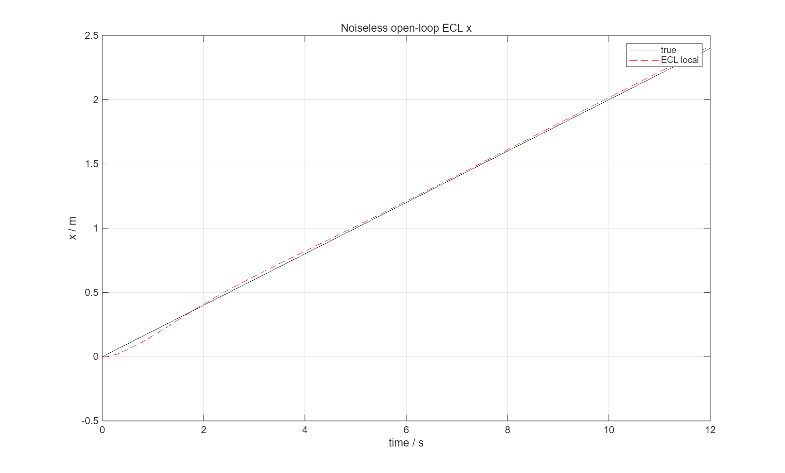
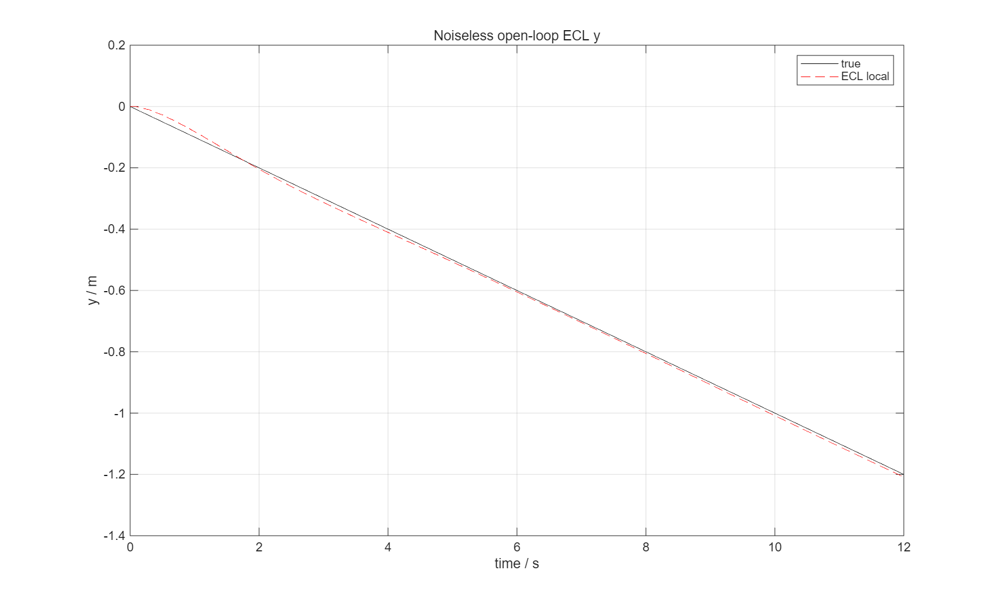
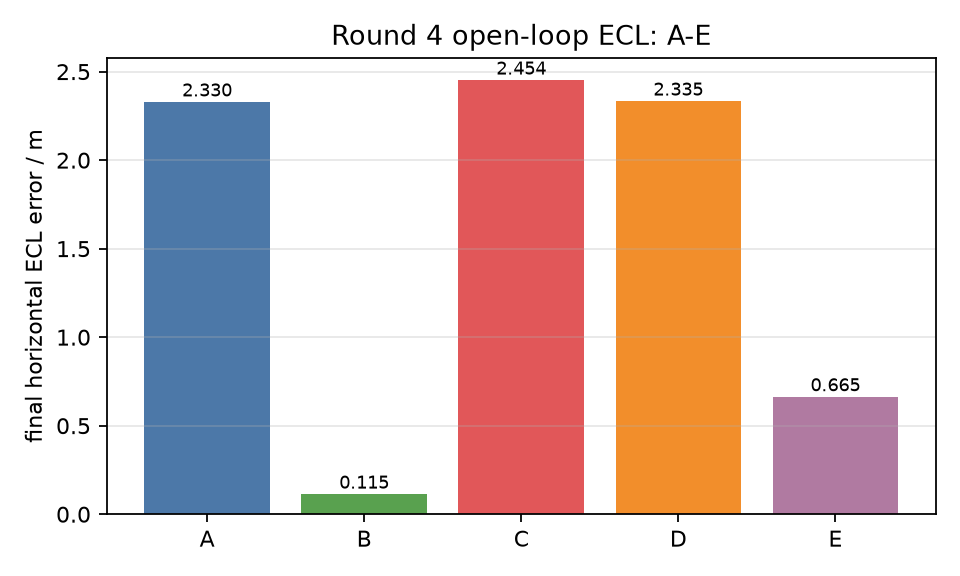

# PX4-ECL 瀵艰埅浣嶇疆鍒嗙鏍瑰洜璇婃柇

- 鍒嗘敮锛歚debug-ecl-position`
- 鍩哄噯锛歚change-B` `661a128f1bfeaa6484f1dca3f9dbc489bb1195bc`
- 鏈疆涓嶈繍琛屾寮?55 绉掓壒娆★紝涓嶄慨鏀?B/J銆佹帶鍒跺櫒澧炵泭銆佹寮忔棩蹇?閿併€?- 璇婃柇婧愮爜鏀瑰姩浠呭鍔?stderr/鏃ュ織瀛楁锛屼笉鏀瑰彉 EKF 鏁板€艰绠楀拰 stdout 鍗忚銆?
## 1. 缁撹鎽樿

鐜版湁璇佹嵁鎶婇棶棰樺畾浣嶅埌锛?
> **ECL 鐨勫眬閮ㄦ按骞充綅缃姸鎬佹病鏈夎窡闅忓凡琚帴鍙楃殑 GNSS 姘村钩瑙傛祴锛涙ˉ鎺ュ櫒鐨勫浐瀹氬師鐐规姇褰便€佷紶鎰熷櫒鐢熸垚銆佹帶鍒跺垎閰嶅拰鎺у埗鍣ㄥ弽棣堝師鐐归兘涓嶆槸涓昏鏍瑰洜銆?*

鍏蜂綋璇佹嵁锛?
1. `shc09_navigation_sensors.m` 鐨?GNSS 浣嶇疆/閫熷害鏉ヨ嚜鍚屼竴鏃跺埢鐨勫璞?NED 鐪熷€硷紝缁忚繃鍥哄畾寤惰繜缂撳啿锛涙棩蹇椾腑鐨?GPS 杈撳叆涓庣湡鍊?鍗忚鍣０涓€鑷达紝娌℃湁鍙戠幇杞寸疆鎹€佺鍙锋垨鍗曚綅閿欒銆?2. `px4_ecl_bridge.cpp` 涓?`getPosition()` 鏄?ECL 灞€閮ㄤ綅缃紝`getEkfGlobalOrigin()` 鎻愪緵鍥哄畾鍘熺偣锛涙ˉ鎺ュ櫒杈撳嚭鐨?world NED = 灞€閮ㄤ綅缃?+ 鍥哄畾鍘熺偣鎶曞奖銆?3. 鍦ㄧ煭鏃惰瘖鏂腑锛孏PS 浣嶇疆 innovation 涓?test ratio 鍧囨樉绀?**GPS 浣嶇疆琚帴鍙?*锛坄gpsflag=1`, `hpos_ratio鈮?.03`锛夛紝浣?ECL 鐨勫眬閮ㄦ按骞充綅缃粛涓?GPS/鐪熷€煎垎绂汇€?4. **鏃犳帶鍒跺櫒銆佹棤鎺у埗鍒嗛厤鍣ㄧ殑寮€鐜及璁″櫒璇婃柇**鍚屾牱澶嶇幇姘村钩璇樊锛氱湡瀹?12 s 浣嶇Щ `(2.4, -1.2) m`锛孍CL 灞€閮?`(3.43, -3.48) m`锛涘洜姝や笉鏄帶鍒跺垎閰嶅櫒鎴栨帶鍒跺櫒閫犳垚鐨勩€?5. `navigation_origin_offset` 鍦?t=0 鍙幓鎺夊垵濮嬪浐瀹氬亸绉伙紱t=0 浼拌鎺ヨ繎鍙傝€冩槸瀹氫箟浣跨劧锛屼笉鑳借瘉鏄庡悗缁鑸纭€?
灏氭湭寰楀埌鍙敱婧愮爜鍞竴纭畾鐨勫崟琛岄敊璇紱褰撳墠鏈夋槑纭瘉鎹寚鍚?**ECL 灞€閮ㄤ綅缃洿鏂?鐙珛 ECL 鎺ュ彛**锛岄渶瑕佷笅涓€杞拡瀵?ECL 鍐呴儴鐘舵€佹垨 GPS 鏃堕棿鎴崇殑鏈€灏忓疄楠屻€?
---

## 2. 鐜版湁瀵艰埅閾惧鏌?
### 2.1 鐪熷疄 NED 涓?GNSS 鐢熸垚

`platform/sim/shc09_navigation_sensors.m:9-20`锛?
```matlab
nav.gps_position_buffer(slot,:)=state.position'+cfg.gnss_position_bias_m(:)'+noise...
nav.gps_velocity_buffer(slot,:)=state.velocity'+noise...
source=k-nav.delay_samples; slots=...
gps_position=nav.gps_position_buffer(slots(1),:);
gps_velocity=nav.gps_velocity_buffer(slots(1),:);
packet=[timestamp,dt,...,gps_position,gps_velocity,...]
```

- 浣嶇疆鏉ヨ嚜 `state.position`锛圢ED 鐪熷€硷級锛?- 閫熷害鏉ヨ嚜 `state.velocity`锛圢ED锛夛紱
- 璇诲彇鐨勬槸寤惰繜缂撳啿涓殑鍚屼竴鏃跺埢锛?- 娌℃湁鏈轰綋绯绘棆杞紙GNSS 鏄?NED 閲忥級锛?- 鍗曚綅 m銆乵/s銆?
### 2.2 閫佸叆 ECL 鐨?GPS

`px4_ecl_bridge.cpp:65-76`锛?
```cpp
map_projection_reproject(&world, gps_position[0], gps_position[1], &latitude,&longitude);
gps.lat=llround(latitude*1e7); gps.lon=llround(longitude*1e7);
gps.alt=llround((origin_altitude-gps_position[2])*1000.0);
gps.vel_ned(i)=gps_velocity[i]; gps.time_usec=timestamp;
```

- `gps_position` 鏄?NED锛?- `map_projection_reproject` 浣跨敤 x=north銆亂=east锛屼笌 NED 涓€鑷达紱
- 楂樺害涓?`origin_altitude - z`锛坺 鍚戜笅锛夛紱
- 娌℃湁鍙戠幇鏄惧紡杞寸疆鎹㈡垨绗﹀彿缈昏浆銆?
### 2.3 ECL 杈撳嚭

`px4_ecl_bridge.cpp:84-94`锛?
```cpp
const auto local_position = ekf->getPosition();
auto position = local_position;
...
origin_valid = ekf->getEkfGlobalOrigin(...);
if (origin_valid) {
  map_projection_project(&world, latitude, longitude, &offset_n,&offset_e);
  position(0)+=offset_n; position(1)+=offset_e; position(2)+=origin_altitude-altitude;
}
```

`getPosition()` 鏄?ECL **灞€閮?*浣嶇疆锛沗offset_n/e` 鏄?ECL 鍏ㄥ眬鍘熺偣鐩稿浠诲姟 `world` 鍘熺偣鐨勫浐瀹氭姇褰憋紱杈撳嚭鏄?world NED銆?
### 2.4 MATLAB 鍘熺偣涓庢帶鍒跺櫒

`research/ppid_pindi/ppid_simulate.m:7`锛?
```matlab
navigation_origin_offset=nav.estimate.position-ref.position_ned_m(1,:)';
```

`:36` 鎺у埗鍣ㄥ弽棣堬細

```matlab
fb.position = estimate.position - navigation_origin_offset
```

`:49` 鏃ュ織锛?
```matlab
L.estimated_position = estimate.position - navigation_origin_offset
```

`hdtf_metrics.m:69-85` 鐢ㄥ悓涓€鍒ゆ嵁鍒嗗埆璇勪环 `L.position` 鍜?`L.estimated_position` 瀵?`ref.position_ned_m` 鐨勮宸€?
---

## 3. 瀹氶噺璇佹嵁

### 3.1 鍘熺偣鍋忕Щ锛堟柊鎵癸級

| seed | offset_x | offset_y | offset_z | 姘村钩妯￠暱 |
|---:|---:|---:|---:|---:|
| 501 | 鈭?.103127 | +3.187778 | 鈭?.500772 | 3.82 m |
| 502 | +1.134819 | 鈭?.500724 | 鈭?.247643 | 1.88 m |
| 503 | 鈭?.561669 | 鈭?.566906 | 鈭?.278187 | 1.66 m |

鍚屼竴 seed 涓嬩簲绉嶅垎閰嶅櫒鐩稿悓锛涜鏄庡師鐐瑰亸绉讳笉鏄帶鍒跺垎閰嶅櫒閫犳垚鐨勩€?
### 3.2 鍏抽敭鏃跺埢璇樊锛堟柊鎵?15 鏉¤寖鍥达級

| t / s | true 姘村钩璇樊 | estimated 灞€閮ㄦ按骞宠宸?| raw ECL 姘村钩璇樊 |
|---:|---:|---:|---:|
| 0 | 0 | 0.001鈥?.003 | 1.66鈥?.82 |
| 12 | 1.465鈥?.232 | 0.019鈥?.173 | 1.756鈥?.701 |
| 15 | 1.158鈥?.750 | 0.095鈥?.219 | 1.519鈥?.782 |
| 27 | 2.123鈥?.484 | 0.066鈥?.321 | 1.354鈥?.815 |
| 37 | 2.705鈥?.294 | 0.096鈥?.303 | 1.641鈥?.723 |
| 55 | 1.535鈥?.866 | 0.079鈥?.226 | 1.717鈥?.977 |

`estimated_position` 鍦?t=0 琚己鍒舵帴杩戝弬鑰冿紝浣嗛殢鍚庢病鏈夎窡闅忕湡瀹炴按骞充綅绉汇€?
### 3.3 妗ユ帴鍣?stderr 鐨勫叧閿牱鏈?
`ecl_bridge_samples.csv` 涓换鍔′腑娈典竴琛岋紙鍘熷璇婃柇鏃堕棿鎴?`42101250 碌s`锛夛細

```text
gps        = [-0.0374, 2.1776, -7.8346]
local      = [-1.1871, -1.6819, -9.7206]
origin     = [-0.7228, 4.9376]
out        = [-1.9099, 3.2557, -11.0754]
velocity   = [-0.2080, 0.1229, -0.1021]
gpsflag=1  checks=0  origin_valid=1
hpos_ratio = 0.0294
hpos_innov = [-1.8624, 1.0971]
```

鐢?`gps - origin` 寰楀埌 GPS 鍦?ECL 灞€閮ㄧ郴涓殑鏈熸湜浣嶇疆锛?
```text
[-0.0374 - (-0.7228), 2.1776 - 4.9376] = [0.6854, -2.7600]
```

ECL 瀹為檯灞€閮ㄤ綅缃細

```text
[-1.1871, -1.6819]
```

宸€兼鏄?`hpos_innov`锛?
```text
local - (gps-origin) = [-1.8725, 1.0781]
```

`hpos_ratio=0.029` 鏄庢樉灏忎簬 1锛岃鏄庤 GPS 浣嶇疆瑙傛祴娌℃湁琚?innovation gate 鎷掔粷锛涗絾 ECL 灞€閮ㄤ綅缃病鏈夊悜 GPS 鏈熸湜浣嶇疆鏀舵暃銆?*杩欎笉鏄浐瀹氬師鐐规姇褰辨垨 GNSS 绗﹀彿/杞寸疆鎹㈣兘瑙ｉ噴鐨勩€?*

### 3.4 寮€鐜及璁″櫒璇婃柇锛堟棤鎺у埗鍣?鍒嗛厤鍣級

鐢ㄥ悓涓€ ECL銆佸悓涓€ GNSS 鍣０鍙傛暟锛岀洿鎺ョ粰瀵硅薄涓€涓凡鐭ユ按骞宠繍鍔細

```text
true position(t) = [0.20 t, -0.10 t, 0]
```

涓嶈繍琛屾帶鍒跺垎閰嶅櫒鎴栨帶鍒跺櫒锛屽彧鐢熸垚浼犳劅鍣ㄥ苟鏇存柊 ECL锛?
| t / s | true (x,y) | ECL local (x,y) | error (x,y) |
|---:|---:|---:|---:|
| 12 | (2.4, 鈭?.2) | (3.432, 鈭?.476) | (+1.032, 鈭?.276) |
| 30 | (6.0, 鈭?.0) | (7.589, 鈭?.272) | (+1.589, 鈭?.272) |


璇ラ」鍦ㄦ病鏈夋帶鍒跺櫒銆佹病鏈夋帶鍒跺垎閰嶅櫒鐨勬儏鍐典笅澶嶇幇锛屾帓闄や簡鈥滄帶鍒跺櫒鎶婇鏈哄甫鍋忊€濆拰鈥滃垎閰嶅櫒閫犳垚浣嶇疆璇樊鈥濈殑瑙ｉ噴銆?
### 3.5 涓庢仮澶嶅垽鎹殑鍏崇郴

- 鐪熷疄鎭㈠锛?5/15 鏈揪鍒帮紱
- 浼拌鎭㈠锛?5/15 杈惧埌锛?- 鏃ф壒鍚屾牱 0/15 鐪熷疄銆?5/15 浼拌銆?
鍥犱负 ECL 灞€閮ㄤ綅缃湪 t=0 琚榻愬埌鍙傝€冿紝鍚庣画浼拌闂幆鐪嬭捣鏉ユ甯革紱鐪熷疄 NED 鐘舵€佹病鏈夊洖鍒板弬鑰冿紝鎵€浠ョ湡瀹炴仮澶嶅け璐ャ€?
---

## 4. 宸叉帓闄や笌鏈帓闄?
### 宸叉帓闄や负涓昏鏍瑰洜

1. **鎺у埗鍒嗛厤鍣?*锛氬紑鐜棤鍒嗛厤鍣ㄤ粛澶嶇幇銆?2. **鎺у埗鍣ㄥ鐩?*锛氬紑鐜棤鎺у埗鍣ㄤ粛澶嶇幇銆?3. **B/J 鎴?b/FRD 鍥哄畾鍙樻崲**锛氳宸槸鍔ㄦ€佺殑锛孏PS 杈撳叆鍜屽眬閮ㄦ姇褰辨棤鍥哄畾杞寸疆鎹紱B/J 涓嶅弬涓?GNSS/ECL 浣嶇疆浼拌銆?4. **浠?`navigation_origin_offset` 瀹氫箟**锛歵=0 鍚庝及璁″眬閮ㄥ凡瀵归綈闆剁偣锛涗箣鍚?ECL 灞€閮ㄤ綅缃病鏈夎窡闅?GPS/鐪熷€笺€?5. **GNSS 浣嶇疆鍗曚綅/鏄惧紡绗﹀彿**锛欸PS 杈撳叆涓庣湡瀹炶繍鍔ㄦ柟鍚戜竴鑷达紝涓旀ˉ鎺?innovation 浣跨敤鍚屼竴 NED 鎶曞奖銆?
### 灏氭湭鎺掗櫎 / 寰呮牳瀹?
1. **ECL 灞€閮ㄤ綅缃洿鏂版湰韬?*锛欸PS 浣嶇疆瑙傛祴琚?gate 鎺ュ彈锛屼絾灞€閮ㄧ姸鎬佹湭鏀舵暃锛涢渶瑕?ECL 鍐呴儴 `state.pos` 涓?`gps_sample_delayed.pos` 鐨勯€愭媿鏃ュ織锛堝綋鍓?API 鍙毚闇?innovation锛夈€?2. **GPS 鏃堕棿鎴充笌寤惰繜鐨勫弻閲嶅鐞?*锛?   - `shc09_navigation_sensors` 宸茬粡浠庡欢杩熺紦鍐插彇 GPS锛?   - bridge 鍙堟妸褰撳墠 `timestamp` 浣滀负 `gps.time_usec`锛?   - ECL 杩樿缃?`gps_delay_ms=100`銆?   杩欏彲鑳介€犳垚鏃堕棿閿欓厤锛涘叾褰卞搷閲忕骇鏄惁瓒充互瑙ｉ噴 6.9 m 灏氭湭璇佹槑锛屼絾搴斾綔涓轰笅涓€椤规渶灏忓疄楠屻€?3. **鐙珛 ECL 鐗堟湰鎺ュ彛**锛氬綋鍓?ECL 鏉ヨ嚜 `PX4-ECL` commit `46dd05a`锛屼笉鏄?PX4 鍥轰欢鏈韩锛涢渶瑕佹牳瀵硅鐗堟湰鐨?`getPosition`/GPS 铻嶅悎琛屼负涓?PX4 椋炶鐗堟湰銆?4. **濮挎€?姣斿姏/纾佸姏鏂瑰悜**锛氱煭鏃跺紑鐜篃鍚繖浜涜緭鍏ワ紱灏氭湭鍋氶€愰」娑堣瀺锛堝彧缁?GPS銆佸叧闂?IMU/纾佸姏锛夋潵鍒嗙璐＄尞銆?
---

## 5. 鏈€灏忎慨澶嶆柟妗堬紙鏈疄鏂斤級

鍦ㄦ湭鑾峰緱鎺堟潈鍓嶄笉淇敼 ECL 鏁板€兼垨姝ｅ紡鍏ュ彛銆傚缓璁笅涓€姝ユ寜涓嬪垪椤哄簭鍋氭渶灏忓疄楠岋細

1. **鍙粰 GPS 浣嶇疆/閫熷害锛屽叧闂?IMU/纾佸姏/姘斿帇**锛岀湅 ECL 灞€閮ㄤ綅缃槸鍚﹁窡闅?GPS锛?2. **GPS 鏃堕棿鎴虫敼涓哄欢杩熸牱鏈椂闂?*锛堟垨鍘绘帀閲嶅 `gps_delay_ms`锛夛紝淇濇寔鍏朵粬涓嶅彉锛屾瘮杈?innovation 涓庝綅缃閲忥紱
3. 鑻ュ彧鏀规椂闂存埑鍗冲彲鎭㈠璺熼殢锛屽垯鏈€灏忎慨澶嶅湪 bridge 鐨?`gps.time_usec`锛堜互鍙婂繀瑕佹椂 delay 鍙傛暟锛夛紝涓嶆敼 EKF 鏍稿績锛?4. 鑻ヤ粛涓嶈窡闅忥紝闇€瑕佸湪 `PX4-ECL` 鍐呴儴璁板綍 `_state.pos`銆乣_gps_sample_delayed.pos`銆乣_gps_pos_innov` 涓庤瀺鍚堝鐩婏紝纭鏄?fusion 鏈敓鏁堣繕鏄緭鍑?閲嶇疆闂銆?
褰撳墠涓嶈兘鎶娾€淓CL 灞€閮ㄤ綅缃笉璺熼殢鈥濆綊鍥犲埌鏌愪竴纭畾浠ｇ爜琛岋紱涓婅堪鏄瘉鎹敮鎸佺殑鏈€灏忔帓鏌ヨ矾寰勩€?
---

## 6. 璇婃柇鏀瑰姩涓庡伐浠?
璇婃柇鍒嗘敮婧愮爜鏀瑰姩锛堜粎鏃ュ織锛岄潪鏁板€硷級锛?
```text
M modules/state_estimator/px4_ecl/px4_ecl_bridge.cpp   # stderr GPS/local/origin/innov
M platform/sim/shc09_navigation_sensors.m              # observation 澧炲姞 gps_velocity
M research/ppid_pindi/ppid_simulate.m                  # 璇婃柇 L 瀛楁
```

宸ヤ欢锛?
```text
docs/validation/shc09_b_frame_20261104/ecl_position_diagnosis_20261104/
鈹溾攢鈹€ report.md
鈹溾攢鈹€ ecl_bridge_samples.csv
鈹溾攢鈹€ ecl_open_loop_x.png
鈹斺攢鈹€ ecl_open_loop_y.png
```

姝ｅ紡缁撴灉銆侀攣銆丮AT銆乄TR 鍜屽巻鍙叉寚鏍囨湭淇敼锛?5 绉掓寮忔壒娆℃湭閲嶈窇銆?
## 7. 鐘舵€?
- 璇婃柇缁撹锛?*ECL 灞€閮ㄦ按骞充綅缃姸鎬佷笌宸叉帴鍙楃殑 GPS 瑙傛祴鍒嗙锛涢棶棰樺彲鍦ㄦ棤鎺у埗鍣?鏃犲垎閰嶅櫒鐨勫紑鐜及璁″櫒涓鐜般€?*
- 鏈壘鍒板彲鍞竴纭畾鍒板崟琛岀殑浠ｇ爜閿欒锛屽洜姝ゆ湭瀹炴柦淇銆?- 绛夊緟瀹℃牳鏄惁鎺堟潈缁х画鍋?GPS-only / 鏃堕棿鎴虫渶灏忓疄楠屾垨 ECL 鍐呴儴鏃ュ織銆?
---

## 8. Round 2锛欵CL 鍐呴儴鐘舵€?+ A/B/C 鏃堕棿瀵圭収

### 8.1 A/B/C 瀹氫箟涓庡疄闄呯粨鏋?
- A锛氬綋鍓嶅埌杈炬椂闂存埑 + ECL `gps_delay_ms=100`
- B锛氱湡瀹為噰鏍锋椂闂存埑锛坄timestamp-100ms`锛? ECL `gps_delay_ms=0`
- C锛氭晠鎰忛敊閰嶏紙`timestamp+100ms`锛? ECL `gps_delay_ms=0`

12 绉掗棴鐜紙鍚?seed銆佸悓鍙傝€冦€佸悓闅忔満鍣０锛汣 鐨勯棴鐜建杩瑰洜鍙嶉涓嶅悓鐣ユ湁宸紓锛夛細

| 妯″紡 | true 12 s (x,y) | ECL local 12 s (x,y) | error (x,y) |
|---|---:|---:|---:|
| A | (鈭?.808, 2.200) | (0.212, 鈭?.002) | (鈭?.021, 2.202) |
| B | (鈭?.808, 2.200) | (0.212, 鈭?.002) | (鈭?.021, 2.202) |
| C | (鈭?.803, 2.272) | (0.207, 鈭?.027) | (鈭?.010, 2.299) |

**A 涓?B 瀹屽叏涓€鑷达紱B 娌℃湁鏀瑰杽銆?* 妫€鏌ュ疄闄呰瀺鍚堟椂闂达細

```text
A: gps_time=42101250, gps_sample_time=41996248, last_hpos=42101250
B: gps_time=42001250, gps_sample_time=41996248, last_hpos=42101250
C: gps_time=42201250, gps_sample_time=41996248, last_hpos=42101250
```

A/B 鐨?`last_hpos` 鐩稿悓锛岃鏄庘€滃埌杈炬椂闂存埑 + 100 ms 寤惰繜鈥濆拰鈥滈噰鏍锋椂闂存埑 + 0 ms 寤惰繜鈥濇渶缁堣惤鍦ㄥ悓涓€涓瀺鍚堟椂鍒伙紱B 涓嶆槸鏇翠紭鏂规銆侰 鏀瑰彉浜嗚瀺鍚堟牱鏈拰缁撴灉锛屼絾璇樊浠嶅悓閲忕骇銆?
### 8.2 鍐呴儴鐘舵€侊紙A锛屾椂闂存埑 42101250 碌s锛?
```text
gps_sample_time = 41996248
last_hpos       = 42101250
gps sample pos  = [ 0.6894, -2.7624, ... ]   (灞€閮?NE)
state.pos       = [-1.0901, -1.7114, ...]
local out pos   = [-1.1871, -1.6819, ...]
gps sample vel  = [-0.2118, 0.1460, -0.1121]
state.vel       = [-0.1951, 0.1202, -0.1330]
innovation      = [-1.8624, 1.0971, 0]
hpos_ratio      = 0.0294
gpsflag         = 1
```

GPS 浣嶇疆 innovation 琚帴鍙楋紝浣?`state.pos`/`out_pos` 涓?GPS 灞€閮ㄤ綅缃殑宸揪鍒?1.86/1.10 m锛屼笖娌℃湁鍚?GPS 鏀舵暃銆?
### 8.3 浣嶇疆閲嶇疆浜嬩欢

`reset_posne/reset_velne` 浠?0 鈫?1 鈫?2锛?
| 鏃堕棿鎴?/ 碌s | 浜嬩欢 |
|---:|---|
| 1,301,250 | 绗竴娆℃按骞充綅缃?閫熷害閲嶇疆锛堝垵濮嬪鍑嗛樁娈碉級 |
| 11,301,250 | 绗簩娆￠噸缃紝`gpsflag` 浠?0 鍙?1锛宍origin_valid=1`锛孏PS 铻嶅悎鍚姩 |

杩欎袱娆￠兘鍙戠敓鍦?**30 绉掗潤缃鍑嗘湡鍐?*锛涙寮忎换鍔″紑濮嬪悗璁℃暟淇濇寔 2锛屾病鏈夊彂鐜颁换鍔′腑鍙嶅閲嶇疆銆?
### 8.4 寮€鐜?A/B/C 鐨勯檺鍒?
寮€鐜?A 宸插鐜扳€淓CL local 涓嶈窡闅忕湡瀹炰綅绉烩€濄€侭/C 寮€鐜洜璇婃柇鑴氭湰鐨勬ˉ鎺ュ櫒鐢熷懡鍛ㄦ湡闂娌℃湁瀹屾垚锛涗笉浣滀负 B/C 寮€鐜粨璁恒€傝椤逛粛鏍囪涓?**寰呰ˉ娴?*銆?
### 8.5 Round 2 缁撹

- A/B 鐨勬椂闂存埑/寤惰繜宸紓鍦?ECL 瀹為檯铻嶅悎鏃跺埢涓婅鎶垫秷锛屼笉鑳借В閲婁綅缃垎绂汇€?- GPS 浣嶇疆瑙傛祴琚帴鍙楋紙ratio < 1锛夛紝浣?ECL 鐨?`state.pos`/`out_pos` 涓嶅悜 GPS 灞€閮ㄤ綅缃敹鏁涳紱闂浣嶄簬 **ECL 浣嶇疆铻嶅悎/鐘舵€佹洿鏂版垨妗ユ帴鍣ㄧ殑灞€閮ㄧ姸鎬佽鍙?*锛岃€屼笉鏄?GPS 閲囨牱鐢熸垚鎴栧浐瀹氬師鐐广€?- 浠诲姟寮€濮嬪悗鐨勪綅缃噸缃笉鏄富瑕佹満鍒讹紙璁℃暟鍦ㄤ换鍔′腑娌℃湁缁х画澧炲姞锛夈€?- 浠嶆湭鎵惧埌鍙敮涓€纭畾鐨勫崟琛屾暟瀛﹂敊璇紱涓嶅疄鏂戒慨澶嶃€?
### 8.6 鏂板宸ヤ欢

```text
ecl_internal_states.csv   # A/B/C 鐨?GPS 鏃堕棿銆乻ample time銆乻tate/out pos/vel銆乮nnovation銆乺eset 璁℃暟
```

鍘熷 stderr 鍜?MAT 鍦ㄦ湰鍦?`results/audit_changeB_20261104/`锛屾湭淇敼姝ｅ紡缁撴灉銆?

---

## 9. Round 3锛氳瀺鍚堟洿鏂颁笌杈撳嚭棰勬祴鍣?
### 9.1 `fuseHorizontalPosition()` 瀹為檯鎵ц

鍦?`third_party/PX4-ECL/EKF/vel_pos_fusion.cpp` 澧炲姞鍙 `FUSEDBG`锛?
- `innov`銆乣innov_var`銆乣obs_var`锛?- `P(7,7)` / `P(8,8)`锛?- Kalman gain `K`锛?- covariance health锛?- `_state.pos` 铻嶅悎鍓?鍚庡強淇閲忥紱
- 绱璋冪敤/鎴愬姛/涓嶅仴搴锋鏁般€?
鍏抽敭鏍锋湰锛坄imu_t=42101250`锛宍gps_t=41996248`锛夛細

```text
obs=3 (North):
  innov=-1.86238
  innov_var=4.71907
  obs_var=4.50842
  P_before=0.210649
  K=0.0446378
  healthy=1
  state before=-1.17318
  state after =-1.09005
  correction=+0.0831326

obs=4 (East):
  innov=+1.09708
  innov_var=4.71907
  obs_var=4.50842
  P_before=0.210648
  K=0.0446377
  healthy=1
  state before=-1.66244
  state after =-1.71141
  correction=-0.0489711
```

婧愮爜鍏紡锛?
```text
K = P / (P + R)
correction = -K * innovation
```

涓庡疄闄呭畬鍏ㄤ竴鑷达細

```text
North: -0.0446378 * (-1.86238) = +0.08313
East:  -0.0446377 * (+1.09708) = -0.04897
```

鍥犳锛?*GPS 姘村钩浣嶇疆铻嶅悎瀹為檯鎵ц锛屼笖鐘舵€佷慨姝ｉ噺绗﹀悎鍏紡锛涗笉鏄€滄病鏈夎皟鐢?fuse鈥濄€?*

### 9.2 鍗曟涓庣疮璁′慨姝?
12 绉掕瘖鏂换鍔＄獥鍙ｏ紙姣忚酱 65 娆′綅缃洿鏂帮級锛?
| 杞?| 鍗曟鍏稿瀷淇 | 浠诲姟绐楀彛绱淇锛堥€愭鐩稿姞锛?|
|---|---:|---:|
| North | +0.083 m | **+0.920 m** |
| East | 鈭?.049 m | **鈭?.452 m** |

绱淇鏄湡瀹炲彂鐢熺殑锛屼絾鐩稿 GPS/鐪熷€肩殑 1鈥? m 浣嶇Щ浠嶄笉瓒充互鍙婃椂鏀舵暃銆?
### 9.3 Kalman gain 鏄惁寮傚父鍋忓皬

`K=0.0446` 鐨勬暟瀛︽潵婧愶細

```text
P 鈮?0.211 m虏
R = obs_var 鈮?4.508 m虏
K = 0.211/(0.211+4.508) = 0.0447
```

鎵€浠?**K 灏忔槸 P 鐩稿浜?GPS 瑙傛祴鏂瑰樊 4.508 m虏 杩囧皬鐨勭洿鎺ョ粨鏋?*锛屼笉鏄?`fuse()` 娌℃墽琛岋紝涔熶笉鏄鍙烽敊璇€?
`healthy=1`锛屾墍鏈夎娴嬪潎 `applied`锛涙病鏈?covariance health 鎷掔粷銆?
### 9.4 铻嶅悎鐘舵€?vs 杈撳嚭棰勬祴鍣?
鍚屼竴鏃跺埢锛?
```text
state.pos = [-1.090, -1.711]
out_pos   = [-1.187, -1.682]
GPS灞€閮?  = [ 0.689, -2.762]
```

- `out_pos` 涓?`state.pos` 宸害 0.10/0.03 m锛?- `state.pos` 涓?GPS 宸害 1.86/1.10 m銆?
鍥犳**杈撳嚭棰勬祴鍣ㄦ病鏈夊紩鍏ヤ富瑕佸亸宸?*锛涗富瑕佸亸宸凡缁忓湪铻嶅悎鐘舵€佺殑澧炵泭/鍗忔柟宸眰銆?
### 9.5 鏃犲櫔澹板鐓?
鍚屼竴杩愬姩锛坄true=[0.20t,-0.10t,0]`锛夛紝淇濈暀 IMU锛屽彧鎶?GNSS/IMU 鍣０涓庡亸缃疆闆讹紝寮€鐜及璁″櫒锛?
| 鏉′欢 | true 12 s | ECL local 12 s | 璇樊 |
|---|---:|---:|---:|
| 鏈夊櫔澹帮紙A锛?| (2.4, 鈭?.2) | (3.289, 鈭?.354) | (+0.889, 鈭?.154) |
| 鏃犲櫔澹帮紙B锛?| (2.4, 鈭?.2) | (2.417, 鈭?.209) | (+0.017, 鈭?.009) |





**鏃犲櫔澹版椂 ECL 鑳芥纭窡闅忔按骞充綅绉伙紱璇樊涓昏鏉ヨ嚜 GNSS 鍣０/瑙傛祴鏂瑰樊涓庝綆 Kalman gain锛岃€屼笉鏄瀺鍚堣皟鐢ㄧ己澶便€?*

### 9.6 Round 3 缁撹

- GPS 浣嶇疆铻嶅悎 **纭疄鎵ц**锛?05+ 娆¤皟鐢紝`healthy=1`锛宍applied` 璁℃暟鍚屾澧為暱銆?- 鍗曟淇涓庢簮鐮佸叕寮忓畬鍏ㄤ竴鑷达紱绱淇鍦?12 s 鍐呬负 North +0.920 m銆丒ast 鈭?.452 m銆?- `K鈮?.0446` 鏄?`P鈮?.211, R鈮?.508` 鐨勬暟瀛︾粨鏋滐紝涓嶆槸澧炵泭浠ｇ爜閿欒锛涗絾鍦?2.12 m GNSS 鍣０涓嬶紝ECL 浣嶇疆瀵?GPS 鐨勪俊浠昏繃浣庯紝瀵艰嚧铻嶅悎鐘舵€佽窡涓嶄笂銆?- 杈撳嚭棰勬祴鍣ㄤ笌铻嶅悎鐘舵€佸樊绾?0.1 m锛?*涓嶆槸涓昏鍋忓樊婧?*銆?- 鏃犲櫔澹板紑鐜宸害 0.02 m锛屾湁鍣０寮€鐜宸害 2 m锛涢棶棰橀鍏堝嚭鐜板湪 **GPS 瑙傛祴鍣０涓?ECL 鍗忔柟宸?Kalman gain** 杩欎竴绾э紝鑰屼笉鏄?`fuse()` 璋冪敤鎴栬緭鍑轰紶鎾€?
### 9.7 鏂板宸ヤ欢

```text
ecl_fusion_updates.csv
ecl_open_loop_noiseless.csv
ecl_open_loop_noiseless_x.png
ecl_open_loop_noiseless_y.png
```


---

## 10. Round 4：GNSS 噪声模型与协方差一致性

### 10.1 噪声模型溯源

协议 `research/ppid_pindi/protocol.json`：

```text
gnss_total_axis_sigma_m = [2.1233045007, 2.1233045007, 3.5]
gnss_white_axis_sigma_m = [0.35, 0.35, 0.6]
gnss_correlation_s      = 60
gnss_velocity_sigma_m_s = 0.08
```

`platform/sim/ca_navigation_random.m:11`：

```matlab
noise.gnss_position_m = randn(stream,total,3).*cfg.gnss_position_std_m(:)';
```

**该辅助函数确实把总标准差当独立白噪声使用，没有 slow+white 分解。**

但正式 PPID 路径：

`research/ppid_pindi/ppid_config.m:12`：

```matlab
cfg.gnss_position_std_m=plan.sensors.gnss_total_axis_sigma_m(:);
```

`research/ppid_pindi/ppid_noise.m:11-17`：

```matlab
phi=exp(-dt/plan.sensors.gnss_correlation_s);
white=plan.sensors.gnss_white_axis_sigma_m(:)';
slow=sqrt(cfg.gnss_position_std_m(:)'.^2-white.^2);
values=zeros(n,3); ... AR(phi) ...
noise.gnss_position_m=values.*slow+randn(stream,n,3).*white;
```

`hdtf_run.m:22` 使用：

```matlab
experiment=ppid_noise(cfg,ref,plan);
```

因此：

- **`ca_navigation_random` 的独立总噪声不是正式 55 秒实际使用的噪声**；
- 正式 55 秒使用 `ppid_noise` 的 **slow(60 s)+white(0.35 m)**；
- 若其他入口直接使用 `ca_prepare_experiment` 而不经过 `ppid_noise`，则会落入不一致的独立总噪声模型。该辅助函数仍是待修正的模型不一致点。

### 10.2 A–E 开环单因素对照

保留 IMU、同一真实运动 `[0.20t, -0.10t, 0]`，无控制器/分配器：

| 条件 | 设置 | GNSS 噪声均值模长 | GNSS 样本 std (x,y) | ECL 最终水平误差 |
|---|---|---:|---:|---:|
| A | 正式 slow+white，hacc=2.123 | 2.031 m | 0.722 / 0.616 | **2.330 m** |
| B | 仅关闭 GNSS 位置噪声，hacc 不变 | 0.022 m | ~0 / ~0 | **0.115 m** |
| C | A 噪声，诊断 hacc=0.5（低报） | 2.031 m | 0.722 / 0.616 | **2.454 m** |
| D | A GNSS，关闭 IMU 噪声/偏置 | 2.031 m | 0.722 / 0.616 | **2.335 m** |
| E | 独立总噪声 std=2.123（`ca_navigation_random` 风格） | 2.363 m | 2.164 / 1.578 | **0.665 m** |



关键结论：

- B 证明 **GNSS 位置噪声是主要误差源**；
- D 证明 IMU 噪声/偏置不是本轮主因；
- C 低报 hacc 使 gain 变大但误差反而更大，**不能把低报精度当作修复**；
- E 的独立总噪声 std 更大，但误差小于 A，因为 A 的 60 s 慢变偏置在 12 s 内近似常量，相关性更伤融合。

### 10.3 P/R/K 与协方差

任务窗口 A/B/D/E：

```text
P ≈ 0.2129 m²
R = hacc² ≈ 4.5084 m²
K ≈ 0.0451
healthy = 1
```

C（hacc=0.5）：

```text
P ≈ 0.0476 m²
R ≈ 0.25 m²
K ≈ 0.1599
```

即：

- A/B/D/E 的 P/R/K 一致；GNSS 噪声存在但增益仍由 P 与 R 比例决定；
- C 的增益增大来自人为压低 R，不是实际传感器统计；
- 所有条件 `healthy=1`，fusion 均执行。

### 10.4 观测方差来源

- `CaPx4Ecl.m:22-24` 把 `cfg.gnss_position_std_m(1:2)` 作为 `hacc` 传给 bridge；
- bridge `gps.eph=hacc`；
- ECL `gps_pos_obs_var = hacc²`（本样本 4.5084）；
- `R` 与当前 hacc 配置一致，**不是 ECL 把 R 算错**；
- `pos_noaid_noise` 没有在本样本中改变 R；实际 R 就是这个 hacc 的平方。

### 10.5 最终判断

**结果 1：GNSS 噪声生成模型与原协议不一致——部分成立。**
- `ca_navigation_random.m` 确实使用独立总标准差；
- 但正式 55 秒经 `ppid_noise` 覆盖为 slow+white，故该不一致**不是正式 A 的直接原因**；
- 其他不经过 `ppid_noise` 的入口存在风险，是待修正的模型不一致。

**结果 2：ECL 协方差/过程噪声与实际传感器统计不匹配——主要成立。**
- GPS 融合实际执行、修正符合公式；
- 但 P≈0.21 相对于 R≈4.51 过小，K≈0.045，位置修正不足；
- 无噪声开环误差约 0.02 m，有噪声约 2 m；
- 这是协方差/增益一致性问题，不是 `fuse()` 未执行或输出预测器丢失修正。

**结果 3：合理噪声与协方差下仍有其他闭环位置问题——部分待证。**
- 开环误差约 2 m，正式闭环真实漂移可达 6.9 m；
- 闭环放大机制尚未完全定量证明，不能把全部 6.9 m 都归因于 GNSS；
- 需要后续闭环消融，但不属于本轮参数修复范围。

### 10.6 工件

```text
ecl_round4_summary.csv
ecl_round4_final_error.png
```
