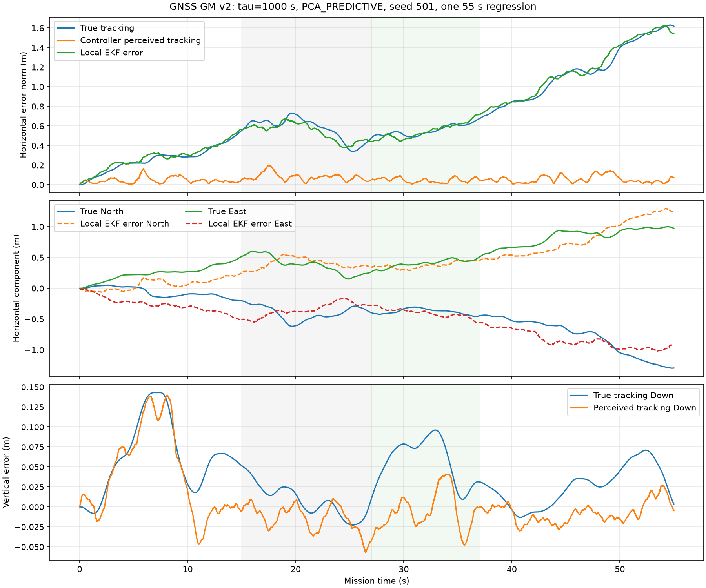

# GNSS-GM-v2：1000秒相关时间模型修正与55秒ECL回归

日期：2026-11-04；分支：`debug-ecl-position`；启动基准：`b1cf139b40992f9b7420a21b996b6d00d09a4013`。

## 1. 交付与收尾结论

**GNSS版本化模型修正、传感器文档、来源时刻核验及唯一一条55秒数值回归均已完成。真实位置恢复未通过既有标准，因此不将分支标记为“诊断完成，待整合”。** 当前状态为“模型修正完成，真实恢复验收未通过，等待审核”。没有为收尾调整阈值或追加参数实验。

本次代码改动的唯一数值参数为三轴共同的 `gnss_correlation_s: 60 → 1000`。原总误差、白噪声、GNSS速度噪声、5 Hz更新、100 ms延迟和随机流保持不变；ECL算法、控制器、分配器、气动和执行器没有修改。原正式协议、锁、Round 1–7及历史55秒结果保持原字节。

## 2. 配置加载链与历史保护

原 `research/ppid_pindi/protocol.json`、`ppid_config.m`、`ppid_noise.m` 均在旧正式来源锁中。原正式入口还检查完整来源manifest，直接修改它们会破坏历史来源。因此采用新的显式入口和嵌套协议：

```text
shc09_gnss_config(seed,"f8"或"takeoff55")
  → research/ppid_pindi/gnss_v2/ppid_gnss_v2_config.m
  → 原ppid_config或hdtf_config（读取冻结父协议）
  → 校验父协议SHA及全部幅值/更新率/速度/延迟
  → 叠加gnss_v2/protocol.json的1000秒相关时间
  → 原ppid_noise(cfg,ref,plan)
  → 原ppid_simulate + 原ECL桥接
```

旧入口仍明确服务历史60秒协议；后续新仿真须选择 `shc09_gnss_config`，不静默改变旧入口含义，不向旧正式批追加结果，不更新旧锁。新MAT中的 `plan.gnss_model` 记录版本ID、路径、物理相关时间及父协议SHA。

新实现位于子目录，旧 `ppid_source_manifest` 顶层文件集合不被新函数扩充；本次新来源另外写入 [source_lock.json](source_lock.json)，覆盖当前公共数值源、ECL可执行文件、新入口、新协议、配置函数及执行脚本。父协议SHA与Git中原字节一致，加载时不一致则拒绝运行。

## 3. 最终GNSS参数

| 参数 | N轴 | E轴 | D轴 |
|---|---:|---:|---:|
| 总位置误差σ/m | 2.1233045007 | 2.1233045007 | 3.5 |
| 白噪声σ/m | 0.35 | 0.35 | 0.6 |
| 慢变误差σ/m | 2.0942592969 | 2.0942592969 | 3.4481879299 |
| 慢变相关时间/s | 1000 | 1000 | 1000 |
| 速度噪声σ/(m/s) | 0.08 | 0.08 | 0.08 |

更新率5 Hz；现有GNSS延迟100 ms。慢变标准差由 `sqrt(total_sigma²−white_sigma²)` 计算，未将四舍五入的2.094/3.448硬编码为新幅值。

模型为 `b_next=phi*b+sigma_slow*sqrt(1−phi²)*w`，`phi=exp(−dt/1000)`，`w~N(0,1)`。原实现按800 Hz预生成，dt=0.00125 s，phi=0.9999987500007812；5 Hz观测间相关系数为phi^160≈0.999800019998659。1000物理秒对应800000个生成步后衰减到exp(−1)。原平稳初始化与全部随机数生成顺序保持不变。

[noise_checks.json](noise_checks.json)验证三轴方差恒等式和时间尺度；独立分量重构与原生成器逐字段相同。与历史已保存数组检查，白噪声及所有非GNSS位置噪声序列逐位一致。此处是随机流回归检查，没有运行另一套GNSS参数的飞行对照。短于相关时间的55秒样本方差不用于反推总体σ。

参数文档已更新至 [测量、估计和任务坐标](../../../history/ENGINEERING_HISTORY.md)，包括公式、方差分解、N/E/D参数和新加载入口。

## 4. 公开参考与工程边界

- [MathWorks gpsSensor](https://www.mathworks.com/help/uav/ref/gpssensor-system-object.html)提供一阶Gauss–Markov位置噪声建模依据；其默认DecayFactor=0.999是无量纲量，不是直接给出的1000秒相关时间。本研究显式指定tau=1000秒，按生成步长计算指数衰减。不能把文档示例的1000秒仿真时长当作相关时间。
- [Beard/McLain教材配套作者仓库](https://github.com/byu-magicc/mavsim_public/blob/main/mavsim_python/parameters/sensor_parameters.py)提供公开无人机GPS长相关建模参考，其中gps_k=1/1100 s⁻¹、GPS步长0.2秒；本项目取1000秒，不借用该代码的误差幅值。
- [CUAV NEO V2原资料](https://doc.cuav.net/gps/neo-series-gnss/en/neo-v2.html)与[现行页面](https://doc.cuav.net/en/gnss/neo-series/neo-v2.html)给出2.5 m水平精度。本项目沿用其CEP解释，在二维各向同性高斯假设下换算每轴σ=2.5/sqrt(2ln2)。现行页面未明确CEP定义，统计解释作为工程输入假设保留。
- 垂直3.5 m为保守工程假设；白噪声[0.35,0.35,0.6] m和速度0.08 m/s沿用原协议；ULog可核对频率和测量质量，不构成慢变σ或tau的辨识证据。

本组参数用于**控制与控制分配仿真的代表性工程工况**，不代表NEO V2某台接收机的精确标定或实机误差复现。本次不将软件模型选择写成ECL算法缺陷修复，也不宣称真实导航精度已获实机证明。

## 5. 单条55秒回归

seed501，PCA_PREDICTIVE，30秒静置对准＋完整55秒任务，正式takeoff55参考、控制器、15/15 Hz INDI滤波和执行机构保持原样。仅运行一次，不扫描、不比较其他参数或分配器。

- 44001状态点、18316实际PWM事件、275条fresh GNSS观测。
- 550次任务期水平位置融合调用（N/E各275次）全部healthy；GPS active、位置和原点有效标志全程有效。
- 原 `hdtf_metrics` 数值及预检通过：控制公式最大差0，控制器离线重放最大差3.55e−15，原1e−7 rad边界容差未改，命令最大超限仅1.11e−15 rad；无气动域越界或新增非有限状态。
- 原真实恢复标准：27–37秒窗口，水平位置≤0.2 m、速度≤0.2 m/s、滚转≤2°，连续0.5秒。**真实恢复未通过**；该窗真实水平位置误差最小值为 0.477044 m，连位置半径条件也未满足。估计恢复确认时间为卸载后0.97625秒，两者分别报告。

### 位置误差

水平RMSE按sqrt(mean(N²+E²))计算，全程窗口包含起飞和保持；主窗为[15,27)。

| 窗口 | 误差定义 | 水平RMSE/m | 水平峰值/m | 窗末水平误差/m |
|---|---|---:|---:|---:|
|whole_0_55|true_tracking|0.781936|1.629143|1.616451|
|whole_0_55|local_ekf_error|0.788159|1.620862|1.544611|
|whole_0_55|raw_ekf_error|3.752332|4.374595|3.083430|
|whole_0_55|perceived_tracking|0.066379|0.196133|0.072472|
|main_15_27|true_tracking|0.581174|0.731823|0.476907|
|main_15_27|local_ekf_error|0.546395|0.674106|0.440602|
|main_15_27|raw_ekf_error|3.880563|4.064162|3.966368|
|main_15_27|perceived_tracking|0.088046|0.196133|0.051195|

`true_tracking = truth−reference`；`local_ekf_error = controller_local_estimate−truth`；`raw_ekf_error = raw_world_ECL−truth`；`perceived_tracking = controller_local_estimate−reference`。其中controller_local_estimate减去飞前绑定的固定navigation_origin_offset；原始世界坐标误差另列，不能混用。

全程真实位置3D RMSE为0.783756 m、峰值1.629204 m；水平末端误差1.616451 m。局部EKF水平误差约0.788159 m，而控制器感知水平RMSE只有0.066379 m。**感知跟踪良好仍不能判为真实位置跟踪通过。**



完整窗口、恢复和尾段指标见 [navigation_metrics.csv](navigation_metrics.csv)；原场景指标保持原计算函数，输出于新的 [original_scene_metrics.csv](original_scene_metrics.csv)。无旧指标被覆盖。

## 6. GNSS来源时间和融合核验

生产 `shc09_navigation_sensors.m`、缓冲区、桥接时间戳和ECL接收路径均未改。按Round7验证过的索引规则：source=k−80，fresh以来源索引的160拍节拍判定。接收0.1秒的数据来源0秒，最后接收54.9秒的数据来源54.8秒。

[gnss_source_alignment.csv](gnss_source_alignment.csv)对275条实际观测逐条使用来源真值及来源slow/white，验证 `observed−truth_at_source−configured_bias−slow_at_source−white_at_source`，最大逐分量残差 **9.44e−16 m**。没有引入新的来源/接收时间错位。

[mission_horizontal_fusion.csv](mission_horizontal_fusion.csv)来自已有ECL只读FUSEDBG记录，不是仅凭gps_active推断融合。原ECL二进制SHA与运行前一致，未重编译或修改数值算法；既有诊断日志机制保留。

## 7. 历史完整性与实际文件修改

运行前对1031个既有数值源、锁、Round1–7及历史正式产物建立 [protected_before.json](protected_before.json)，共1029133119字节；运行后全部SHA/大小相同。没有修改原protocol.json、ppid_config.m、ppid_noise.m、formal_lock.json、ECL源码/EXE、控制器、分配器、气动、执行器或历史MAT/WTR/指标。原锁原有的历史版本关系不被本次重写或追认。

新增配置文件：

- `shc09_gnss_config.m`：后续配置显式入口。
- `research/ppid_pindi/gnss_v2/ppid_gnss_v2_config.m`：复用旧加载链并执行幅值与来源检查。
- `research/ppid_pindi/gnss_v2/protocol.json`：1000秒版本、固定幅值及公开参考。

更新文档：传感器README、导航诊断摘要、HANDOFF、AGENTS及项目README/文档索引。其余新增文件均为本验证目录中的独立脚本、CSV、曲线、来源记录和报告。

运行入口 [scripts/gnss1000_run.m](scripts/gnss1000_run.m) 拒绝覆盖已有MAT；分析入口 [scripts/gnss1000_analyze.py](scripts/gnss1000_analyze.py) 只读MAT。结果与完整ECL stderr位于本机 `results/gnss_1000s_regression_20261104_r1/`，不进入旧批。SHA见 [local_results_manifest.json](local_results_manifest.json)。

## 8. 分支状态与停止边界

Round1–7已确认：GNSS融合实际执行；来源时刻统计曾有错配但现在已独立校正；局部原点只吸收绑定时的偏移，初始化后状态收敛与任务期slow变化仍可进入控制反馈。G组表明完整初始化与任务期均为恒定偏置时，与零slow基线接近，不能把F残余独立归结为固定偏置。

本次将代表性GNSS工程模型正式版本化为1000秒，但完整55秒仍出现估计跟踪良好、真实恢复不达标。因此**不满足本轮预先记录的完整收尾条件**，保留真实恢复失败状态；不标记“诊断完成，待整合”。不自动合并main或change-B，不追加任何GNSS优化、参数对照或正式批量飞行；完成本轮文件与Git检查后停止等待审核。
