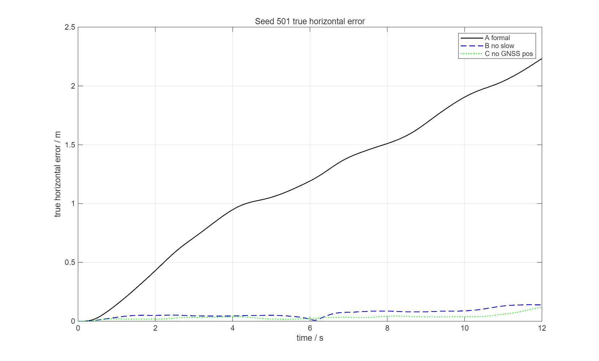
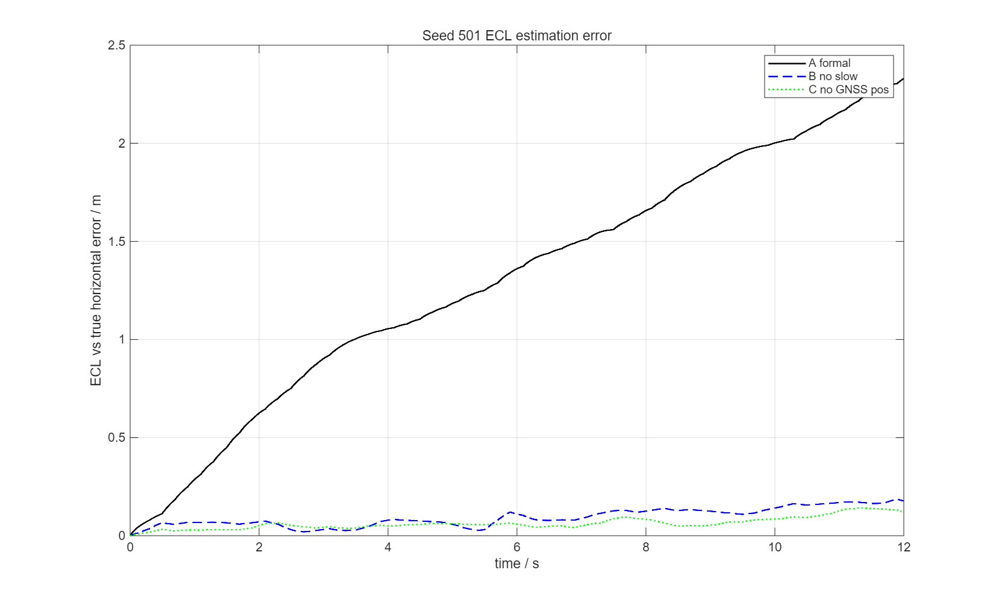
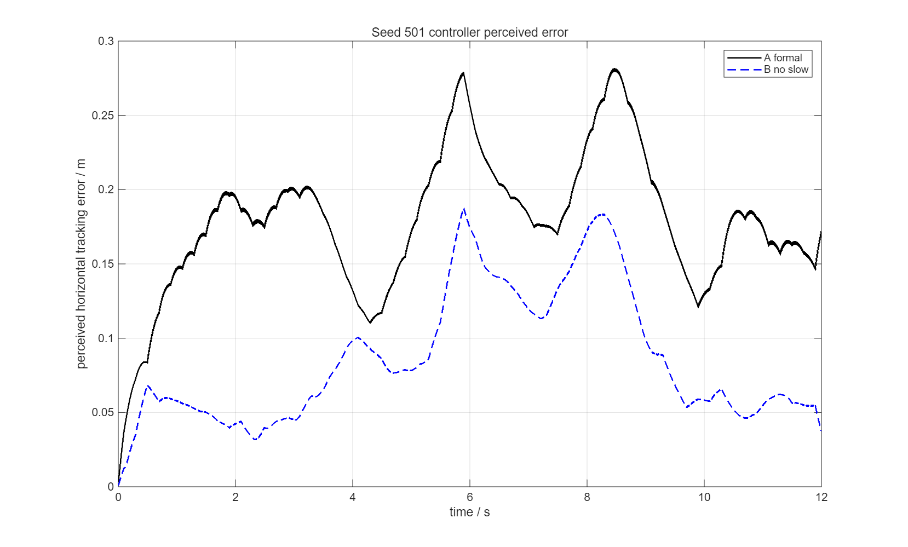
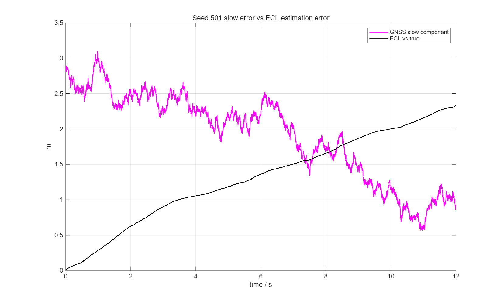

# SHC09 PX4-ECL Round 5：GNSS 慢变误差与位置闭环漂移因果验证

- 分支：`debug-ecl-position`
- 基准：`1c4779d3607288d31cbe905ce12867cca871110f`
- 时长：12 s；seed 501/502/503；条件 A/B/C；共 9 条
- 方法：PCA_PREDICTIVE、正式 SHC09 6DOF、PX4-ECL、PINDI/INDI、正式执行器与扰动
- 无控制器/ECL 参数修改；无 55 秒正式批次；无历史结果覆盖

## 1. 结论摘要

**GNSS 60 s 相关慢变误差是当前 12 s 真实水平漂移的主要原因。**

- 去掉慢变误差（B，仅保留 0.35 m 白噪声）后，三个 seed 的真实水平 RMSE 下降 **86.8%–94.5%**，12 s 末真实误差下降 **89.3%–93.8%**；
- 再关闭 GNSS 位置噪声（C）只比 B 再小幅改善；
- A 中 ECL 估计误差约 1.46/1.32/0.70 m，控制器感知误差仅约 0.17/0.18/0.15 m，**控制器认为跟踪良好，但真实位置已偏移 2.23/1.63/1.47 m**；
- B 中 ECL 误差降到约 0.10 m，真实误差约 0.14–0.16 m；A→B 的因果链成立；
- 12 s 结果不能直接外推到 55 s 的 6.9 m；但本轮已经证明慢变误差通过 ECL 位置估计进入控制反馈并造成真实漂移。

---

## 2. 噪声分离实现

诊断脚本 `scripts/round5_components.m` 复现 `ppid_noise`：

```text
total sigma = 2.1233045007 m
white sigma = 0.35 m
slow sigma  = sqrt(total²-white²) = 2.094 m
phi         = exp(-dt/60)
```

保存：

- `gnss_slow_position_m`
- `gnss_white_position_m`
- `gnss_total_position_m`

并对每个 seed 断言：

```text
max(abs(component_total - ppid_noise(...).navigation.gnss_position_m)) < 1e-12
```

A/B/C 全部复用同一组预生成的 `slow`/`white` 数组，不重新生成随机数：

| 条件 | slow | white | hacc |
|---|---|---|---|
| A | 保留 | 0.35 m | 2.1233045007 |
| B | 置零 | 0.35 m | 2.1233045007 |
| C | 置零 | 置零 | 2.1233045007 |

IMU、磁力计、气压计、GNSS 速度噪声及其他随机序列在所有条件中保持一致。  
30 s 静置对准使用同一组预生成噪声数组，无单独重采样。

---

## 3. 九组实验汇总

`round5_summary.csv` 的 9 行核心指标：

| seed | 条件 | 真实水平 RMSE / m | 真实峰值 / m | 12 s 末真实误差 / m | ECL vs 真实 RMSE / m | 感知跟踪 RMSE / m | GNSS 水平 RMSE / m |
|---:|---|---:|---:|---:|---:|---:|---:|
| 501 | A | 1.3352 | 2.2321 | 2.2321 | 1.4567 | 0.1681 | 2.0568 |
| 501 | B | 0.0738 | 0.1403 | 0.1394 | 0.1004 | 0.0607 | 0.4997 |
| 501 | C | 0.0399 | 0.1191 | 0.1191 | 0.0655 | 0.0460 | 0.0035 |
| 502 | A | 1.2393 | 1.6799 | 1.6322 | 1.3199 | 0.1764 | 1.3437 |
| 502 | B | 0.1305 | 0.1810 | 0.1465 | 0.1372 | 0.0645 | 0.4568 |
| 502 | C | 0.0938 | 0.1291 | 0.1291 | 0.0965 | 0.0483 | 0.0048 |
| 503 | A | 0.6162 | 1.4668 | 1.4668 | 0.6967 | 0.1491 | 1.5153 |
| 503 | B | 0.0814 | 0.1572 | 0.1572 | 0.0993 | 0.0556 | 0.4771 |
| 503 | C | 0.0479 | 0.0988 | 0.0988 | 0.0553 | 0.0484 | 0.0048 |

定义：

- 真实水平误差：`true position - ref.position_ned_m` 的水平模长；
- ECL vs 真实：`L.estimated_position - L.position`（控制器局部原点对齐后）；
- 感知跟踪：`L.estimated_position - ref.position_ned_m`；
- GNSS 水平：`L.gnss_position - L.position` 在 fresh GNSS 样本处；
- 统计窗口：0–12 s，800 Hz。

均值：

| 条件 | 真实 RMSE | 真实峰值 | 12 s 末真实误差 | ECL vs 真实 | 感知跟踪 |
|---|---:|---:|---:|---:|---:|
| A | 1.0635 | 1.7929 | 1.7770 | 1.1578 | 0.1645 |
| B | 0.0952 | 0.1595 | 0.1477 | 0.1123 | 0.0603 |
| C | 0.0605 | 0.1157 | 0.1157 | 0.0724 | 0.0476 |

---

## 4. B/C 相对 A 的改善

| seed | B 真实 RMSE 变化 | B 末误差变化 | C 真实 RMSE 变化 | C 末误差变化 |
|---:|---:|---:|---:|---:|
| 501 | **−94.48%** | **−93.76%** | −97.01% | −94.66% |
| 502 | **−89.47%** | **−91.02%** | −92.43% | −92.09% |
| 503 | **−86.80%** | **−89.28%** | −92.23% | −93.26% |

三个 seed 一致：

- 去掉慢变误差后真实闭环显著改善；
- 剩余白噪声贡献很小，C 只比 B 再改善；
- 因而 A 的真实漂移主要不是白噪声、也不是 IMU，而是 **60 s 相关慢变 GNSS 位置误差**。

---

## 5. 因果链

### 5.1 慢变误差被 ECL 继承

seed501 A：

```text
GNSS slow 水平均值 ≈ 1.911 m
GNSS total 水平 RMSE ≈ 2.057 m
ECL vs true 水平 RMSE ≈ 1.457 m
真实水平 RMSE ≈ 1.335 m
```

ECL 误差与 slow 分量同数量级；B 去掉 slow 后：

```text
ECL vs true ≈ 0.100 m
真实水平 RMSE ≈ 0.074 m
```

更严格地看 **相对初始原点的变化** `Δslow(t)=slow(t)-slow(0)`：

```text
seed501 北向: Δslow 末值 = +1.59 m；ECL 误差末值 = +0.999 m；corr(Δslow, ECL err)=0.783
seed501 东向: Δslow 末值 = -1.39 m；ECL 误差末值 = -2.103 m；corr=0.757
```

初始慢变分量在原点对齐时被大部分吸收；**任务期间的 Δslow 仍与 ECL 相对真实误差同向、强相关**。B 去掉 slow 后：

```text
ECL vs true ≈ 0.100 m
真实水平 RMSE ≈ 0.074 m
```

因此慢变误差进入了 ECL 位置估计，而不是仅停留在 GNSS 原始观测。

### 5.2 控制器被错误反馈“欺骗”

seed501 A：

```text
真实水平误差 2.232 m
控制器感知误差 0.168 m
```

seed501 B：

```text
真实水平误差 0.139 m
控制器感知误差 0.061 m
```

A 中控制器认为跟踪误差只有约 0.17 m，因此没有纠正真实 2.23 m 偏移；这是“ECL 估计接近参考、真实飞机已偏移”的直接证据。

### 5.3 曲线









---

## 6. 三项验收问题

### 问题 1：GNSS 60 s 慢变误差是否是当前 12 s 真实水平漂移的主要原因？

**是。**

- B（仅去掉 slow）使真实 RMSE 下降 86.8%–94.5%，末误差下降 89.3%–93.8%；
- C（再去掉白噪声）只带来小幅进一步改善；
- A 中 ECL 误差与 slow 分量同量级，控制器感知误差却远小于真实误差。

### 问题 2：去掉慢变误差后，真实位置 RMSE 和最终偏移分别降低多少？三个 seed 是否一致？

| seed | ΔRMSE（B vs A） | Δ末误差（B vs A） |
|---:|---:|---:|
| 501 | −94.48% | −93.76% |
| 502 | −89.47% | −91.02% |
| 503 | −86.80% | −89.28% |

三个 seed 方向一致，幅度 87%–95%；C 进一步到 92%–97%。

### 问题 3：如果仍有明显偏差，剩余误差首先出现在哪个环节？

B/C 后剩余真实误差约 0.10–0.16 m，ECL 误差约 0.07–0.14 m，感知误差约 0.05–0.06 m。  
剩余误差不再表现为明显漂移；它包含：

- 剩余 GNSS 白噪声（B）；
- IMU/姿态/速度估计残差；
- 控制器/执行器稳态误差；
- 初始原点对齐残差。

本轮不继续修改控制算法；12 s 数据不能直接解释 55 s 的 6.9 m 末偏移，但已证明慢变误差是 12 s 漂移的主因。

---

## 7. 限制

1. 仅 12 s；不能直接外推 55 s 全窗口或 6.9 m 峰值。
2. 仅 PCA_PREDICTIVE；其他分配器未在本轮重复。
3. A/B/C 修改的是诊断噪声注入，不改变正式 `ppid_noise` 默认行为。
4. 未实施修复；未改 ECL/控制器/B/J/正式参数。
5. 开环/闭环差异仍存在，闭环放大机制未做完整 55 s 因果分解。

---

## 8. 可复现文件

```text
docs/validation/shc09_b_frame_20261104/round5_gnss_slow_20261104/
├── report.md
├── round5_summary.csv
├── round5_noise_components.csv
├── round5_conditions.json
├── round5_curves_seed501.csv
├── round5_true_error_s501.png
├── round5_ecl_error_s501.png
├── round5_perceived_error_s501.png
├── round5_slow_vs_ecl_s501.png
└── scripts/
    ├── round5_components.m
    ├── round5_run2.m
    └── round5_curves.m
```

完整 9 条 MAT 在本地 `results/round5_changeB_20261104/`；没有覆盖正式 MAT/WTR、锁、指标或历史结果。
