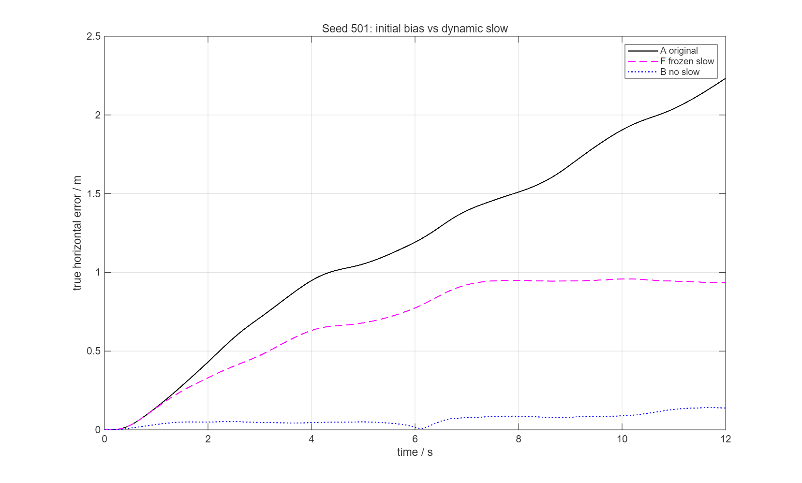
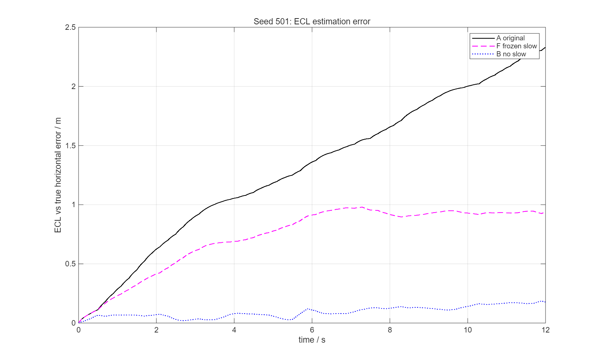

# SHC09 PX4-ECL Round 6：GNSS 初始偏置与任务期慢变漂移分离验证

- 分支：`debug-ecl-position`
- 基准：`6db369ce9dc7f8c4b2293c593cb3e5ab2831f658`
- 短时：3 seeds × A/F = 6 条 12 s 闭环；B 复用 Round 5 作为参考
- 历史：只读分析正式 change-B 55 s 的 seed 501/502/503 PCA_PREDICTIVE
- 不重跑 55 s；不修改正式参数、ECL 核心、B/J、控制器、分配器、历史 MAT/WTR/指标/锁

## 1. 结论摘要

1. **初始固定 slow 偏置本身就会造成明显真实漂移。**  
   F 将任务期 slow 冻结在任务开始值，真实水平 RMSE 仍为 **0.747/0.771/0.252 m**，12 s 末误差 **0.937/1.071/0.378 m**。

2. **任务期动态 slow 增量进一步加重漂移。**  
   A−F 的真实 RMSE 差为 **0.588/0.468/0.364 m**，末误差差为 **1.295/0.561/1.089 m**。

3. **完全去掉 slow（B）才接近消除漂移。**  
   B 的真实 RMSE 为 **0.074/0.131/0.081 m**，12 s 末 **0.139/0.147/0.157 m**。

4. **历史 55 s 最大真实偏移与 slow 变化在时间、幅值、方向上高度一致，但这是观察性证据，不能单独证明因果。**

---

## 2. A/F 设计

| 条件 | 30 s 对准 | 任务期 slow | 任务期 white | hacc |
|---|---|---|---|---|
| A | 与 F 相同 | 原 slow(t) | 0.35 m | 2.1233045007 |
| F | 与 A 相同 | 冻结为任务首样本 slow(0) | 0.35 m | 2.1233045007 |
| B | Round 5 参考 | 0 | 0.35 m | 2.1233045007 |

- A/F 使用同一组预生成 slow/white 数组、同一 30 s 静置噪声、同一 EKF 初始化输入；
- F 只把任务期 slow 置为 `slow(0)` 常量，白噪声序列完全不变；
- C 未重跑；
- `round6_components` 复用 Round 5 的精确 slow+white 分解，并断言与 `ppid_noise` 一致。

---

## 3. 九组汇总（A/B/F）

| seed | 条件 | 真实水平 RMSE / m | 真实峰值 / m | 12 s 末真实误差 / m | ECL vs 真实 RMSE / m | 感知跟踪 RMSE / m |
|---:|---|---:|---:|---:|---:|---:|
| 501 | A | 1.3352 | 2.2321 | 2.2321 | 1.4567 | 0.1681 |
| 501 | B | 0.0738 | 0.1403 | 0.1394 | 0.1004 | 0.0607 |
| 501 | F | 0.7472 | 0.9583 | 0.9370 | 0.7819 | 0.0888 |
| 502 | A | 1.2393 | 1.6799 | 1.6322 | 1.3199 | 0.1764 |
| 502 | B | 0.1305 | 0.1810 | 0.1465 | 0.1372 | 0.0645 |
| 502 | F | 0.7713 | 1.0727 | 1.0710 | 0.8397 | 0.1238 |
| 503 | A | 0.6162 | 1.4668 | 1.4668 | 0.6967 | 0.1491 |
| 503 | B | 0.0814 | 0.1572 | 0.1572 | 0.0993 | 0.0556 |
| 503 | F | 0.2523 | 0.3845 | 0.3783 | 0.2796 | 0.0682 |

均值：

| 条件 | 真实 RMSE | 真实峰值 | 12 s 末误差 | ECL vs 真实 | 感知跟踪 |
|---|---:|---:|---:|---:|---:|
| A | 1.0635 | 1.7929 | 1.7770 | 1.1578 | 0.1645 |
| B | 0.0952 | 0.1595 | 0.1477 | 0.1123 | 0.0603 |
| F | 0.5903 | 0.8052 | 0.7954 | 0.6337 | 0.0936 |





---

## 4. 初始偏置 vs 动态增量

定义：

- **动态增量贡献** = A − F；
- **初始固定偏置贡献** = F − B。

| seed | A−F：真实 RMSE / m | A−F：末误差 / m | F−B：真实 RMSE / m | F−B：末误差 / m |
|---:|---:|---:|---:|---:|
| 501 | 0.588 | 1.295 | 0.673 | 0.798 |
| 502 | 0.468 | 0.561 | 0.641 | 0.925 |
| 503 | 0.364 | 1.089 | 0.171 | 0.221 |

结论：

- **F 仍然漂移**：仅保留任务开始时的固定 slow，真实误差仍到 0.94/1.07/0.38 m；
- 初始固定偏置和动态增量都重要，且 seed 间比例不同；
- 502 的 F−B 更大（初始偏置主导）；503 的 A−F 更大（动态增量主导）；
- **不能把全部漂移只归因于“任务期间 slow 变化”**。

F 与 B 对比表明：初始 slow 偏置进入 ECL 后不会被 `navigation_origin_offset` 完全消除；F 的慢变分量保持不变，但真实位置仍形成稳定偏移并持续。

---

## 5. 修正后的实际注入噪声统计

Round 5 的 `round5_noise_components.csv` 记录的是“配置分量”，不是 B/C 条件中实际注入的噪声；本轮新增：

```text
round6_noise_components_actual.csv
```

字段同时保留：

- `slow_cfg`、`white_cfg`：协议配置；
- `slow_actual`、`white_actual`、`total_actual`：该条件实际注入；
- `gnss_err_n/e`：与 fresh GNSS 样本时间对齐的观测误差。

B/C 的 `slow_actual` 明确为 0；C 的 `white_actual` 也为 0。

### 实际注入误差统计（12 s，fresh GNSS 样本，60 个/seed）

| seed | 条件 | 均值向量 (N,E) / m | 平均误差模长 / m | RMSE / m |
|---:|---|---:|---:|---:|
| 501 | A | (−1.391, +1.231) | 1.951 | 2.057 |
| 501 | B | (−0.006, +0.013) | 0.436 | 0.500 |
| 501 | F | (−1.634, +2.284) | 2.833 | 2.853 |
| 502 | A | (+1.119, +0.233) | 1.242 | 1.344 |
| 502 | B | (−0.005, +0.016) | 0.397 | 0.457 |
| 502 | F | (+1.573, −0.476) | 1.678 | 1.706 |
| 503 | A | (−1.117, +0.196) | 1.467 | 1.515 |
| 503 | B | (+0.047, −0.018) | 0.427 | 0.477 |
| 503 | F | (−1.211, −0.413) | 1.326 | 1.365 |

这里严格区分：

- **均值向量**：各轴平均偏置；
- **平均误差模长**：`mean(||e||)`；
- **RMSE**：`sqrt(mean(||e||²))`。

---

## 6. 历史 55 s 只读分析

数据：

```text
results/hover_distance_takeoff_formal_changeB_20261104_r1/logs/
  PCA_PREDICTIVE_s501.mat
  PCA_PREDICTIVE_s502.mat
  PCA_PREDICTIVE_s503.mat
```

只读载入，不重跑、不覆盖。

正式 MAT 未保存 GNSS 原始观测字段，因此 GNSS 误差使用 `ppid_noise` 的确定性 slow+white 分量重建，并与 `L.gnss_fresh` 采样时间对齐；这是重建值，不是原始日志字段。

### 6.1 窗口指标

| seed | 窗口 / s | 真实 RMSE / m | 真实峰值 / m | ECL vs 真实 RMSE / m | 感知 RMSE / m | GNSS 噪声 RMSE / m | Δslow 均值 / m |
|---:|---|---:|---:|---:|---:|---:|---:|
| 501 | 15–27 | 2.628 | 2.874 | 2.586 | 0.123 | 1.653 | 1.406 |
| 501 | 27–37 | 2.848 | 3.656 | 2.905 | 0.098 | 1.007 | 2.405 |
| 501 | 37–55 | 5.440 | 6.655 | 5.514 | 0.132 | 2.732 | 5.141 |
| 502 | 15–27 | 1.286 | 2.126 | 1.334 | 0.151 | 2.624 | 1.063 |
| 502 | 27–37 | 2.582 | 2.969 | 2.586 | 0.147 | 3.575 | 1.981 |
| 502 | 37–55 | 2.180 | 2.706 | 2.148 | 0.175 | 1.921 | 1.405 |
| 503 | 15–27 | 1.962 | 3.445 | 2.112 | 0.204 | 2.068 | 2.668 |
| 503 | 27–37 | 4.821 | 5.290 | 4.923 | 0.163 | 3.998 | 5.251 |
| 503 | 37–55 | 6.195 | 6.873 | 6.242 | 0.119 | 5.095 | 6.282 |

### 6.2 最大偏移

| seed | t_max / s | 真实最大 / m | ECL 误差 / m | 感知误差 / m | Δslow 模长 / m | cos(Δslow, ECL err) | cos(Δslow, true err) |
|---:|---:|---:|---:|---:|---:|---:|---:|
| 501 | 54.06 | 6.655 | 6.621 | 0.066 | 5.149 | **+0.994** | **−0.993** |
| 502 | 34.53 | 2.969 | 2.947 | 0.074 | 1.762 | **+0.869** | **−0.856** |
| 503 | 54.68 | 6.873 | 6.832 | 0.045 | 6.833 | **+0.996** | **−0.996** |

符号说明：

- `true err = true − ref`；
- `ECL err = est − true`；
- 当 ECL 估计接近参考时，`ECL err ≈ −true err`。

因此 **ECL 误差与 Δslow 同向（cos≈+0.87…+0.996），真实偏移与 Δslow 反向**，这正是“慢变误差把估计拉向参考、真实飞机反向漂移”的闭环特征。

### 6.3 时间相关性

15–55 s 内 `Δslow` 与 ECL 误差的逐轴相关系数：

| seed | N 轴 | E 轴 |
|---:|---:|---:|
| 501 | 0.950 | 0.906 |
| 502 | 0.796 | 0.575 |
| 503 | 0.965 | 0.679 |

seed 501/503 的最大偏移出现在 54–55 s，与 Δslow 的增长同相；seed 502 的最大值出现在 34.5 s 恢复窗口，随后回落，时间上不完全单调，但方向仍一致。

### 6.4 观察性限制

历史 55 s 数据只能说明：

- 最大真实偏移与 `Δslow` 在时间、幅值、方向上高度一致；
- ECL 误差几乎等于真实误差，而感知误差很小；
- 不能仅凭这一条轨迹证明“没有慢变误差时 55 s 一定只有 0.x m”；
- 不能排除姿态/速度/控制/执行器对幅值的贡献。

本轮 12 s 的 A/F/B 随机对照补强了因果证据，但不能直接外推 55 s 的全部 6.9 m。

---

## 7. 三项问题

### 问题 1：如果 GNSS slow 保持常值，仅移除任务期间慢变增量，真实漂移是否明显消失？

**没有消失。**

- F 真实 RMSE：0.747/0.771/0.252 m；
- F 末误差：0.937/1.071/0.378 m；
- 相对 A 仅下降 37.8%–59.1%（RMSE）和 34.4%–74.2%（末误差）。

因此初始固定 slow 偏置本身就能造成显著漂移；动态增量是额外加重项。

### 问题 2：初始偏置与动态漂移各占多少？

- 动态贡献（A−F）RMSE：0.588/0.468/0.364 m；
- 初始固定贡献（F−B）RMSE：0.673/0.641/0.171 m；
- 两者均显著，seed 间比例不同；不能只归因于其中一个。

B（无 slow）才把 RMSE 降到 0.074–0.131 m，说明 slow 总量是主因，但“初始”与“动态”两部分都不可忽略。

### 问题 3：历史 55 s 最大偏移是否与 GNSS slow 一致？

**观察性数据支持一致，但不能单独证明因果。**

- seed501/503 最大偏移 6.655/6.873 m 出现在 54–55 s，Δslow 模长 5.15/6.83 m；
- ECL 误差与真实误差几乎相等，感知误差仅 0.045–0.066 m；
- cos(Δslow, ECL err)=+0.994/+0.996，cos(Δslow, true err)=−0.993/−0.996；
- seed502 最大 2.969 m 出现在 34.5 s 恢复窗口，方向仍一致但时间不完全单调。

这支持“slow → ECL → 控制反馈 → 真实漂移”的机制；完整因果仍需 55 s 的反事实实验，本轮不做。

---

## 8. 剩余误差

B/C 后：

- 真实 RMSE 0.04–0.13 m；
- 末误差 0.10–0.16 m；
- ECL 误差 0.05–0.14 m；
- 感知误差 0.05–0.06 m。

F（仅初始固定 slow）后仍有 0.25–0.77 m RMSE，说明初始偏置是主要剩余项。除此之外，未发现另一个占主导的 12 s 控制/导航问题。

---

## 9. 限制

1. 短时仅 12 s，F/B 不能直接外推 55 s 的 6.9 m；
2. 历史 55 s 是观察性单轨迹，无随机反事实；
3. 历史 MAT 不含 GNSS 原始字段，GNSS 误差为确定性重建；
4. B 复用 Round 5，没有重新运行；
5. 未修改任何正式参数或算法。

---

## 10. 可复现文件

```text
docs/validation/shc09_b_frame_20261104/round6_gnss_bias_drift_20261104/
├── report.md
├── round6_summary_A_B_F.csv
├── round6_noise_components_actual.csv
├── round5_noise_components_corrected.csv
├── round6_conditions.json
├── round6_historical_windows.csv
├── round6_historical_max.csv
├── round6_historical_series_s501.csv
├── round6_curves_seed501.csv
├── round6_true_error_s501.png
├── round6_ecl_error_s501.png
├── round6_historical_s501.png
├── round6_historical_slow_ecl_s501.png
└── scripts/
    ├── round6_run.m
    ├── round6_actual_noise.m
    ├── round6_history.m
    ├── round6_curves.m
    └── round5_components.m
```

完整 6 条 A/F MAT 在本地 `results/round6_changeB_20261104/`；B 的 3 条在 `results/round5_changeB_20261104/`。正式历史数据只读，未覆盖。
