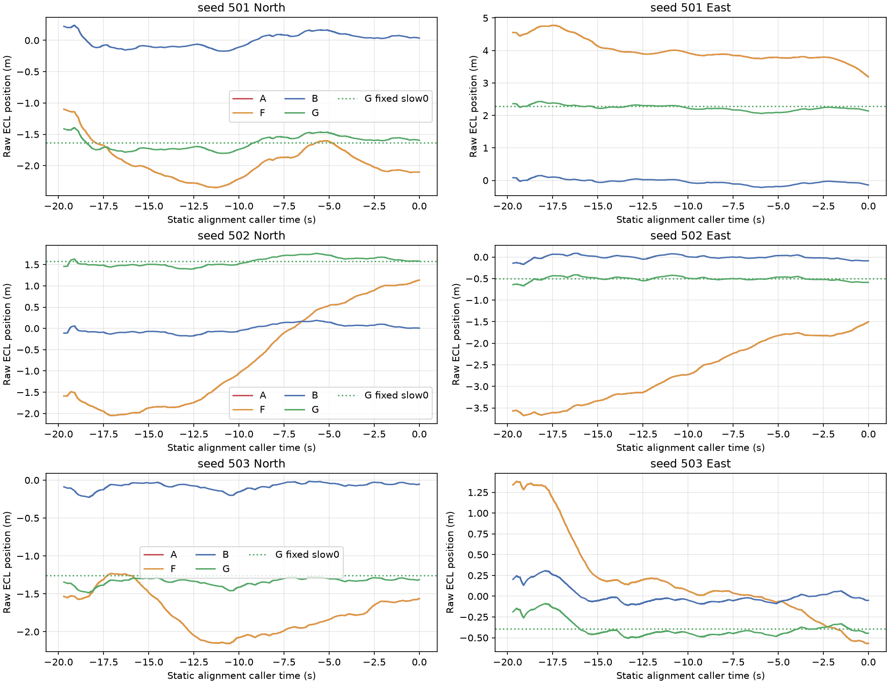
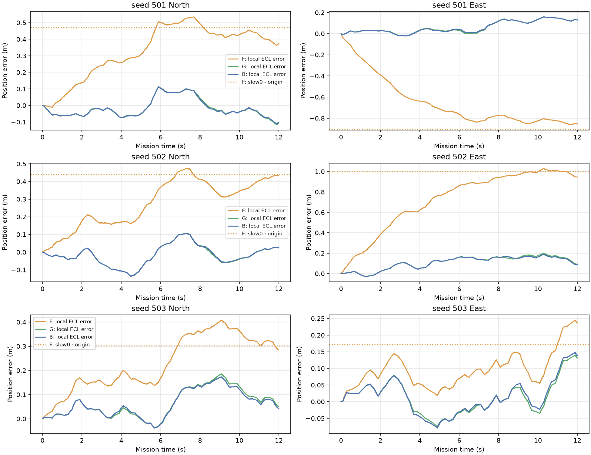
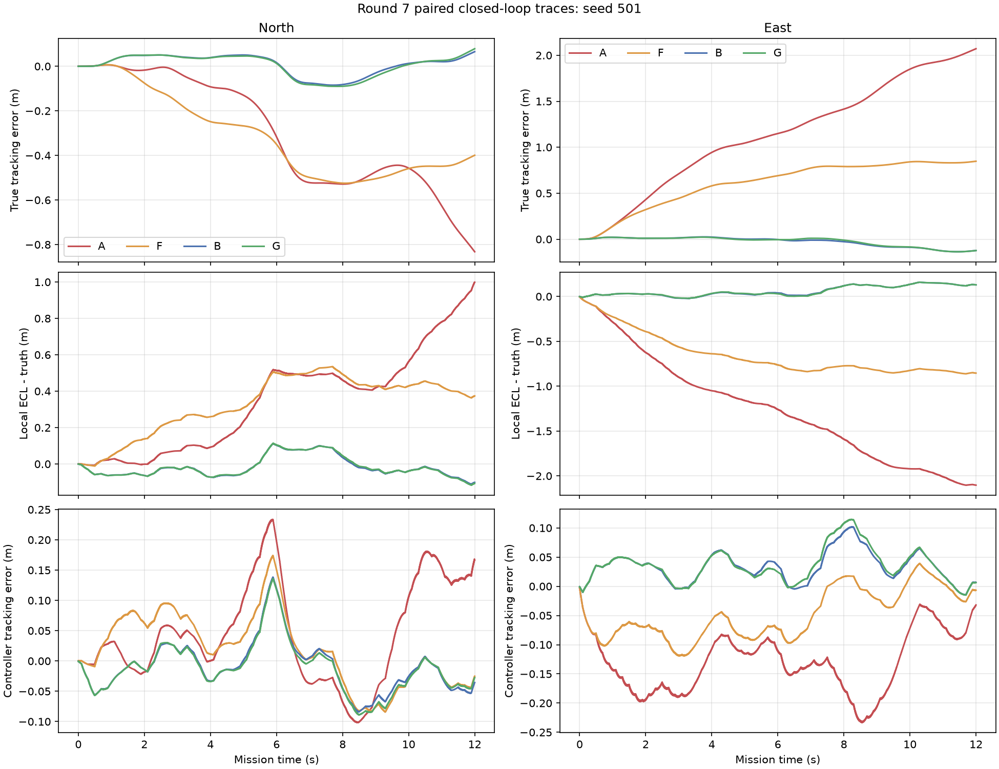
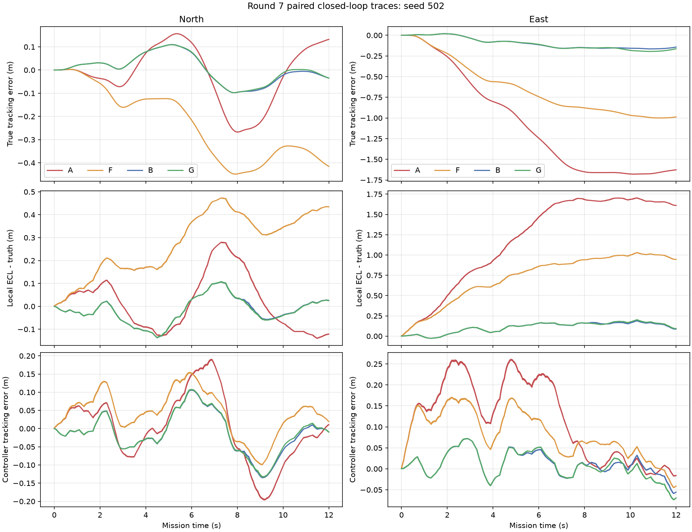
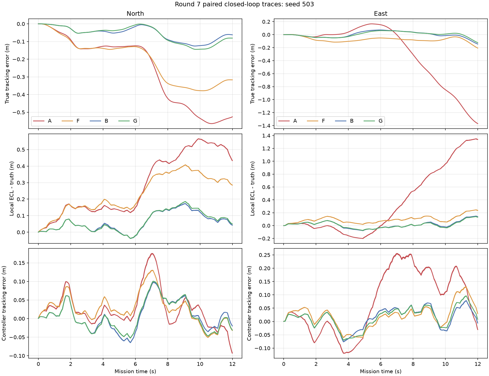

# SHC09 PX4-ECL Round 7：固定 GNSS 偏置与初始化收敛

分支：`debug-ecl-position`；启动基准：`766956655dc499d59bac9d5d3dbae76639106dde`。日期：2026-11-04（Asia/Shanghai）。

## 1. 验收结论

1. **完整静置对准和任务期均采用相同恒定 slow 时，没有观察到相对零 slow 基线新增的米级持续漂移。** G 三个种子的真实水平 RMSE 为 **0.074502/0.136847/0.084531 m**，末误差为 **0.146505/0.166092/0.147042 m**。G 与 B 的配对真实位置向量差 RMS 为 **0.010433/0.012864/0.018295 m**，末端向量差为 **0.013160/0.020122/0.028428 m**。这是本次12秒窗口内的闭环观察，不是无限时间无漂移保证，也不代表误差或速度严格为零。
2. **F 的残余偏移主要与初始化历史及其后估计状态继续收敛有关，不能据 F 单独归因于恒定偏置本身。** F 和 G 在任务期使用完全相同的 slow0、白噪声、控制器和其他测量误差，只在静置期 slow 历史不同。对应配对真实位置向量差 RMS 为 **0.775300/0.655677/0.188281 m**，末端向量差为 **1.082477/0.908408/0.250614 m**。这些是受控改变初始化历史造成的闭环差异，包含初始化后状态收敛和闭环传播，不是某个独立误差分量的可加“贡献”。
3. **不改变历史55秒漂移与 GNSS slow 变化经 ECL 进入控制反馈高度一致的判断，但收窄 Round 6 对固定偏置的解释。** 原 Round 6 中“初始固定偏置本身必然造成 F 残余偏移”以及将 A−F、F−B 的 RMSE 差直接称为物理贡献，均不能由该对照单独成立。本轮补足初始化历史这个控制变量；未运行55秒反事实，未证明55秒全部偏移的严格因果分解。

## 2. 实验范围与复用

| 条件 | 30秒静置期 slow | 任务期 slow | 白噪声 | 来源 |
|---|---|---|---|---|
| A | 原动态 slow | 原动态 slow | 原同一序列 | Round 6 MAT |
| F | 与 A 完全相同 | 固定为原任务首样本 slow0 | 原同一序列 | Round 6 MAT |
| B | 0 | 0 | 原同一序列 | Round 5 MAT |
| G | 固定为原任务首样本 slow0 | 同一 slow0 | 原同一序列 | 本轮新增3条 |

slow0 取原始分量数组第 `warmup_samples+1` 行，三个轴同时冻结，不取 G 自身第一次接收到的 GNSS 样本。G 使用原正式 `ppid_simulate`，控制器、PCA_PREDICTIVE、ECL、其他传感器序列、动态模型和参数保持不变。运行前与 `ppid_noise` 逐字段断言一致，仅替换 GNSS 位置数组的 slow 分量。

仅新增 seed 501/502/503 三条飞行闭环。A/F/B 没有重新飞行。为恢复历史未保存的静置轨迹，另作 A/F/B/G 共12次**静置测量重放**：使用原初始化函数的独立日志副本，传感器/融合调用顺序不变，不调用对象积分。每次静置末端复现的 `navigation_origin_offset` 与对应已保存 MAT **逐位相同**，A/F 的整段静置重放数组也完全相同。日志副本与原函数的精确差异见 [initializer_logging_only.diff](initializer_logging_only.diff)。

沿用历史12秒切片：9600点，`[0,12)`，末点 **11.99875 s**，没有额外增加12.00000秒样本。下文“12秒末”均指该末点。此处验证的是起飞段，没有施加第15秒才开始的滚转压力。父配置与spec中的55秒标识原样保留；实际积分长度由切片后的ref决定，日志断言为9600点，不是新55秒实验。

## 3. 闭环结果

均使用原始800 Hz全部样本独立重算。水平取 N/E 两分量。

| seed | 条件 | 真实位置RMSE/m | 末真实误差/m | 局部ECL相对真值RMSE/m | 控制器感知跟踪RMSE/m |
|---:|---|---:|---:|---:|---:|
|501|A|1.335187|2.232056|1.456675|0.168108|
|501|F|0.747196|0.937003|0.781872|0.088757|
|501|B|0.073764|0.139390|0.100365|0.060684|
|501|G|0.074502|0.146505|0.100462|0.063780|
|502|A|1.239278|1.632173|1.319928|0.176366|
|502|F|0.771339|1.071026|0.839676|0.123782|
|502|B|0.130524|0.146506|0.137195|0.064534|
|502|G|0.136847|0.166092|0.140020|0.065457|
|503|A|0.616182|1.466837|0.696740|0.149133|
|503|F|0.252290|0.378315|0.279630|0.068168|
|503|B|0.081363|0.157211|0.099261|0.055600|
|503|G|0.084531|0.147042|0.101440|0.057415|

原始 ECL 世界位置的误差与控制器局部位置误差分开记录。后者减去了初始化绑定的固定 offset。完整字段见 [summary_corrected.csv](summary_corrected.csv)。这些重新计算的统计是独立派生物，没有覆盖旧指标。

### 配对轨迹向量比较

定义 `RMS_pair(X,Y)=sqrt(mean(||p_X(t)-p_Y(t)||²_NE))`，末端差为 `||p_X(T)-p_Y(T)||_NE`。使用相同时间索引，不做平移、旋转、相位拟合。

| seed | 对照 | 配对轨迹向量差RMS/m | 末端位置向量差/m |
|---:|---|---:|---:|
|501|G_vs_B|0.010433|0.013160|
|501|F_vs_G|0.775300|1.082477|
|501|A_vs_F|0.650427|1.297776|
|502|G_vs_B|0.012864|0.020122|
|502|F_vs_G|0.655677|0.908408|
|502|A_vs_F|0.580117|0.841931|
|503|G_vs_B|0.018295|0.028428|
|503|F_vs_G|0.188281|0.250614|
|503|A_vs_F|0.491535|1.181118|

- **G vs B** 隔离完整初始化与任务期共同平移的恒定 slow 条件；相对轨迹只出现厘米级差异。原点差扣除 slow0 后的水平剩余分别为0.000410/0.000623/0.000590 m，表明恒定平移在初始化原点绑定中几乎被吸收。厘米级剩余未在本轮进一步拆因。
- **F vs G** 隔离静置期 slow 历史；任务期输入 slow/white 相同，后续真实测量会随各自飞机位置不同而自然不同。
- **A vs F** 的初始化完全相同，隔离任务期动态 slow 相对于冻结 slow 的影响。

以上配对量仍非三个独立、可加的物理分量。尤其 `RMSE(A)-RMSE(F)` 与 `RMSE(F)-RMSE(B)` 不能解释为严格可加的动态和固定贡献。

## 4. 为什么 F 冻结偏置后飞机仍移动

以下关系取N/E水平分量。记原始 ECL 输出为 p_E，真实位置为 p，固定任务原点偏移为 o，参考为 p_r。控制器使用 p_c=p_E−o，原始估计偏差为 e_E=p_E−p，则恒有：

```text
控制器感知跟踪误差 e_c = p_E − o − p_r
真实跟踪误差             = e_c − e_E + o
```

若任务期原始 ECL 偏差向 slow0 附近继续收敛，而 o 已在任务开始前绑定且全程不变，则即使控制器维持 e_c 接近零，真实位置也会向 `o−slow0` 附近移动。**原点对齐消去的是绑定时的偏差，不会冻结滤波器状态，也不会消去绑定后继续变化的估计误差。**

F 静置时跟随动态 slow，绑定的原始位置反映此前测量历史；冻结后的常值与这一历史状态并不相同。G 从静置开始就接收同一常值，初始原点已接近该常值偏移。G/B 的静置末速度也接近，而 F/A 的静置末速度并非普遍为零。健康/对准标志通过不等于所有位置和速度状态已达到稳态。

| seed | slow0(N,E)/m | F 原点offset(N,E)/m | G 原点offset(N,E)/m | F−G末端向量与原点差之差/m | 二者方向cos |
|---:|---|---|---|---:|---:|
|501|-1.631509, 2.279480|-2.103127, 3.187778|-1.595412, 2.136895|0.085025|0.999973|
|502|1.575089, -0.499067|1.134819, -1.500724|1.580534, -0.586466|0.110591|0.999777|
|503|-1.260237, -0.395165|-1.561669, -0.566906|-1.313739, -0.445172|0.039650|0.993374|

`F−G末端向量≈o_F−o_G` 在三种子方向上吻合，剩余水平向量差约0.085/0.111/0.040 m。该关系和逐时刻 ECL 误差曲线共同支持初始化后估计收敛驱动真实偏移的解释；不把原点差独立解释为全部 ECL 状态的精确贡献。

slow 固定也不等于 GNSS 实际观测固定：观测仍为**对应采样时刻的真实位置 + 固定 slow0 + 白噪声**。飞机移动时 GNSS 观测随之移动，控制器、ECL 和飞机构成闭环。G 和 B 末端仍有约0.07–0.11 m/s水平速度，最后两秒仍有厘米至分米运动；本结论是没有出现 F 所示的新增米级偏移，并非宣称完全静止或已达无限时间稳态。

## 5. 初始化末端与任务检查点

[initialization_and_checkpoints.csv](initialization_and_checkpoints.csv) 逐条件、逐种子记录84行：静置末端、任务0/2/4/6/10/12秒。

字段包含三轴原始 ECL 位置及其对真值偏差、固定 `navigation_origin_offset`、控制器实际接收的位置与接收时间、当前局部位置投影、真实位置与跟踪误差、估计速度、最近一次实际 GNSS 观测、该观测的来源时刻真值及 slow/white。

- 静置期没有运行控制器，`controller_position` 为 NaN；`bound_projection` 是按随后绑定原点计算的离线位置投影，二者不混称。
- 12秒检查点实际取11.99875秒；该样本不是400 Hz控制更新点，因此 `controller_position` 取最后一次实际更新的11.99750秒反馈，并单列其时间。其他检查点取精确更新时刻。
- 检查点处 GNSS 不是“当前噪声加当前真值”；使用最近一次实际 fresh 观测及其来源样本。任务0秒尚未收到任务期GNSS，使用静置期末最后一条真实可用观测。
- 静置曲线的 caller 时间末端为0；任务首点也为0。两者是调用方时间轴的衔接约定，桥接包时间戳仍连续递增。对齐以一基全局来源索引及包时间戳为准。

## 6. GNSS 时间对齐修正

核查对象：`platform/sim/shc09_navigation_sensors.m`。生产文件未修改。定义一基全局接收调用索引 k：

```text
delay_samples = round(800 × 0.1) = 80
source        = k − 80
sample_stride = round(800 / 5) = 160
fresh         = source >= 1 且 mod(source − 1,160) == 0
buffer_slot   = mod(source − 1,81) + 1
```

缓冲区长81，保存接收时刻向前80拍的样本，不会被本拍写入覆盖。任务样本索引 i 的全局调用索引是 `24000+i`，因此任务第一条 fresh 出现在 **0.10000 s**，对应任务 **0.00000 s** 的来源真值和噪声；以后每0.2秒刷新，共60条/条件/种子，最后一条接收于11.9秒，来源为11.8秒。

桥接默认时间模式A对数据包使用接收时间戳，并向 ECL 提供100 ms的已知GPS延迟；本轮未改变该配置、桥接或ECL。诊断统计直接回到生成器的来源索引，不用融合状态的延迟时间替代传感器来源索引，也不在来源索引上再次扣ECL延迟。

Round 6 的实际噪声统计用接收时刻 `warmup+idx` 取噪声，并用接收时刻真值相减，存在错配。本轮独立输出：

- [gnss_source_aligned_samples.csv](gnss_source_aligned_samples.csv)：720条任务fresh样本的接收/来源索引、时刻、真值、实际slow/white、观测及闭合残差。
- [alignment_gnss_samples.csv](alignment_gnss_samples.csv)：1800条静置fresh样本及其来源噪声。
- [gnss_corrected_statistics.csv](gnss_corrected_statistics.csv)：12条件的来源对齐误差统计。

2520条观测验证 `GNSS_observed − truth_at_source − configured_bias − slow_at_source − white_at_source`，最大逐分量绝对残差 **1.3184e−15 m**。按旧接收时刻拼接的诊断闭合残差水平峰值可达 **1.6702 m**。这项修正改变的是统计解释，不改变任何历史飞行轨迹或融合算法。原Round 6文件全部保留。

## 7. 曲线



位置有效标志出现前的未初始化位置不绘制。A与F静置曲线完全重合，G为从静置起固定slow0，B为零slow。









曲线显示完整样本；派生导出 [trajectories_20hz.csv](trajectories_20hz.csv) 和 [alignment_10hz.csv](alignment_10hz.csv) 供快速查阅，指标均由原始800 Hz全数据计算。

## 8. 与Round 6历史55秒结论的关系

本轮没有重新飞行或修改任何55秒结果。历史55秒中 slow 变化与 ECL 估计误差、真实偏移高度一致的观察保持成立；A/F 在相同初始化下的闭环差异也继续支持任务期动态slow的重要性。

本轮改变的是**固定偏置与初始化历史的区分**：恒定绝对GNSS偏置若在整个初始化和任务期都一致，可由任务起点的局部原点绑定大部分吸收；若先经历动态历史再冻结，ECL仍会继续收敛，冻结后的移动不能直接当作恒定偏置本身的独立作用。

不将本次12秒G组作为55秒修复验证，不将三个种子作为统计显著性或无限时间稳定性证明。正式参数、ECL数值、控制器、分配器、正式MAT/WTR/指标/锁均未变。

## 9. 运行、独立验证与Git范围

- 新增闭环：**3/3 G组成功**，无气动域越界；静置重放12/12末端原点复现。
- 运行入口：[scripts/round7_run.m](scripts/round7_run.m)，使用原正式仿真器；重执行时复用已保存G组，不自动重飞。运行前已有MAT且输入不一致则拒绝。
- 只读分析：[scripts/round7_analyze.py](scripts/round7_analyze.py)；独立复核：[scripts/round7_verify.py](scripts/round7_verify.py)。Python环境为本机已有 `E:/Ducted-Fan-SHC09-app/.venv/Scripts/python.exe`。
- [verification.json](verification.json)：984个既有数值源码及历史/正式结果文件，共888505246字节SHA未变；独立RMSE复算最大差0；720条任务来源索引另行校验；A/F静置整段数组完全一致。
- [protected_before.json](protected_before.json) 为本轮保护快照，不更新任何旧锁。[local_mat_manifest.json](local_mat_manifest.json) 记录本机新增MAT的精确字节数及SHA。
- 完整G组MAT及静置重放MAT保存在本机 `results/round7_changeB_20261104/`，按仓库惯例忽略，不上传大文件。运行与分析日志同目录保存；此目录未写入旧Round5/6或正式目录。
- 本轮开始已有AGENTS/HANDOFF/README/docs索引和诊断摘要改动，保留并整合为Round7交接。修改前差异保存在本机 `initial_worktree.diff`，不覆盖既有内容或撤销用户修改。
- 提交范围仅交接文档与本轮独立诊断脚本/CSV/PNG/JSON/diff。交付提交SHA由最终 `git rev-parse HEAD` 获取，不在版本内写自引用SHA。不合并main/change-B；推送同名诊断分支后停止等待审核。
