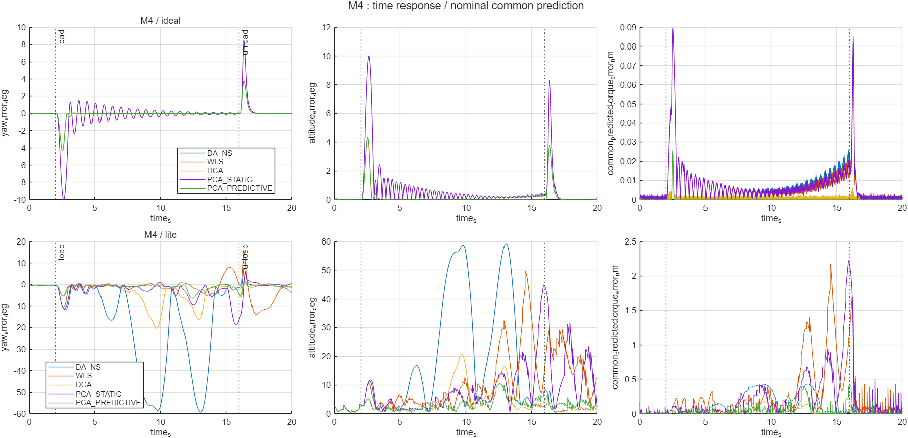
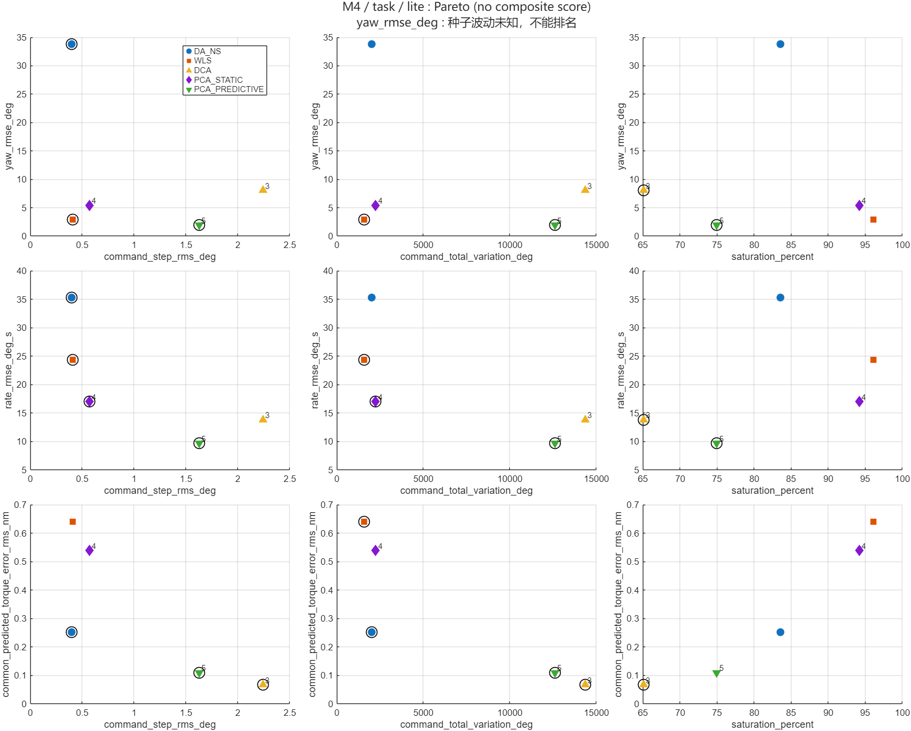
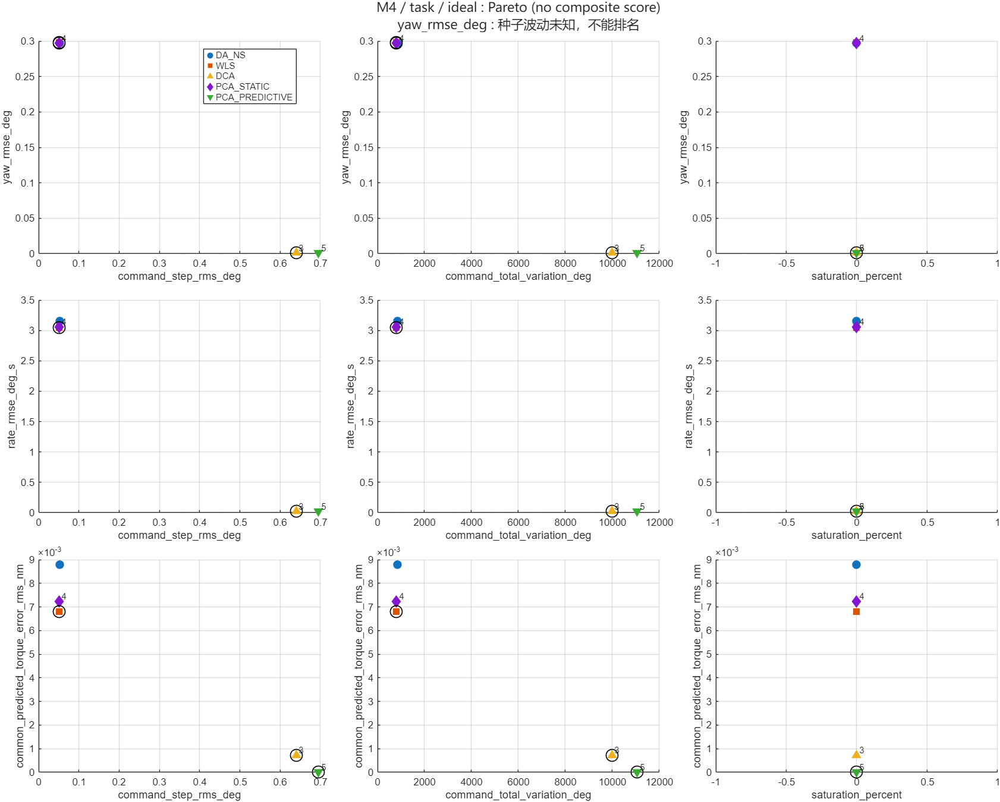
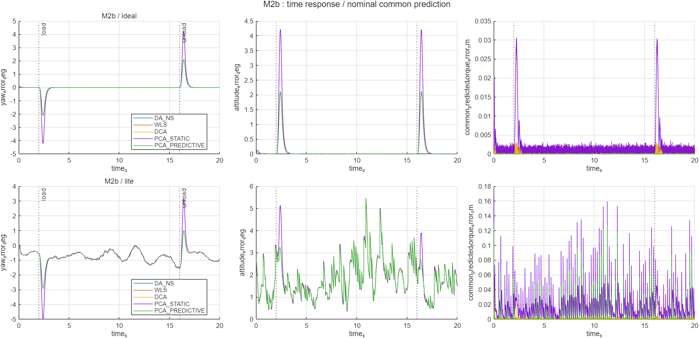
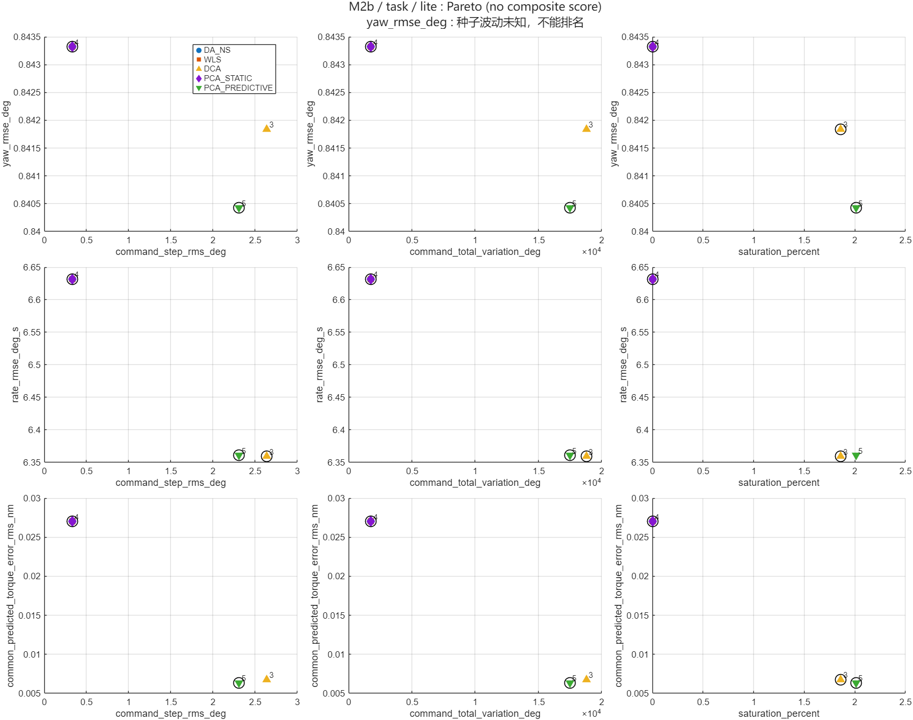
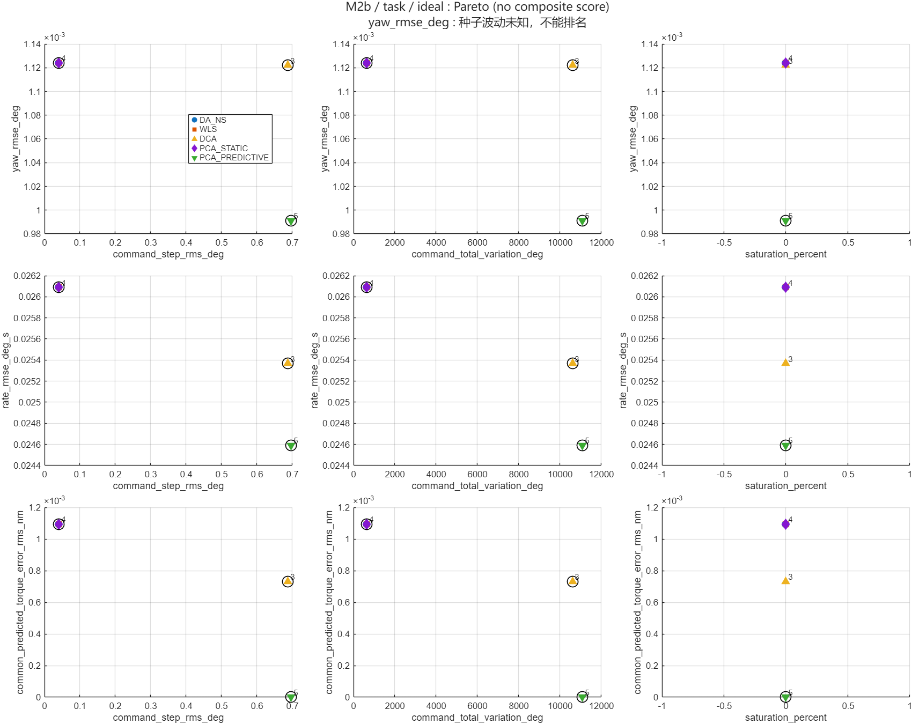

# E3 估计反馈结构失配：轻量证据

来源：本地 `results/e3_estimated_mismatch_research_seed1`，2026-10-31；M0/M2b/M4 × ideal/lite × 五方法30次全新运行，seed=1、lite_seed=72001，20秒60%偏航负载。2秒加载、16秒卸载、过渡0.5秒；whole/task/transient=[0,20]/[6,16]/[0,6]。全部运行完成，气动域error未改，控制采样越界比例零；15次lite真值topic隔离通过。

[完整解释与四问回答](../../docs/e3_estimated_structural_mismatch.md) · [E3验证](../../docs/release_validation/e3/e3_checks.json)。默认ideal，lite仍experimental且偏置门禁失败。本轮未跑可选ECL；单种子不作统计排名、稳定性或实机主张。原始日志及共同输入仅在本地保留，不随Git发布。

- [summary.csv](summary.csv)：90行，按case/mode/method/window分开；跟踪、分配、代价、估计各字段及原单位。
- [pareto.csv](pareto.csv)：810行，九个二维指标对×三窗口×六case/mode，黑圈是数值非支配点，没有综合得分。
- [metric_effects.csv](metric_effects.csv)：306行方法跨度；单种子波动未知，标准差和归一化效应比保留缺失。
- [cases.csv](cases.csv)：实际舵效定义、行/零空间算子、M4名义24°负载点局部雅可比。
- [status.csv](status.csv)、[provenance.csv](provenance.csv)：30/30完成且全部loaded=false。

M4/lite没有完整复现ideal的两组收敛图景，部分方法严重饱和和大姿态摆动；M0/M2b主窗姿态细微差异难以区分，但分配/控制代价及离线实际模型误差仍有信息。M4的动态方法PWM活动较高、共同残差较低，饱和率并不必然较高。各二维前沿不同，不能选出全局最优。

[M0 ideal图](pareto_M0_ideal_task.png) · [M0 lite图](pareto_M0_lite_task.png)。完整本地report还含whole/瞬态Pareto，CSV保留所有窗口，未用主窗掩盖启动与卸载。
