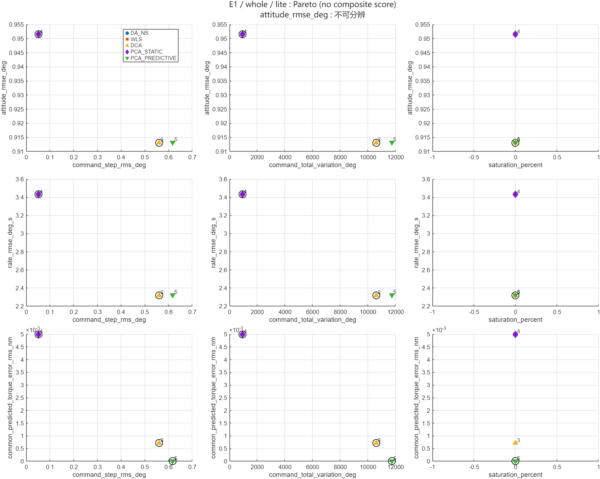
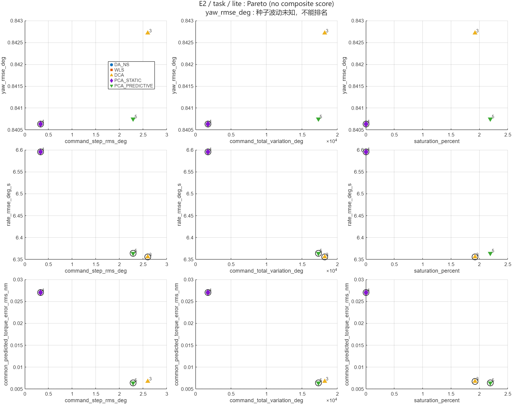

# 估计反馈比较 MVP 轻量示例

来自 Stage 6A seed=1 的十份 lite E1/E2 数值缓存，没有新增完整比较仿真。summary.csv 三十行、pareto.csv 二百七十行，metric_effects.csv 含明确的历史/当前波动来源；仅两张代表 PNG 随仓库保存，完整六图位于本地 results/estimated_comparison_phaseA_reviewed。

黑圈为该指标对数值非支配点，不是显著性或全局排名。E1 姿态差异低于历史三种子波动，标“不可分辨”；E2 单种子无法估计种子波动，不作排名。lite 仍 experimental，tau 匹配，平台默认 ideal。见[入口说明](../../docs/estimated_allocation_comparison.md)。
