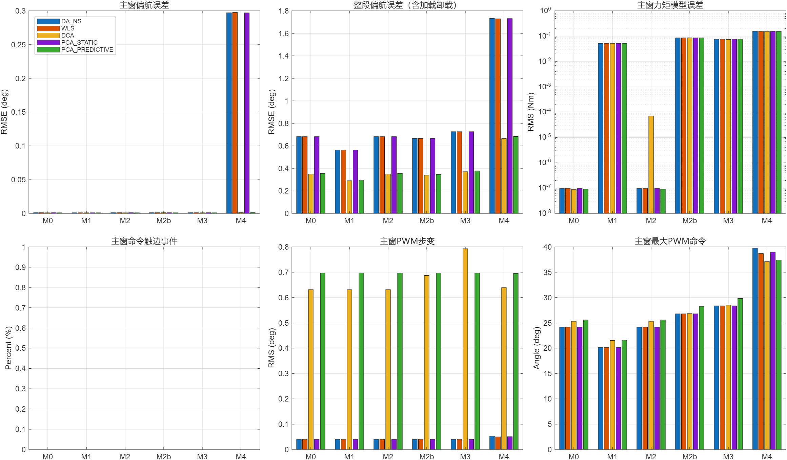
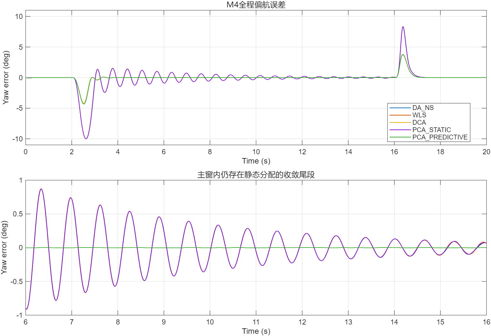

# 第二轮结构失配示例

> 文档类型：证据。按生成时的协议和版本理解。

本目录保留30次20秒、60%负载正式运行的轻量摘要，不包含完整原始日志。使用仓库根目录的`main_mismatch_ladder`可以重新生成协议和日志；`plot_mismatch_ladder`可重绘。

`cases.csv`给出六档对象、行/零空间指标；`summary.csv`包含主窗与全程指标；`relative_to_M0.csv`为同方法配对差异；`priority_activity.csv`和`M4_time_bins.csv`补充机制辨析；`wls_sensitivity.csv`独立于主排名。

30/30完成，无气动表外推。M1/M2主窗跟踪近似不变；M2b/M3产生真实力矩模型误差但被共同反馈大量吸收。M4三种静态分配在主窗仍呈衰减振荡的收敛尾段，两种动态分配接近噪声底。主窗优先级正常缩减和mode1/mode2均为零，不能直接把差异归为优先级收益。

这些是单组配对种子、理想导航、真实与名义tau均30ms、低速正则化模型下的结果，不代表统计显著性或实机优势。

