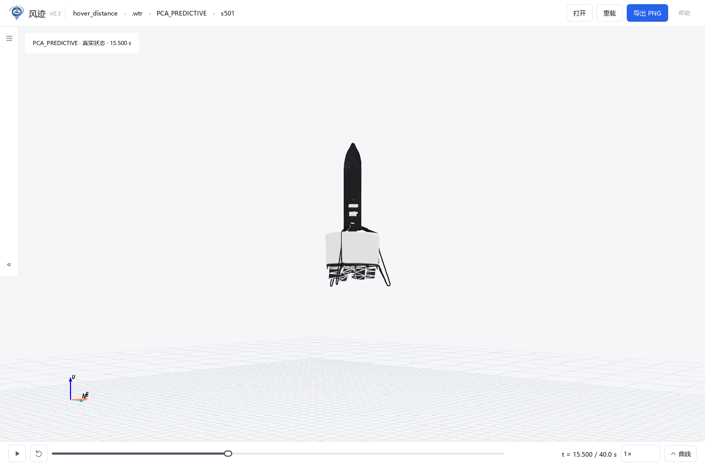
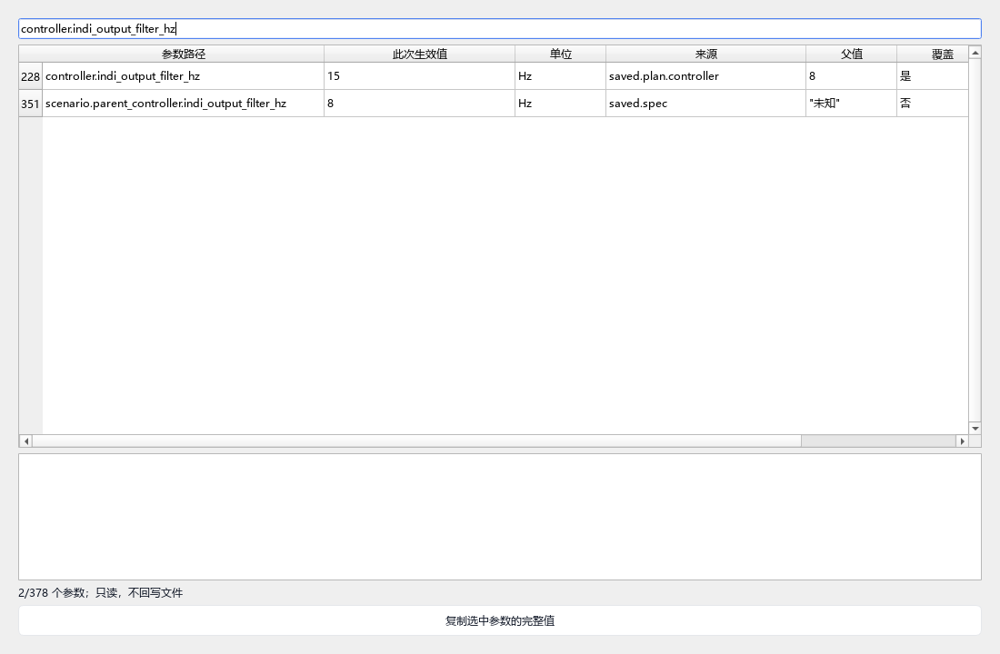

# WindTrace单飞行交付验收包

[完整报告](../../codex-repo-10.md) · [应用与启动](../../apps/windtrace/README.md) · [格式契约](../../docs/interfaces/windtrace_flight_v1.md)

保留原WindTrace主题、抽屉式布局和飞机配色，在单飞行.wtr数据入口上加入只读参数搜索。图中是现有保存日志回放，没有重跑仿真。

[左抽屉](left_drawer.png) · [底部曲线抽屉](multi_flight_curves.png)。曲线截图同时打开不同协议的三份日志，仅作加载演示，不用于比较方法性能。

- `real_artifacts.json`：三份真实完整.wtr的本机路径、SHA与大小；重型文件不包含在本包。
- `audit_*.json`：对原始日志的独立转换核验，非旧实验门禁改判。
- `gui_checks.json`、`tests_final.xml`：离屏三维／抽屉／参数和15项新增测试证据。
- `integrity_checks.json`：已有源码／协议／锁／旧证据未改的快照核验。
- `synthetic_contract_demo.wtr`：9个状态点的**合成格式测试夹具**，CUSTOM_ALLOCATOR／fixture；不是飞行仿真、真实传感器或科学实验数据。可验证clone后无需原日志即可打开自包含格式。生成源为apps/windtrace/tests/test_flight.py中的fixture。
- `manifest.json`：除自身外全部本包文件的SHA和字节数。

本包不含原始MAT、完整真实轨迹和Python／MATLAB构建产物。完整真实.wtr在本机 `results/windtrace_integration_20261102_r1/deliveries/`，每份为单飞行，并保留实际参数及审计来源。旧多方法bundle不作为输入。

[原版简洁材质预览](scene_original.png) · [柔和光照与场景配色预览](scene_soft_light_preview.png)。两图相机与姿态相同；柔光只作视觉备选，尚未设为默认。
