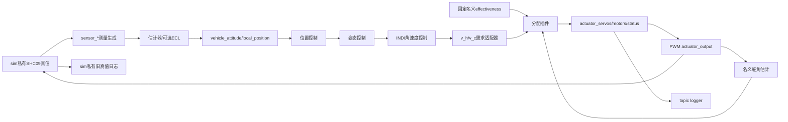

# 平台边界与数据流

平台把测量、估计、控制和分配分开；冻结物理对象由sim私有持有。所有模块仍在同一MATLAB线程顺序调用，保留原控制器、算法和积分顺序。

## 核心职责

- [msg](msg/shc09_topics.m)：`Shc09Bus`保存每topic最新值、仿真时间和全局发布序号；同刻覆盖允许，单topic时间倒退报错，缺topic读取报错。
- [scheduler](scheduler/Shc09Scheduler.m)：PWM时刻`phase+k/hz`；`next_boundary`划分物理积分段；通用rate group按时间、优先级及注册次序确定执行。实际兼容仿真仍以原参考控制网格驱动，使用该时钟精确插入PWM，而非改写成独立线程。
- [params](params/Shc09Params.m)：参数声明、读取、验证后更新和变更历史；每次仿真取cfg快照，不宣称飞行中自动热更新。
- [modules](modules/README.md)：topic输入输出包装冻结控制器/估计器；位置外环仅在position_hold启用。
- [sim](sim/sim_driver.m)：参数与运行时薄适配器，连接原物理对象和事件间积分；传感器生成可读取真值，融合/控制/插件不得订阅真值。
- [logger](logger/Shc09TopicLogger.m)：记录每次publish；`log.topic_log.<topic>`包含`time_s/sequence/data`，任意算法info原样保存，不识别lambda等专属字段。

## 时序与输出

控制默认800Hz、PWM333Hz。每控制点先测量、估计、位置/姿态/角速度控制，再分配候选命令；同刻PWM在控制后锁存，周期内PWM先推进物理/名义估计至事件再锁存。电机按控制周期保持并由原电机动态推进；六舵面由PWM锁存。

`actuator_output`发布的`actuator_outputs`仅记录真实PWM锁存事件；源时间来自候选命令。求解耗时只是桌面诊断，没有注入执行延迟，也不是硬实时保证。默认commander只发布初始armed/mode/failsafe状态，其最小状态机可测试，但不是飞行安全门控系统。

## 真值、名义模型和单位

sim持有完整state、真实tau、气流、舵效、扰动和传感器偏置。它发布原始测量或显式理想测量包；非理想导航时生成传感器包后由ECL融合模块发布估计。ideal导航与ideal测量可能等于真值，这是公开配置假设。

分配器只能收到白名单ctx；名义B/J/C、界、配平与tau均不随实际气流/舵效更新。真实量保留在兼容log，用于离线评价，不经总线反馈。位置环读取的质量/重力/推力系数也是固定名义控制参数。

`vehicle_torque_setpoint.v_h/v_c`沿用角加速度单位rad/s²，不是PX4的Nm消息；`vehicle_thrust_setpoint.motor_command`是rad/s电机转速，不是归一化推力。六舵面插件没有优化电机。其他topic细节见[模块表](modules/README.md)。

## 使用与回归

从仓库根目录执行`ca_setup; hover_app(5);`。`shc09_run`和`platform_run`与旧`main_comparison`接收同一覆盖结构。冻结基线见[tests/baseline](../tests/baseline/README.md)，新平台测试由根目录`run_platform_tests`执行。

更多：[PX4映射](../docs/platform_px4_mapping.md)、[架构](../docs/architecture.md)、[插件指南](../docs/platform_plugin_guide.md)。

## Stage5估计反馈

显式研究预设`shc09_airframe("lite")`提供测量初始化的lite观察器，但实际闭环偏置门禁未过；hover_app及旧无参配置继续保留ideal上界；ECL仍可显式选择。lite不发布真值姿态/位置包，sim/log才计算真实误差；健康失败停止。见[真实化报告](../docs/estimator_realism_report.md)。
